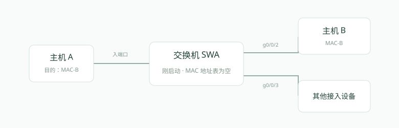
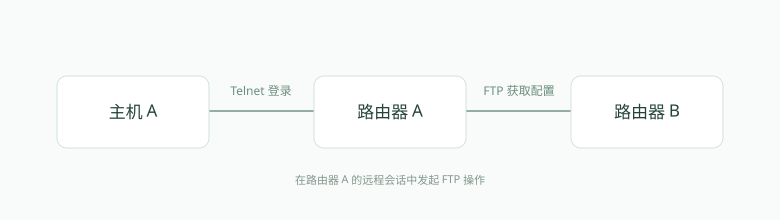

# ICT 网络赛道题库与简短解析

原题 792 道，清理后保留 544 道。原题号保留，便于核对。

图示依据题干文字重绘，已在图下标注；答案、文字修正与剔除明细见《题库清理报告》。

## 原题 1 · 单选 · 路由基础

以下关于路由器的描述,错误的是:

- **A.** 路由器可以作为网关设备
- **B.** 路由器不能隔离广播域
- **C.** 路由器工作在网络层
- **D.** 路由器能够实现IP报文转发

**答案：B**

**解析：** 路由器在网络层按目的 IP 转发报文，默认不转发二层广播，因此能隔离广播域。

参考依据：[来源 1](https://info.support.huawei.com/info-finder/encyclopedia/en/detail?action=queryEntityDetail&keyword=IP+routing)

## 原题 2 · 单选 · VRP命令

某网络工程师在输入命令行时提示如下信息:Error:Unrecognized command found at ‘’ position.对于该提示信息说法正确的是:

- **A.** 输入命令不完整
- **B.** 参数整型错
- **C.** 输入命令不明确
- **D.** 没有查找到关键字

**答案：D**

**解析：** Unrecognized command 表示当前位置的关键字无法识别；命令缺少参数通常提示 Incomplete command。

参考依据：[来源 1](https://info.support.huawei.com/hedex/api/pages/EDOC1100277644/AEM10221/04/resources/software/nev8r10_vrpv8r16/user/galaxy/vrp_cli_cfg_0008.html)

## 原题 3 · 单选 · OSPF

缺省情况下,广播网络上ospf协议HELLO报文发送周期为

- **A.** 20s
- **B.** 30s
- **C.** 10s
- **D.** 40s

**答案：C**

**解析：** 广播型接口的默认 Hello 间隔为 10 秒，Dead 间隔通常为其 4 倍。

参考依据：[来源 1](https://www.rfc-editor.org/rfc/rfc2328.html)

## 原题 5 · 单选 · OSPF

ospf协议使用哪种状态表示邻接关系已经建立

- **A.** 2-way
- **B.** Attempt
- **C.** Down
- **D.** Full

**答案：D**

**解析：** 2-Way 只表示双向邻居关系；达到 Full 才表示链路状态数据库同步完成、邻接关系建立。

参考依据：[来源 1](https://www.rfc-editor.org/rfc/rfc2328.html)

## 原题 7 · 单选 · 静态路由

管理员计划通过配置静态浮动路由来实现路由备份,则正确实现方法有:

- **A.** 管理员需要为主要静态路由和备用静态路由配置不同的TAG
- **B.** 管理员只需要配置两个静态路由
- **C.** 管理员需要为主用静态路由和备用静态路由配置不同的度量值
- **D.** 管理员需要为主要静态路由和备用静态路由配置不同的协议优先级值

**答案：D**

**解析：** 备用路由配置更大的 preference 值，使其优先级低于主路由，主路由失效后再参与转发。

参考依据：[来源 1](https://support.huawei.com/enterprise/zh/doc/EDOC1100333406/ac7caed7/ip-route-static)

## 原题 8 · 单选 · OSPF

ospf协议使用哪种报文发现和维护邻居关系

- **A.** LSU
- **B.** LSR
- **C.** HELLO
- **D.** DD

**答案：C**

**解析：** Hello 报文周期性发现邻居并维护其存活状态，也用于检查建立邻居所需的参数。

参考依据：[来源 1](https://www.rfc-editor.org/rfc/rfc2328.html)

## 原题 10 · 单选 · STP/RSTP

RSTP协议不包含以下哪个端口状态

- **A.** Blocking
- **B.** Learning
- **C.** Discarding
- **D.** Forwarding

**答案：A**

**解析：** RSTP 将端口状态归并为 Discarding、Learning、Forwarding；Blocking 是传统 STP 的状态名。

参考依据：[来源 1](https://info.support.huawei.com/enterprise/zh/doc/EDOC1100457495/e66d44a3)

## 原题 12 · 单选 · 以太网交换

如图所示,假设SWA刚刚启动,MAC地址表为空,现在主机A发送一个目的MAC地址为MAC-B的数据帧,下列说法正确的是:

依据题干文字重绘的示意图，非原图复原；未补入缺失的网络参数。

- **A.** SWA将数据帧丢弃
- **B.** 将这个数据帧泛洪出去
- **C.** 将这个数据帧只从g0/0/3端口转发出去
- **D.** 将这个数据帧只从g0/0/2端口转发出去

**答案：B**

**解析：** 目的 MAC 未在地址表中时，交换机会在同 VLAN 内除入端口外的可转发端口泛洪，并学习源 MAC。

参考依据：[来源 1](https://info.support.huawei.com/hedex/api/pages/EDOC1000053358/YEF0907R/25/resources/en-us_concept_0141563763.html)

## 原题 13 · 单选 · VLAN

以下关于vlanif接口说法正确的是

- **A.** 不同的vlanif接口可以使用相同的IP地址
- **B.** vlanif接口没有MAC地址
- **C.** vlanif接口不需要学习MAC地址
- **D.** vlanif接口是三层接口

**答案：D**

**解析：** VLANIF 是 VLAN 对应的三层逻辑接口，可以配置 IP 地址并作为该 VLAN 的网关。

参考依据：[来源 1](https://info.support.huawei.com/hedex/api/pages/EDOC1000053358/YEF0907R/25/resources/en-us_cliref_0133018324.html)

## 原题 14 · 单选 · VLAN

在VRP平台上,命令“interface vlanif ”的作用是:

- **A.** 给某端口配置vlan
- **B.** 创建一个vlan
- **C.** 无此命令
- **D.** 创建或进入vlan虚拟口视图

**答案：D**

**解析：** interface vlanif 加 VLAN 编号用于创建或进入相应 VLAN 的三层接口视图。

参考依据：[来源 1](https://info.support.huawei.com/hedex/api/pages/EDOC1000053358/YEF0907R/25/resources/en-us_cliref_0133018324.html)

## 原题 15 · 单选 · STP/RSTP

RSTP协议存在几种端口状态:

- **A.** 3
- **B.** 2
- **C.** 4
- **D.** 1

**答案：A**

**解析：** RSTP 的三种端口状态分别是丢弃、学习和转发；丢弃状态不学习 MAC，也不转发用户帧。

参考依据：[来源 1](https://info.support.huawei.com/enterprise/zh/doc/EDOC1100457495/e66d44a3)

## 原题 16 · 单选 · ACL

路由器某个ACL中存在如下规则:rule deny tcp source 192.168.2.0 0.0.0.255 destination 172.16.10.2 0.0.0.0下列说法正确的是;

- **A.** 源ip172.16.10.2,目的ip为192.168.2.1的所有TCP报文匹配这条规则
- **B.** 源ip192.168.2.1,目的ip为172.16.10.2的所有TCP报文匹配这条规则
- **C.** 源ip172.16.10.2,目的ip为192.168.2.0的所有TCP报文匹配这条规则
- **D.** 源ip192.168.2.1,目的ip为172.16.10.1的所有TCP报文匹配这条规则

**答案：B**

**解析：** 通配符 0.0.0.255 匹配 192.168.2.0/24，0.0.0.0 精确匹配目的主机 172.16.10.2。

参考依据：[来源 1](https://info.support.huawei.com/info-finder/encyclopedia/en/ACL.html)

## 原题 18 · 单选 · NAT

NAPT允许多个私有IP地址通过不同的端口号映射到同一个公有IP地址,则下面关于NAPT中端口号描述正确的是

- **A.** 只需要配置端口号的范围
- **B.** 必须手工配置端口号和私有地址的对应关系
- **C.** 需要使用ACL分配端口号
- **D.** 不需要做任何关于端口号的配置

**答案：D**

**解析：** 动态 NAPT 自动建立地址和端口转换表，通常无需逐个手工指定私网端口与公网端口的对应关系。

参考依据：[来源 1](https://www.rfc-editor.org/rfc/rfc3022.html)

## 原题 19 · 单选 · DHCP

以下关于DHCP协议的使用场景说法正确的是

- **A.** DHCP客户端和DHCP服务器必须连接到同一个交换机
- **B.** 如果DHCP客户端和DHCP服务器不在同一个网段,需要通过DHCP中继来转发DHCP报文
- **C.** 网络中不允许出现多个DHCP服务器
- **D.** DHCP中继接收到DHCP请求或应答报文后,不修改报文格式直接进行转发

**答案：B**

**解析：** 客户端初始广播不能跨路由器，中继把请求送到其他网段的 DHCP 服务器，并用 giaddr 标识客户端网段。

参考依据：[来源 1](https://www.rfc-editor.org/rfc/rfc2131.html)

## 原题 20 · 单选 · CAPWAP

AP通过以下哪项报文从AC请求软件版本

- **A.** VRP System Request
- **B.** Image Package Request
- **C.** Image Data Request
- **D.** Software Request

**答案：C**

**解析：** CAPWAP 使用 Image Data Request / Response 传输镜像相关数据，AP 可据此完成软件镜像下载。

参考依据：[来源 1](https://www.rfc-editor.org/rfc/rfc5415.html)

## 原题 21 · 单选 · PPPoE

在以太网这种多点访问网络上,PPPoE服务器可以通过一个以太网端口与很多PPPoE客户端建立起PPP连接,因此服务器必须为每个PPP会话建立唯一的会话标识符以区分不同的连接,PPPoE会使用什么参数建立会话标识符

- **A.** IP地址与MAC地址
- **B.** MAC地址与PPP-ID
- **C.** MAC地址与Session-ID
- **D.** MAC地址

**答案：C**

**解析：** PPPoE 会话由 Session-ID 与通信双方的以太网 MAC 地址共同标识，不以 IP 地址区分。

参考依据：[来源 1](https://www.rfc-editor.org/rfc/rfc2516.html)

## 原题 22 · 单选 · PPP

ppp协议定义的是osi参考模型中哪个层次的封装格式

- **A.** 表示层
- **B.** 应用层
- **C.** 数据链路层
- **D.** 网络层

**答案：C**

**解析：** PPP 提供点到点链路上的封装与链路控制，属于 OSI 数据链路层协议。

参考依据：[来源 1](https://www.rfc-editor.org/rfc/rfc1661.html)

## 原题 23 · 单选 · IPv6

链路本地单播地址的接口标识总长度为多少bit

- **A.** 64bit
- **B.** 32bit
- **C.** 96bit
- **D.** 48bit

**答案：A**

**解析：** 链路本地地址的标准格式包含 64 bit 接口标识，前 64 bit 由前缀和零位组成。

参考依据：[来源 1](https://www.rfc-editor.org/rfc/rfc4291.html)

## 原题 24 · 单选 · Python Telnet

现需要实现一个python自动化脚本Telnet到设备上查看设备运行配置。以下说法错误的是

- **A.** 可以使用 telnet.write(b"display current-configuration\n") 向设备输入查看当前配置的命令
- **B.** 使用 telnetlib.Telnet(host) 连接到 Telnet 服务器
- **C.** telnet.close()用在每一次输入命令后,作用是用户等待交换机回显信息
- **D.** Telnetlib 可以实现这个功能

**答案：C**

**解析：** close() 会关闭 Telnet 连接，不能用来等待命令回显；读取回显应使用 read_until() 等方法。该题适用于 Python 3.12 及更早版本，telnetlib 已从 Python 3.13 移除。

参考依据：[来源 1](https://docs.python.org/3.12/library/telnetlib.html)

## 原题 25 · 单选 · 静态路由

以下关于静态路由说法错误的是

- **A.** 通过网络管理员手动配置
- **B.** 路由器之间需要交互路由信息
- **C.** 不能自动适应网络拓扑的变化
- **D.** 对系统性能要求低

**答案：B**

**解析：** 静态路由由管理员配置，无须路由协议交换更新；路径变化时通常需要人工修改或配合检测机制。

参考依据：[来源 1](https://support.huawei.com/enterprise/zh/doc/EDOC1100333406/ac7caed7/ip-route-static)

## 原题 26 · 单选 · 静态路由

VRP操作平台,以下哪条命令可以只查看静态路由

- **A.** display ip routing-table
- **B.** display ip routing-table statistics
- **C.** display ip routing-table verbose
- **D.** display ip routing-table protocol static

**答案：D**

**解析：** display ip routing-table protocol static 按协议来源筛选，只显示静态路由。

参考依据：[来源 1](https://info.support.huawei.com/enterprise/en/doc/EDOC1100335692/c1ebaf03/basic-ip-routing-configuration)

## 原题 27 · 单选 · VRP命令

在VRP平台使用ping命令时,如果需要指定一个ip地址作为回显请求报文的源地址,那么应该使用下面哪一个参数

- **A.** -d
- **B.** -a
- **C.** -s
- **D.** -n

**答案：B**

**解析：** VRP ping 的 -a 参数指定 Echo Request 使用的源 IP 地址。

参考依据：[来源 1](https://support.huawei.com/enterprise/en/doc/EDOC1100352661/fda60ef2/verifying-the-network-connectivity-and-reachability)

## 原题 28 · 单选 · OSPF

下列哪个ospf协议的报文可以确保LSA更新的可靠性

- **A.** DD
- **B.** LSR
- **C.** LSU
- **D.** LSACK

**答案：D**

**解析：** LSAck 对收到的 LSA 进行确认，配合超时重传保证链路状态信息可靠泛洪。

参考依据：[来源 1](https://www.rfc-editor.org/rfc/rfc2328.html)

## 原题 29 · 单选 · OSPF

ospf协议使用哪种报文请求本地缺少的LSA

- **A.** LSACK
- **B.** LSU
- **C.** HELLO
- **D.** LSR

**答案：D**

**解析：** LSR 按 LSA 的类型、标识和通告路由器，请求邻居发送本地缺少或更新的 LSA。

参考依据：[来源 1](https://www.rfc-editor.org/rfc/rfc2328.html)

## 原题 30 · 单选 · STP/RSTP

交换网络中STP协议的桥ID如下,拥有哪个桥ID的交换机会成为根桥

- **A.** 4096 00-01-02-03-04-DD
- **B.** 32768 00-01-02-03-04-AA
- **C.** 32768 00-01-02-03-04-BB
- **D.** 32768 00-01-02-03-04-CC

**答案：A**

**解析：** 根桥选择最小 Bridge ID，先比较桥优先级，再比较 MAC；4096 小于其余选项的 32768。

参考依据：[来源 1](https://info.support.huawei.com/enterprise/zh/doc/EDOC1100457495/e66d44a3)

## 原题 31 · 单选 · 链路聚合

以下关于链路聚合LACP模式选举active端口说法正确的是:

- **A.** 先比较接口优先级,无法判断出较优者继续比较接口编号,越小越优
- **B.** 只比较接口优先级
- **C.** 比较设备优先级
- **D.** 只比较接口编号

**答案：A**

**解析：** 选定主动端设备后，活动端口先按端口优先级排序；值相同再比较端口号，均为较小者优先。

参考依据：[来源 1](https://info.support.huawei.com/info-finder/encyclopedia/en/LACP.html)

## 原题 32 · 单选 · VLAN

以下关于Hybrid端口说法正确的是

- **A.** Hybrid端口可以在出端口方向将某些vlan帧的tag剥掉
- **B.** Hybrid 端口发送数据帧时,一定携带vlan tag
- **C.** Hybrid 端口只接收带vlan tag 的数据帧
- **D.** Hybrid 端口不需要PVID

**答案：A**

**解析：** Hybrid 可按 VLAN 分别设置 tagged 或 untagged，发送属于 untagged 列表的帧时去除标签。

参考依据：[来源 1](https://info.support.huawei.com/hedex/api/pages/EDOC1100331435/AEM10132/04/resources/dc/dc_cfg_vlan_1007.html)

## 原题 33 · 单选 · VLAN

使用命令“vlan batch 10 20”和:“vlan batch 10 to 20”,分别能创建的vlan数量是

- **A.** 11 和11
- **B.** 2 和2
- **C.** 11 和2
- **D.** 2 和11

**答案：D**

**解析：** 空格列举 10 和 20 只创建两个 VLAN；10 to 20 是包含两端的连续区间，共 11 个。

参考依据：[来源 1](https://info.support.huawei.com/hedex/api/pages/EDOC1100277650/AZM1016J/04/resources/command/yunshan/BATCHCREATEVLAN%28VLANOM%29.html)

## 原题 34 · 单选 · ACL

二层ACL的编号范围是

- **A.** 4000-4999
- **B.** 2000-2999
- **C.** 6000-6031
- **D.** 3000-3999

**答案：A**

**解析：** 华为编号型二层 ACL 使用 4000–4999，主要按 MAC 地址和以太网类型等二层字段匹配。

参考依据：[来源 1](https://info.support.huawei.com/info-finder/encyclopedia/en/ACL.html)

## 原题 35 · 单选 · ACL

高级ACL的编号范围是

- **A.** 2000-2999
- **B.** 4000-4999
- **C.** 6000-6031
- **D.** 3000-3999

**答案：D**

**解析：** 高级 ACL 的编号范围为 3000–3999，可按源/目的 IP、协议以及 TCP/UDP 端口等条件匹配。

参考依据：[来源 1](https://info.support.huawei.com/info-finder/encyclopedia/en/ACL.html)

## 原题 36 · 单选 · DNS

DNS协议的主要作用是

- **A.** 文件传输
- **B.** 远程输入
- **C.** 域名解析
- **D.** 邮件传输

**答案：C**

**解析：** DNS 将域名解析为地址等资源记录，客户端可用易记的名字访问网络服务。

参考依据：[来源 1](https://www.rfc-editor.org/rfc/rfc1034.html)

## 原题 38 · 单选 · WLAN

WiFi6相比WiFi5的优势不包括以下哪项

- **A.** 更高的消耗
- **B.** 更高每AP接入终端数
- **C.** 更低的传输时延
- **D.** 更高的带宽

**答案：A**

**解析：** Wi-Fi 6 引入 OFDMA 等机制提高容量并降低拥塞时延，TWT 有助于终端节电，更高耗电并非其优势。

参考依据：[来源 1](https://info.support.huawei.com/info-finder/encyclopedia/en/detail?action=queryEntityDetail&keyword=WiFi+6)

## 原题 39 · 单选 · AP上线

FIT AP获取AC的IP地址之后首先执行的操作是

- **A.** 建立CAPWAP隧道
- **B.** 请求配置文件
- **C.** 下载配置文件
- **D.** 升级软件版本

**答案：A**

**解析：** AP 发现 AC 后先建立 CAPWAP 控制连接，随后才进行镜像检查、配置获取和业务运行。

参考依据：[来源 1](https://info.support.huawei.com/hedex/api/pages/EDOC1100210440/AZK0901G/09/resources/dc/dc_fd_wlan_basic_0007.html)

## 原题 40 · 单选 · Segment Routing

段路由SR( )基于什么理念而设计的在网络上转发数据包的一种协议

- **A.** 策略路由
- **B.** 源路由
- **C.** 路由策略
- **D.** 目的路由

**答案：B**

**解析：** Segment Routing 将转发路径表达为段的有序列表，由源节点施加段列表，属于源路由思想。

参考依据：[来源 1](https://www.rfc-editor.org/rfc/rfc8402.html)

## 原题 41 · 单选 · PPP

在PPP中,当通信双方的两端检测到物理链路激活时,就会从链路不可用阶段转化到链路建立阶段,在这个阶段主要通过()协议进行链路参数的协商

- **A.** IP
- **B.** LCP
- **C.** NCP
- **D.** DHCP

**答案：B**

**解析：** 链路建立阶段由 LCP 协商 MRU、认证方式等链路参数；NCP 在之后配置网络层协议。

参考依据：[来源 1](https://www.rfc-editor.org/rfc/rfc1661.html)

## 原题 42 · 单选 · IPv4

IP报文头部中有一个TTL字段,关于该字段说法正确的是:

- **A.** 该字段用于数据包防环
- **B.** 该字段用于数据包分片
- **C.** 该字段用来表示数据包的优先级
- **D.** 该字段长度为7位

**答案：A**

**解析：** TTL 为 8 bit，路由器转发时递减；归零后丢弃报文，避免数据包在环路中无限转发。

参考依据：[来源 1](https://www.rfc-editor.org/rfc/rfc791.html)

## 原题 43 · 单选 · IPv6报文

IPv6 基本报文头长度为多少 Byte？

- **A.** 40
- **B.** 48
- **C.** 32
- **D.** 64

**答案：A**

**解析：** IPv6 基本首部固定为 40 字节；扩展首部与负载不计入这个长度。

参考依据：[来源 1](https://www.rfc-editor.org/rfc/rfc8200.html)

## 原题 44 · 单选 · IPv6报文

IPV6报文中哪一个字段的作用类似于IPV4报文中的TTL字段

- **A.** hop limit
- **B.** Next header
- **C.** Traffic class
- **D.** Version

**答案：A**

**解析：** Hop Limit 在每次经过路由器时递减，作用对应 IPv4 的 TTL。

参考依据：[来源 1](https://www.rfc-editor.org/rfc/rfc8200.html)

## 原题 45 · 单选 · SNMP

缺省情况下在SNMP协议中,代理进程使用哪个端口号向NMS发送告警消息

- **A.** 161
- **B.** 163
- **C.** 164
- **D.** 162

**答案：D**

**解析：** 管理站通常在 UDP 162 端口接收 Trap；UDP 161 则用于代理接收常规管理请求。

参考依据：[来源 1](https://www.rfc-editor.org/rfc/rfc1157.html)

## 原题 46 · 单选 · IPv6

如果一个接口的MAC地址为00E0-FCEF-0FEC,则对应的EUI-64地址为

- **A.** 00E0-FCEF-FFFE-0FEC
- **B.** 02E0-FCFF-FEEF-0FEC
- **C.** 00E0-FCFF-FEEF-0FEC
- **D.** 02E0-FCEF-FFFE-0FEC

**答案：B**

**解析：** MAC 中间插入 FFFE，并翻转首字节的 U/L 位：00→02，得到 02E0:FCFF:FEEF:0FEC。

参考依据：[来源 1](https://www.rfc-editor.org/rfc/rfc4291.html)

## 原题 49 · 单选 · 路由基础

以下说法正确的是:

- **A.** 路由器工作在网络层
- **B.** 交换机工作在物理层
- **C.** 交换机工作在网络层
- **D.** 路由器工作在物理层

**答案：A**

**解析：** 路由器在网络层读取目的 IP 并选择下一跳；普通二层交换机则按 MAC 地址转发帧。

参考依据：[来源 1](https://info.support.huawei.com/info-finder/encyclopedia/en/detail?action=queryEntityDetail&keyword=IP+routing)

## 原题 51 · 单选 · IPv4

如果一个网络的网络地址为10.1.1.0/30,那么它的广播地址是

- **A.** 10.1.1.3
- **B.** 10.1.1.1
- **C.** 10.1.1.4
- **D.** 10.1.1.2

**答案：A**

**解析：** /30 留下 2 bit 主机位，地址块为 .0–.3，主机位全 1 的 .3 为广播地址。

参考依据：[来源 1](https://www.rfc-editor.org/rfc/rfc791.html)

## 原题 52 · 单选 · SNMP

运行SNMPV1协议的网络设备使用哪种报文类型主动发送告警信息

- **A.** Trap
- **B.** Response
- **C.** Get-Next Request
- **D.** Get-Request

**答案：A**

**解析：** Trap 是代理主动发送的异步告警，不要求管理站先发出查询请求。

参考依据：[来源 1](https://www.rfc-editor.org/rfc/rfc1157.html)

## 原题 53 · 单选 · 以太网交换

网络管理员在网络中捕获到一个数据帧,其目的MAC地址是01-00-5E-A0-B1-C3。关于该MAC地址说法正确的是

- **A.** 它是一个组播MAC地址
- **B.** 它是一个单播MAC地址
- **C.** 它是一个非法MAC地址
- **D.** 它是一个广播MAC地址

**答案：A**

**解析：** 首字节 01 的最低有效位为 1，表示组地址，因此该 MAC 是组播而非单播地址。

参考依据：[来源 1](https://info.support.huawei.com/hedex/api/pages/EDOC1000053358/YEF0907R/25/resources/en-us_concept_0141563763.html)

## 原题 54 · 单选 · PPPoE

PPPoE会话建立和终结过程中不包括以下哪个阶段

- **A.** 发现阶段
- **B.** 数据转发阶段
- **C.** 会话阶段
- **D.** 会话终结阶段

**答案：B**

**解析：** PPPoE 定义发现和会话两个主要阶段，PADT 可终结会话；“数据转发阶段”不是独立阶段名称。

参考依据：[来源 1](https://www.rfc-editor.org/rfc/rfc2516.html)

## 原题 55 · 单选 · AAA

以下哪一条命令配置认证模式为HWTACAS认证

- **A.** authentication-mode hwtacacs
- **B.** authentication-mode none
- **C.** Authorization-mode hwtacacs
- **D.** Authorization-mode local

**答案：A**

**解析：** authentication-mode 选择认证方法；authorization-mode 选择授权方法，二者职责不同。

参考依据：[来源 1](https://info.support.huawei.com/enterprise/zh/doc/EDOC1100410648/330af205)

## 原题 56 · 单选 · WLAN

wifi6所对应的IEEE802.11标准为

- **A.** IEEE802.11au
- **B.** IEEE802.11ac
- **C.** IEEE802.11ax
- **D.** IEEE802.11at

**答案：C**

**解析：** Wi-Fi 6 对应 IEEE 802.11ax；IEEE 802.11ac 对应 Wi-Fi 5。

参考依据：[来源 1](https://info.support.huawei.com/info-finder/encyclopedia/en/detail?action=queryEntityDetail&keyword=WiFi+6)

## 原题 57 · 单选 · IPv6

IPV6地址总长度为多少bit

- **A.** 64
- **B.** 96
- **C.** 128
- **D.** 32

**答案：C**

**解析：** IPv6 地址由 8 组、每组 16 bit 构成，总长度为 128 bit。

参考依据：[来源 1](https://www.rfc-editor.org/rfc/rfc4291.html)

## 原题 58 · 单选 · VRP命令

以下哪个命令可以修改设备名字为huawei

- **A.** sysname Huawei
- **B.** rename Huawei
- **C.** do name Huawei
- **D.** hostname

**答案：A**

**解析：** 在系统视图中执行 sysname Huawei，设备名称及命令行提示符随之改变。

参考依据：[来源 1](https://info.support.huawei.com/hedex/api/pages/EDOC1000053358/YEF0907R/25/resources/en-us_cliref_0133022893.html)

## 原题 59 · 单选 · ACL

以下哪种类型的ACL可以匹配传输层端口号

- **A.** 高级ACL
- **B.** 基本ACL
- **C.** 二层ACL
- **D.** 中级ACL

**答案：A**

**解析：** 高级 ACL 可以检查 TCP/UDP 源、目的端口；基本 ACL 主要检查源 IP 地址。

参考依据：[来源 1](https://info.support.huawei.com/info-finder/encyclopedia/en/ACL.html)

## 原题 60 · 单选 · 静态路由

下列配置默认路由的命令中,正确的是

- **A.** [Huawei]ip-route-static 0.0.0.0 0.0.0.0 0.0.0.0
- **B.** [Huawei]ip-route-static 0.0.0.0 255.255.255.255 192.168.1.1
- **C.** [Huawei-Serial0]ip-route-static 0.0.0.0 0.0.0.0 0.0.0.0
- **D.** [Huawei]ip route-static 0.0.0.0 0.0.0.0 192.168.1.1

**答案：D**

**解析：** 默认路由前缀为 0.0.0.0/0，在系统视图配置，并指定有效下一跳 192.168.1.1。

参考依据：[来源 1](https://support.huawei.com/enterprise/zh/doc/EDOC1100333406/ac7caed7/ip-route-static)

## 原题 63 · 单选 · VLAN

Access类型的端口在发送报文时,会

- **A.** 打上本端口的PVID信息,然后再发送过去
- **B.** 发送带Tag的报文
- **C.** 剥离报文的vlan信息。然后再发送出去
- **D.** 添加报文的vlan信息,然后再发送出去

**答案：C**

**解析：** Access 出口面向普通终端，发送本 VLAN 的帧时去除 802.1Q 标签。

参考依据：[来源 1](https://info.support.huawei.com/hedex/api/pages/EDOC1100331435/AEM10132/04/resources/dc/dc_cfg_vlan_1007.html)

## 原题 65 · 单选 · VLAN

网络管理员在三层交换机上创建了 VLAN 10，并在该 VLAN 的虚拟接口下配置了 IP 地址。使用 display ip interface brief 查看接口状态，发现 VLANIF10 处于 Down 状态。应通过怎样的操作使 VLANIF10 恢复正常？

- **A.** 在 VLANIF10 接口下使用 undo shutdown
- **B.** 将一个状态为 Up 的物理接口加入 VLAN 10
- **C.** 将任意物理接口加入 VLAN 10
- **D.** 将一个状态为 Up 且必须为 Trunk 类型的接口加入 VLAN 10

**答案：B**

**解析：** VLANIF 的链路状态依赖所属 VLAN 至少一个成员接口 Up；只有创建 VLAN 和配置 IP 不够。

参考依据：[来源 1](https://info.support.huawei.com/info-finder/encyclopedia/zh/detail?action=queryEntityDetail&keyword=Super+VLAN)

## 原题 66 · 单选 · 以太网交换

下面关于二层以太网交换机的描述,说法不正确的是:

- **A.** 二层以太网交换机工作在数据链路层
- **B.** 能够学习MAC地址
- **C.** 需要对所转发的报文三层头部做一定的修改,然后再转发
- **D.** 按照以太网二层头部信息进行转发

**答案：C**

**解析：** 普通二层交换机按 MAC 转发帧，不执行 IP 路由，因此不需要修改三层 TTL 等字段。

参考依据：[来源 1](https://info.support.huawei.com/hedex/api/pages/EDOC1000053358/YEF0907R/25/resources/en-us_concept_0141563763.html)

## 原题 67 · 单选 · ACL

以下哪种类型的ACL不匹配网络层信息

- **A.** 基本ACL
- **B.** 二层ACL
- **C.** 用户ACL
- **D.** 高级ACL

**答案：B**

**解析：** 编号型二层 ACL 主要匹配 MAC、VLAN、以太网类型等二层信息，区别于 IP ACL。

参考依据：[来源 1](https://info.support.huawei.com/info-finder/encyclopedia/en/ACL.html)

## 原题 68 · 单选 · DHCP

DHCP DISCOVER 报文的主要作用是

- **A.** 服务器对REQUEST报文的确定响应
- **B.** 客户端用来寻找DHCP服务器
- **C.** 客户端请求配置确认,或者续借租期
- **D.** DHCP服务器用来响应DHCP DISCOVER 报文,此报文携带了各种配置信息

**答案：B**

**解析：** 客户端发送 DHCPDISCOVER 发现可用服务器，服务器再用 DHCPOFFER 提供候选配置。

参考依据：[来源 1](https://www.rfc-editor.org/rfc/rfc2131.html)

## 原题 69 · 单选 · CAPWAP

CAPWAP协议规定了AC与AP之间的通信标准,以下关于CAPWAP协议说法正确的是

- **A.** CAPWAP是基于TCP传输的应用层协议
- **B.** CAWAP为减少AP的负担,使用一个隧道同时进行控制报文,数据报文的传输
- **C.** AP可以将用户的数据报文封装在CAPWAP中交由转AC转发
- **D.** 为建立CAPWAP隧道,FIT AP只能通过广播形式的报文发现AC

**答案：C**

**解析：** CAPWAP 使用 UDP 并分别承载控制和数据；在集中转发模式下，AP 将用户报文封装后交给 AC。

参考依据：[来源 1](https://www.rfc-editor.org/rfc/rfc5415.html)

## 原题 70 · 单选 · AP上线

FIT AP 可以通过DHCP Option 获取AC的IP地址以此建立CAPWAP隧道,为此需要在DHCP服务器上配置哪个Option

- **A.** OPTION 10
- **B.** OPTION 55
- **C.** OPTION 43
- **D.** OPTION 82

**答案：C**

**解析：** Huawei IPv4 AP 可从 DHCP Option 43 的厂商信息获取 AC 地址，然后发送单播发现请求。

参考依据：[来源 1](https://info.support.huawei.com/hedex/api/pages/EDOC1100210440/AZK0901G/09/resources/dc/dc_fd_wlan_basic_0007.html)

## 原题 71 · 单选 · MPLS

基于MPLS 标签最多可以标出几类服务等级不同的数据流

- **A.** 8
- **B.** 2
- **C.** 4
- **D.** 16

**答案：A**

**解析：** MPLS 标签的 TC 字段占 3 bit，可编码 2³=8 个值，用于服务类别标记。

参考依据：[来源 1](https://www.rfc-editor.org/rfc/rfc3032.html)

## 原题 72 · 单选 · SNMP

缺省情况下运行SNMPV2C协议的网络设备使用以下哪个端口号向网络管理系统发送TRAP消息

- **A.** 161
- **B.** 6
- **C.** 162
- **D.** 17

**答案：C**

**解析：** Trap 的接收端是管理站 UDP 162；代理 UDP 161 主要接收 Get、Set 等管理请求。

参考依据：[来源 1](https://www.rfc-editor.org/rfc/rfc1157.html)

## 原题 73 · 单选 · IPv6报文

IPV6报文头比ipv4报文头再增加了哪个字段

- **A.** Destination Address
- **B.** Source Address
- **C.** Flow Label
- **D.** Version

**答案：C**

**解析：** IPv6 新增 20 bit Flow Label，用来标识报文所属流；IPv4 基本首部没有对应字段。

参考依据：[来源 1](https://www.rfc-editor.org/rfc/rfc8200.html)

## 原题 74 · 单选 · IPv6

ipv6 无状态自动配置使用的RA报文属于以下哪种协议

- **A.** UDpv6
- **B.** ICMPV6
- **C.** IGMPV6
- **D.** TCPV6

**答案：B**

**解析：** Router Advertisement 是 ICMPv6 邻居发现报文，携带前缀等参数以支持无状态地址配置。

参考依据：[来源 1](https://www.rfc-editor.org/rfc/rfc4291.html)

## 原题 75 · 单选 · IPv6

以下哪个ipv6地址是全球单播地址

- **A.** 2001::12:1
- **B.** FE80::2E0:FCFF:FEEF:FEC
- **C.** FF20::2E0:FCFF:FEEF:FEC
- **D.** FF02::1

**答案：A**

**解析：** 2001::12:1 属于全球单播地址范围；FE80::/10 是链路本地，FF00::/8 是组播。

参考依据：[来源 1](https://www.rfc-editor.org/rfc/rfc4291.html)

## 原题 76 · 单选 · MPLS

采用MPLS标签双层嵌套技术的报文比原ip报文多了多少个字节

- **A.** 8
- **B.** 32
- **C.** 16
- **D.** 4

**答案：A**

**解析：** 一个 MPLS 标签栈条目占 4 字节，双层标签增加 2×4=8 字节。

参考依据：[来源 1](https://www.rfc-editor.org/rfc/rfc3032.html)

## 原题 77 · 单选 · OSPF

ospf报文类型有多少种

- **A.** 3
- **B.** 5
- **C.** 2
- **D.** 4

**答案：B**

**解析：** OSPF 有 Hello、DD、LSR、LSU、LSAck 五类报文，分别承担发现、同步、请求、更新和确认。

参考依据：[来源 1](https://www.rfc-editor.org/rfc/rfc2328.html)

## 原题 78 · 单选 · OSPF

以下哪个命令可以查看ospf是否已经正确建立邻居关系

- **A.** display ospf interface
- **B.** display ospf peer
- **C.** display ospf neighbor
- **D.** display ospf brief

**答案：B**

**解析：** display ospf peer 显示邻居及状态，便于检查是否到达预期的 2-Way 或 Full。

参考依据：[来源 1](https://info.support.huawei.com/hedex/api/pages/EDOC1100277650/AZM1016J/03/resources/log/yunshan/ospfNbrStateChange_ospfNbrStateChange_Active_2.html)

## 原题 80 · 单选 · 路由基础

在vrp平台上,直连路由、静态路由、rip、ospf区域内路由的默认协议优先级从高到低的排序是

- **A.** 直连路由。Ospf、rip、静态路由
- **B.** 直连路由、静态路由、rip、ospf
- **C.** 直连路由、ospf、静态路由、rip
- **D.** 直连路由、rip、静态路由、ospf

**答案：C**

**解析：** 默认 preference 为 Direct 0、OSPF 内部路由 10、Static 60、RIP 100；数值越小越优先。

参考依据：[来源 1](https://info.support.huawei.com/info-finder/encyclopedia/en/detail?action=queryEntityDetail&keyword=IP+routing)

## 原题 81 · 单选 · VLAN

Access 端口发送数据帧时如何处理？

- **A.** 打上pvid转发
- **B.** 发送带TAG的报文
- **C.** 替换vlan tag 转发
- **D.** 剥离TAG转发

**答案：D**

**解析：** Access 端口将所属 VLAN 的帧以 untagged 形式发送，普通终端不需要处理 VLAN 标签。

参考依据：[来源 1](https://info.support.huawei.com/hedex/api/pages/EDOC1100331435/AEM10132/04/resources/dc/dc_cfg_vlan_1007.html)

## 原题 82 · 单选 · STP/RSTP

在stp协议中,假设所有交换机所配置的优先级相同,交换机1的MAC地址为00-e0-fc-00-00-40,交换机2的MAC地址为00-e0-fc-00-00-10,交换机3的MAC地址为00-e0-fc-00-00-20,交换机4的MAC地址为00-e0-dc-00-00-80,则根交换机应当为

- **A.** 交换机3
- **B.** 交换机4
- **C.** 交换机2
- **D.** 交换机1

**答案：B**

**解析：** 桥优先级相同时比较整个 MAC 数值；00-E0-DC 小于 00-E0-FC，因此交换机 4 成为根桥。

参考依据：[来源 1](https://info.support.huawei.com/enterprise/zh/doc/EDOC1100457495/e66d44a3)

## 原题 83 · 单选 · STP/RSTP

以下哪项不是RSTP可以提高收敛速度的原因

- **A.** 根端口的快速切换
- **B.** 边缘端口的引入
- **C.** 取消了Forward Delay
- **D.** P/A机制

**答案：C**

**解析：** RSTP 通过边缘端口、P/A 与快速根端口切换加快收敛，但在某些场景仍会使用 Forward Delay。

参考依据：[来源 1](https://info.support.huawei.com/enterprise/zh/doc/EDOC1100457495/e66d44a3)

## 原题 84 · 单选 · NAT

一个公司有 50 个私有 IP 地址，使用 NAT 接入公网，但仅有一个且不固定的公网地址，哪种 NAT 转换方式符合需求？

- **A.** NAPT
- **B.** Basic NAT
- **C.** 静态NAT
- **D.** easy-ip

**答案：D**

**解析：** Easy IP 用出口接口的当前公网地址进行端口复用，适合只有一个且可能变化的公网地址。

参考依据：[来源 1](https://www.rfc-editor.org/rfc/rfc3022.html)

## 原题 85 · 单选 · ACL

下面哪项参数不能用于高级访问控制列表

- **A.** 时间范围
- **B.** 目的端口号
- **C.** 物理接口
- **D.** 协议号

**答案：C**

**解析：** 高级 ACL 匹配 IP、协议、端口和时间范围等条件；物理接口通常是应用 ACL 的位置。

参考依据：[来源 1](https://info.support.huawei.com/info-finder/encyclopedia/en/ACL.html)

## 原题 86 · 单选 · NAT

下面选项中，能使一台 IP 地址为 10.0.0.1 的主机访问 Internet 的必要技术是？

- **A.** 静态路由
- **B.** 动态路由
- **C.** NAT
- **D.** 路由引入

**答案：C**

**解析：** 10.0.0.1 属于私有地址，访问 IPv4 公网通常需要 NAT 将源地址转换为可路由的公网地址。

参考依据：[来源 1](https://www.rfc-editor.org/rfc/rfc3022.html)

## 原题 87 · 单选 · FTP

FTP协议控制平面使用端口号为

- **A.** 23
- **B.** 21
- **C.** 22
- **D.** 24

**答案：B**

**解析：** FTP 控制连接使用 TCP 21，命令与响应在控制连接上传输，文件内容走数据连接。

参考依据：[来源 1](https://www.rfc-editor.org/rfc/rfc959.html)

## 原题 88 · 单选 · FTP

使用FTP进行文件传输时,会建立多少个TCP连接

- **A.** 1
- **B.** 2
- **C.** 3
- **D.** 4

**答案：B**

**解析：** 一次典型 FTP 文件传输使用一条控制 TCP 连接和一条数据 TCP 连接，共两条。

参考依据：[来源 1](https://www.rfc-editor.org/rfc/rfc959.html)

## 原题 89 · 单选 · WLAN

完成链路认证后，STA 会继续发起关联协商，具体通过以下哪项报文实现？

- **A.** Association
- **B.** Negotiate
- **C.** Handshake
- **D.** Join

**答案：A**

**解析：** 无线 STA 完成认证后通过 Association Request/Response 建立关联，协商接入所需参数。

参考依据：[来源 1](https://info.support.huawei.com/hedex/api/pages/EDOC1100210440/AZK0901G/09/resources/dc/dc_fd_wlan_basic_0008.html)

## 原题 90 · 单选 · VRP命令

用以下哪条命令可以查看路由器的CPU使用率

- **A.** display cpu-usage
- **B.** display memory
- **C.** display cpu-state
- **D.** display interface

**答案：A**

**解析：** display cpu-usage 查看 CPU 使用情况，可用于判断设备处理负载。

参考依据：[来源 1](https://info.support.huawei.com/network/ptmngsys/Web/tsrev_s/en/content/s/13_edesk_ping_packet_loss/edesk_ping_packet_loss_edesk008.html)

## 原题 92 · 单选 · 园区网络

园区网搭建的生命周期中哪个阶段是一个项目的开端

- **A.** 网络优化
- **B.** 网络运维
- **C.** 规划与设计
- **D.** 网络实施

**答案：C**

**解析：** 先规划需求、地址、拓扑和设备，再实施部署，随后进入运维与优化阶段。

参考依据：[来源 1](https://info.support.huawei.com/info-finder/encyclopedia/zh/detail?action=queryEntityDetail&keyword=%E4%BA%91%E7%AE%A1%E7%90%86%E7%BD%91%E7%BB%9C)

## 原题 93 · 单选 · IPv4

一个IPV4数据包首部长度字段为20B,总长度字段为1500B,则此数据包有效载荷为

- **A.** 1480B
- **B.** 1520B
- **C.** 20B
- **D.** 1500B

**答案：A**

**解析：** IPv4 总长度包含首部和数据；有效载荷为 1500−20=1480 字节。

参考依据：[来源 1](https://www.rfc-editor.org/rfc/rfc791.html)

## 原题 94 · 单选 · 路由基础

一条路由条目包含多少个要素,下列说法错误的是

- **A.** NextHop显示此路由条目对应的本地接口地址
- **B.** Pre显示此路由协议的优先级
- **C.** Destination/Mask显示目的网络/主机的地址和掩码长度
- **D.** Proto显示学习此路由的来源

**答案：A**

**解析：** NextHop 表示转发给哪个下一跳设备，通常是邻居接口地址，而不是本路由器的接口地址。

参考依据：[来源 1](https://info.support.huawei.com/info-finder/encyclopedia/en/detail?action=queryEntityDetail&keyword=IP+routing)

## 原题 95 · 单选 · OSPF

VRP 支持 OSPF 多进程，如果启用 OSPF 时不指定进程号，默认使用的进程号是？

- **A.** 0
- **B.** 1
- **C.** 10
- **D.** 100

**答案：B**

**解析：** VRP 执行 ospf 而未指定 process-id 时，默认进入进程 1；进程号只在本机区分实例。

参考依据：[来源 1](https://info.support.huawei.com/hedex/api/pages/EDOC1100331435/AEM10132/05/resources/dc/dc_cfg_ospf_0005.html)

## 原题 96 · 单选 · OSPF

ospf协议在网络层对应的协议号是

- **A.** 89
- **B.** 0
- **C.** 1
- **D.** 6

**答案：A**

**解析：** OSPF 直接封装在 IP 中，IPv4 Protocol 字段为 89，不使用 TCP 或 UDP 端口。

参考依据：[来源 1](https://www.rfc-editor.org/rfc/rfc2328.html)

## 原题 97 · 单选 · OSPF

ospf 协议使用哪种报文对接收到的lsu报文进行确认

- **A.** LSU
- **B.** LSACK
- **C.** LSR
- **D.** LSA

**答案：B**

**解析：** LSAck 对 LSU 携带的 LSA 进行确认，发送方据此取消对应重传。

参考依据：[来源 1](https://www.rfc-editor.org/rfc/rfc2328.html)

## 原题 98 · 单选 · VRP权限

system-view[Huawei]command-privilege level 3 view user save 关于上面的配置命令说法正确的是

- **A.** 修改用户视图命令的权限等级为3,并且保存配置
- **B.** 修改用户的权限等级为3,并且保存配置
- **C.** 修改某一用户使用的save命令的权限等级为3
- **D.** 修改用户视图下的save命令的权限等级为3

**答案：D**

**解析：** command-privilege 修改指定视图中某条命令的权限，本例把用户视图 save 命令设置为 3 级。

参考依据：[来源 1](https://info.support.huawei.com/hedex/api/pages/EDOC1100331435/AEM10132/04/resources/dc/dc_cfg_cli_0029.html)

## 原题 99 · 单选 · STP/RSTP

缺省情况下,STP计算的端口开销( )和端口带宽有一定关系,即带宽越大,开销越

- **A.** 一致
- **B.** 小
- **C.** 大
- **D.** 不一定

**答案：B**

**解析：** 默认路径开销按链路带宽确定，带宽越高开销越低，因而更容易被选入到根桥的路径。

参考依据：[来源 1](https://info.support.huawei.com/enterprise/zh/doc/EDOC1100457495/e66d44a3)

## 原题 100 · 单选 · VLAN

交换机和主机之间相连,交换机常用的端口链路类型为

- **A.** Hybrid链路
- **B.** Trunk链路
- **C.** Access链路
- **D.** 干线链路

**答案：C**

**解析：** 终端通常不携带 VLAN 标签，Access 端口把其流量归入一个 VLAN，并以 untagged 方式发送。

参考依据：[来源 1](https://info.support.huawei.com/hedex/api/pages/EDOC1100331435/AEM10132/04/resources/dc/dc_cfg_vlan_1007.html)

## 原题 101 · 单选 · WLAN

我们在笔记本电脑上搜索可接入无线网络时,显示出来的网络名称实际是

- **A.** BSS
- **B.** BSSID
- **C.** ESS
- **D.** SSID

**答案：D**

**解析：** SSID 是无线网络的名称；BSSID 标识某个 BSS，通常对应 AP 无线接口或 VAP 的 MAC 地址。

参考依据：[来源 1](https://info.support.huawei.com/info-finder/encyclopedia/en/SSID.html)

## 原题 102 · 单选 · 静态路由

下面关于静态与动态路由描述错误的是:

- **A.** 动态路由协议比静态路由要占用更多的系统资源
- **B.** 链路产生故障后,静态路由能够自动完成网络收敛
- **C.** 静态路由在企业中应用时配置简单,管理方便
- **D.** 管理员在企业网络中部署动态路由协议后,后期维护和扩展能够更加方便

**答案：B**

**解析：** 静态路由不交换动态拓扑信息，普通配置不能自动计算故障后的替代路径。

参考依据：[来源 1](https://support.huawei.com/enterprise/zh/doc/EDOC1100333406/ac7caed7/ip-route-static)

## 原题 103 · 单选 · 静态路由

在华为路由器上,缺省情况下静态路由协议优先级的数值为

- **A.** 120
- **B.** 100
- **C.** 0
- **D.** 60

**答案：D**

**解析：** 华为 VRP 静态路由默认 preference 为 60，数值越小优先级越高。

参考依据：[来源 1](https://support.huawei.com/enterprise/zh/doc/EDOC1100333406/ac7caed7/ip-route-static)

## 原题 104 · 单选 · OSPF

ospf协议在哪种状态下确认DD报文的主从关系

- **A.** 2-Way
- **B.** Exchange
- **C.** Full
- **D.** ExStart

**答案：D**

**解析：** ExStart 阶段确定 DD 交换的主从关系和初始序列号，Router ID 较大的一方为主。

参考依据：[来源 1](https://www.rfc-editor.org/rfc/rfc2328.html)

## 原题 105 · 单选 · 以太网交换

以太网交换机工作在OSI参考模型的哪一层

- **A.** 数据链路层
- **B.** 传输层、
- **C.** 物理层
- **D.** 网络层

**答案：A**

**解析：** 普通以太网交换机在数据链路层根据 MAC 地址转发帧，并学习源 MAC 与端口对应关系。

参考依据：[来源 1](https://info.support.huawei.com/hedex/api/pages/EDOC1000053358/YEF0907R/25/resources/en-us_concept_0141563763.html)

## 原题 107 · 单选 · STP/RSTP

缺省情况下,STP协议Forward Delay 时间是多少秒

- **A.** 15
- **B.** 10
- **C.** 20
- **D.** 5

**答案：A**

**解析：** 传统 STP 的 Forward Delay 默认 15 秒，Listening 与 Learning 各经历一次该延时。

参考依据：[来源 1](https://info.support.huawei.com/enterprise/zh/doc/EDOC1100457495/e66d44a3)

## 原题 108 · 单选 · STP/RSTP

RSTP配置BPDU报文中的Type字段取值为

- **A.** 0X03
- **B.** 0X01
- **C.** 0X00
- **D.** 0X02

**答案：D**

**解析：** RSTP BPDU 的协议版本为 2，BPDU Type 为 0x02；传统配置 BPDU 的 Type 为 0x00。

参考依据：[来源 1](https://info.support.huawei.com/enterprise/zh/doc/EDOC1100457495/e66d44a3)

## 原题 109 · 单选 · VRP命令

管理员在哪一个视图下才能为路由器修改设备名称

- **A.** Protocol-view
- **B.** User-view
- **C.** System-view
- **D.** Interface-view

**答案：C**

**解析：** 设备名称属于系统级配置，需进入 System-view 后执行 sysname。

参考依据：[来源 1](https://info.support.huawei.com/hedex/api/pages/EDOC1000053358/YEF0907R/25/resources/en-us_cliref_0133022893.html)

## 原题 110 · 单选 · WLAN

在AC上配置国家码的命令为

- **A.** nation-code
- **B.** province-code
- **C.** country-code
- **D.** state-code

**答案：C**

**解析：** country-code 设置监管国家/地区，决定设备允许使用的信道和发射功率等参数。

参考依据：[来源 1](https://info.support.huawei.com/enterprise/zh/doc/EDOC1100112395/fc9e2b56)

## 原题 111 · 单选 · PPP

LCP协商使用以下哪个参数检测链路环路和其他异常情况

- **A.** CHAP
- **B.** MRU
- **C.** 魔术字
- **D.** PAP

**答案：C**

**解析：** LCP 的 Magic-Number 用于识别环回等异常；收到与自身相同的魔术字可能表明链路环回。

参考依据：[来源 1](https://www.rfc-editor.org/rfc/rfc1661.html)

## 原题 112 · 单选 · STP/RSTP

园区网络搭建时,使用以下哪种协议可以避免出现二层环路

- **A.** SNMP
- **B.** NAT
- **C.** OSPF
- **D.** RSTP

**答案：D**

**解析：** RSTP 在二层冗余拓扑中选择无环转发树，并使部分端口不转发用户流量。

参考依据：[来源 1](https://info.support.huawei.com/enterprise/zh/doc/EDOC1100457495/e66d44a3)

## 原题 114 · 单选 · UDP

UDP 是面向无连接的，必须依靠什么来保障应用所需的传输可靠性？

- **A.** 传输控制协议
- **B.** 应用层协议
- **C.** 网络层协议
- **D.** 网际协议

**答案：B**

**解析：** UDP 自身不提供确认和重传；应用若需要可靠性，应在应用层实现相应机制。

参考依据：[来源 1](https://www.rfc-editor.org/rfc/rfc768.html)

## 原题 115 · 单选 · VRP命令

通用路由平台VRP的全称为

- **A.** Versatile Redundancy Platform
- **B.** Versatile Routing Protocol
- **C.** Virtual Routing Platform
- **D.** Versatile Routing Platform

**答案：D**

**解析：** VRP 是 Versatile Routing Platform 的缩写，即华为通用路由平台。

参考依据：[来源 1](https://info.support.huawei.com/network/ptmngsys/Web/tsrev_wlan/cn/content/wlan/10_edesk_web_login_failure/edesk_web_login_failure_edesk002.html)

## 原题 116 · 单选 · 路由基础

关于 OSI 参考模型中网络层的功能，描述正确的是？

- **A.** 在设备之间传输比特流,规定了电平、速度和电缆针脚
- **B.** OSI参考模式中靠近用户的那一层,为应用程序提供网络服务
- **C.** 提供面向连接或者非面向连接的数据传递以及进行重传前的差错检测
- **D.** 将比特组合成为字节,再将字节组合成为帧,使用链路层地址(以太网使用MAC地址)来访问介质,进行差错检测
- **E.** 提供逻辑地址,实现数据从源到目的地的转发

**答案：E**

**解析：** 网络层提供逻辑地址与路由转发，负责把分组从源网络送往目的网络。

参考依据：[来源 1](https://info.support.huawei.com/info-finder/encyclopedia/en/detail?action=queryEntityDetail&keyword=IP+routing)

## 原题 117 · 单选 · ARP

关于ARP协议的作用和报文封装,描述正确的是

- **A.** ARP协议支持在PPP链路与HDLC链路上部署
- **B.** ARP 协议基于 Ethernet 封装
- **C.** 通过ARP协议可以获取目的端的MAC地址和UUID的地址
- **D.** 网络设备上的ARP缓存只可以通过ARP协议得到

**答案：B**

**解析：** 在以太网中 ARP 直接封装为 EtherType 0x0806 的帧，用来查询同链路 IPv4 地址对应的 MAC。

参考依据：[来源 1](https://www.rfc-editor.org/rfc/rfc826.html)

## 原题 118 · 单选 · IPv4

IPV4最后一个选项字段( )是可变长的可选信息,该字段最大长度是

- **A.** 10B
- **B.** 40B
- **C.** 60B
- **D.** 20B

**答案：B**

**解析：** IPv4 首部最大 60 字节，固定部分为 20 字节，因而选项及填充最多占 40 字节。

参考依据：[来源 1](https://www.rfc-editor.org/rfc/rfc791.html)

## 原题 119 · 单选 · 路由基础

在路由表中不包含以下哪项内容

- **A.** MAC
- **B.** NextHop
- **C.** Cost
- **D.** Destination/Mask

**答案：A**

**解析：** 路由表记录目的前缀、下一跳、出接口等三层信息；MAC 对应关系通常存在 ARP 或 MAC 表中。

参考依据：[来源 1](https://info.support.huawei.com/info-finder/encyclopedia/en/detail?action=queryEntityDetail&keyword=IP+routing)

## 原题 120 · 单选 · OSPF

关于ospf协议区域划分说法错误的是

- **A.** 划分ospf区域可以缩小部分路由器的LSDB规模
- **B.** 同一个ospf区域中的路由器中的LSDB是完全一致的
- **C.** 只有ABR才能作为ASBR
- **D.** Area 0是骨干区域,其他区域都必须与此区域相连

**答案：C**

**解析：** ASBR 负责引入其他路由来源，ABR 负责连接多个区域；路由器可为 ASBR 而不同时是 ABR。

参考依据：[来源 1](https://www.rfc-editor.org/rfc/rfc2328.html)

## 原题 121 · 单选 · IPv4

掩码长度为12位可以表示为

- **A.** 255.240.0.0
- **B.** 255.255.255.0
- **C.** 255.148.0.0
- **D.** 255.255.0.0

**答案：A**

**解析：** /12 表示前 12 位为 1：首字节为 255，第二字节为 11110000₂=240。

参考依据：[来源 1](https://www.rfc-editor.org/rfc/rfc791.html)

## 原题 122 · 单选 · 以太网交换

在交换机MAC地址表中,以下哪一类表项不会老化

- **A.** 动态MAC地址表项
- **B.** 设备MAC地址表项
- **C.** 静态MAC地址表项
- **D.** 端口MAC地址表项

**答案：C**

**解析：** 静态 MAC 表项由管理员配置，不按动态 MAC 的老化计时器自动删除。

参考依据：[来源 1](https://info.support.huawei.com/hedex/api/pages/EDOC1000053358/YEF0907R/25/resources/en-us_concept_0141563763.html)

## 原题 124 · 单选 · Segment Routing

以下关于Adjacency Segment(邻接段)的说法错误的是哪个

- **A.** Adjacency Segment用于标识网络中某节点的某个邻接
- **B.** Adjacency Segment 通过Adjacency Segment ID(SID)标识
- **C.** Adjacency Segment 必须手动配置
- **D.** Adjacency Segment 通过IGP协议扩散到其他网元,全局可见,本地有效

**答案：C**

**解析：** 邻接段表示特定节点的一条邻接链路，Adj-SID 可由节点动态分配，不能说必须手工配置。

参考依据：[来源 1](https://www.rfc-editor.org/rfc/rfc8402.html)

## 原题 125 · 单选 · PPPoE

下列哪项命令可以用来检查PPPoE客户端的会话状态

- **A.** display pppoe-client session packet
- **B.** display pppoe-client session summary
- **C.** display ip interface brief
- **D.** display current-configuration

**答案：B**

**解析：** display pppoe-client session summary 汇总显示 PPPoE 客户端会话状态，便于确认是否建立成功。

参考依据：[来源 1](https://info.support.huawei.com/network/ptmngsys/Web/tsrev_ar/en/content/ar/13_edesk_pppoe_cannot_dialup_to_the_internet/edesk_pppoe_cannot_dialup_to_the_internet_edesk001.html)

## 原题 126 · 单选 · CAPWAP

无线接入控制器( )作为FIT AP架构中的统一管理、控制设备,以下关于AC说法错误的是

- **A.** AP配置下发
- **B.** 用户接入控制
- **C.** 用户接入认证
- **D.** 无论何种数据转发方式,用户的数据报文都由AC进行转发

**答案：D**

**解析：** 直接转发时用户流量由 AP 转发，不必绕经 AC；AC 仍负责控制和统一管理。

参考依据：[来源 1](https://www.rfc-editor.org/rfc/rfc5415.html)

## 原题 127 · 单选 · IPv4

网络管理员给网络中的某台主机分配的IPV4地址为192.168.1.1/28.则这个主机所在的网络还可以增加多少台主机

- **A.** 13
- **B.** 14
- **C.** 15
- **D.** 12

**答案：A**

**解析：** /28 有 16 个地址，除网络和广播地址后有 14 个主机地址；已占用一个，还能增加 13 台。

参考依据：[来源 1](https://www.rfc-editor.org/rfc/rfc791.html)

## 原题 128 · 单选 · OSPF

ospf协议用哪种报文来描述自己的LSDB

- **A.** DD
- **B.** LSR
- **C.** LSU
- **D.** HELLO

**答案：A**

**解析：** DD 携带 LSA 首部摘要描述本地数据库，邻居据此发现缺少或旧的 LSA。

参考依据：[来源 1](https://www.rfc-editor.org/rfc/rfc2328.html)

## 原题 129 · 单选 · IPv4

主机使用以下哪个IPV4地址不能直接访问Inte et

- **A.** 50.1.1.1
- **B.** 10.1.1.1
- **C.** 100.1.1.1
- **D.** 200.1.1.1

**答案：B**

**解析：** 10.1.1.1 位于 RFC 1918 的 10.0.0.0/8 私有范围，公网不直接路由这些地址。

参考依据：[来源 1](https://www.rfc-editor.org/rfc/rfc791.html)

## 原题 130 · 单选 · MPLS

下面关于MPLS LABEL标签的说法,错误的是哪一个

- **A.** 标签由报文的头部所携带,不包含拓扑信息
- **B.** 标签封装在网络层和传输层
- **C.** 标签用于唯一标识一个分组所属的转发等价类FEC
- **D.** 标签是一个长度固定、只具有本地意义的短标识符

**答案：B**

**解析：** 常见以太网 MPLS 封装把标签栈放在二层帧头与 IP 首部之间，而不是网络层与传输层之间。

参考依据：[来源 1](https://www.rfc-editor.org/rfc/rfc3032.html)

## 原题 132 · 单选 · 以太网交换

二层以太网交换机根据端口所接收到以太网帧的()生成MAC地址表的表项

- **A.** 目的MAC地址
- **B.** 目的IP地址
- **C.** 源IP地址
- **D.** 源MAC地址

**答案：D**

**解析：** 交换机收到帧后，用源 MAC、入端口和 VLAN 学习表项，再根据目的 MAC 选择转发出口。

参考依据：[来源 1](https://info.support.huawei.com/hedex/api/pages/EDOC1000053358/YEF0907R/25/resources/en-us_concept_0141563763.html)

## 原题 134 · 单选 · STP/RSTP

生成树协议中哪一个参数来进行根桥的选举

- **A.** 桥优先级
- **B.** 端口ID
- **C.** 根路径开销
- **D.** 桥ID

**答案：D**

**解析：** 根桥按完整 Bridge ID 选举；Bridge ID 由桥优先级等字段和 MAC 地址组成。

参考依据：[来源 1](https://info.support.huawei.com/enterprise/zh/doc/EDOC1100457495/e66d44a3)

## 原题 135 · 单选 · WLAN

在wlan中标识一个AP覆盖范围是

- **A.** SSID
- **B.** BSSID
- **C.** BSS
- **D.** ESS

**答案：C**

**解析：** BSS 是基本服务集，表示单个 AP 提供服务的基本覆盖区域；BSSID 则是这个 BSS 的标识符。

参考依据：[来源 1](https://info.support.huawei.com/info-finder/encyclopedia/en/SSID.html)

## 原题 136 · 单选 · DHCP

DHCP DISCOVER报文的目的IP地址为

- **A.** 255.255.255.255
- **B.** 224.0.0.1
- **C.** 224.0.0.2
- **D.** 127.0.0.1

**答案：A**

**解析：** 初始客户端尚无服务器地址，DHCPDISCOVER 通常以 255.255.255.255 有限广播寻找服务器。

参考依据：[来源 1](https://www.rfc-editor.org/rfc/rfc2131.html)

## 原题 137 · 单选 · AAA

AAA不包含下列哪一项

- **A.** Authorization(授权)
- **B.** Accounting(计费)
- **C.** Authentication(认证)
- **D.** Audit(审计)

**答案：D**

**解析：** AAA 依次是 Authentication、Authorization、Accounting，对应身份认证、权限授权和使用记录。

参考依据：[来源 1](https://info.support.huawei.com/enterprise/zh/doc/EDOC1100410648/330af205)

## 原题 138 · 单选 · RADIUS

RADIUS使用以下哪种报文类型表示认证拒绝

- **A.** Access-Challenge
- **B.** Access-Accept
- **C.** Access-Request
- **D.** Access-Reject

**答案：D**

**解析：** Access-Reject 表示服务器拒绝认证，Access-Accept 则表示认证通过。

参考依据：[来源 1](https://www.rfc-editor.org/rfc/rfc2865.html)

## 原题 141 · 单选 · VLAN

当主机经常移动位置时,使用哪种vlan划分方式最合适

- **A.** 基于端口划分
- **B.** 基于IP子网划分
- **C.** 基于MAC地址划分
- **D.** 基于策略划分

**答案：C**

**解析：** 基于 MAC 的 VLAN 分配跟随终端身份，主机更换交换机端口后仍可归入相同 VLAN。

参考依据：[来源 1](https://support.huawei.com/enterprise/zh/doc/EDOC1100365027/2580a0e4/Interface%20Types.htm)

## 原题 142 · 单选 · ICMP

Tracert 诊断工具记录每一个ICMP TTL超时消息时(),从而可以向用户提供报文到达目的地所经过的IP地址

- **A.** 目的端口
- **B.** 目的IP地址
- **C.** 源端口
- **D.** 源IP地址

**答案：D**

**解析：** 中间路由器发回 ICMP Time Exceeded，其源 IP 标识该跳设备，Tracert 据此显示路径。

参考依据：[来源 1](https://www.rfc-editor.org/rfc/rfc792.html)

## 原题 143 · 单选 · IPv4

下列哪一类地址不能作为主机的IPv4地址

- **A.** c类地址
- **B.** A类地址
- **C.** B类地址
- **D.** D类地址

**答案：D**

**解析：** 传统 D 类地址范围 224.0.0.0/4 用于组播，不分配为普通主机的单播地址。

参考依据：[来源 1](https://www.rfc-editor.org/rfc/rfc791.html)

## 原题 144 · 单选 · IPv4

某公司申请到一个C类地址段,但要分配给6个子公司,最大的一个子公司有26台计算机不同的子公司必须在不同的网段中,则该最大的子公司的网络子网掩码应设为

- **A.** 255.255.255.128
- **B.** 255.255.255.192
- **C.** 255.255.255.224
- **D.** 255.255.255.0

**答案：C**

**解析：** 26 台主机至少需要 5 bit 主机位，2⁵−2=30；因此选 /27，即 255.255.255.224。

参考依据：[来源 1](https://www.rfc-editor.org/rfc/rfc791.html)

## 原题 146 · 单选 · ARP

关于ARP报文的说法错误的是

- **A.** ARP请求报文时广播发送的
- **B.** ARP报文不能被转发到其他广播域
- **C.** ARP应答报文是单播方式发送的
- **D.** 任何链路层协议都需要ARP协议辅助

**答案：D**

**解析：** 以太网 IPv4 通常用 ARP 解析地址；PPP 点到点链路不需要 Ethernet MAC 解析，不能推广到所有链路协议。

参考依据：[来源 1](https://www.rfc-editor.org/rfc/rfc826.html)

## 原题 147 · 单选 · IPv4

园区网络规划时,设备互联IP地址推荐使用以下哪种掩码长度

- **A.** 30
- **B.** 32
- **C.** 16
- **D.** 24

**答案：A**

**解析：** 传统点到点互联常用 /30，提供两个可用主机地址；双方支持 RFC 3021 时也可使用 /31。

参考依据：[来源 1](https://www.rfc-editor.org/rfc/rfc791.html)

## 原题 149 · 单选 · VRP命令

VRP操作平台对于输入命令不完整使用下列哪一条信息提示

- **A.** Error:Incomplete command found at ‘^’ position
- **B.** Error:Wrong paramater found at ‘^’ position
- **C.** Error:Ambiguous command found at ‘^’ position
- **D.** Error:Too many parameters found at ‘^’ position

**答案：A**

**解析：** Incomplete command 表示已识别命令，但还缺少执行所需的关键字或参数。

参考依据：[来源 1](https://info.support.huawei.com/hedex/api/pages/EDOC1100277644/AEM10221/04/resources/software/nev8r10_vrpv8r16/user/galaxy/vrp_cli_cfg_0008.html)

## 原题 150 · 单选 · IPv4

下列哪一个不可能是IPV4数据包首部长度

- **A.** 60B
- **B.** 20B
- **C.** 64B
- **D.** 32B

**答案：C**

**解析：** IPv4 IHL 占 4 bit 且以 4 字节为单位，首部长度为 20–60 字节，64 字节超出上限。

参考依据：[来源 1](https://www.rfc-editor.org/rfc/rfc791.html)

## 原题 152 · 单选 · VLAN

基于端口划分vlan的特点是

- **A.** 根据报文携带的IP地址给数据帧添加BLAN标签
- **B.** 主机移动位置不需要重新配置vlan
- **C.** 主机移动位置需要重新配置vlan
- **D.** 根据数据帧的协议类型,封装格式来分配vlan ID

**答案：C**

**解析：** 端口型 VLAN 绑定交换机端口；终端搬到另一个端口后，需要确保新端口也被配置到目标 VLAN。

参考依据：[来源 1](https://support.huawei.com/enterprise/zh/doc/EDOC1100365027/2580a0e4/Interface%20Types.htm)

## 原题 153 · 单选 · STP/RSTP

运行 STP 协议的设备端口处于 Forwarding 状态，下列说法正确的是？

- **A.** 该端口端口仅仅接收并处理BPDU,不转发用户流量
- **B.** 该端口端口不仅不处理BPDU报文,也不转发用户流量
- **C.** 该端口端口既会转发用户流量也处理BPDU报文
- **D.** 该端口会根据收到的用户流量构建MAC地址表,但不转发用户流量

**答案：C**

**解析：** Forwarding 端口转发用户流量、学习 MAC，也继续处理 BPDU 来维护生成树。

参考依据：[来源 1](https://info.support.huawei.com/enterprise/zh/doc/EDOC1100457495/e66d44a3)

## 原题 155 · 单选 · ACL

基本ACL的编号范围是

- **A.** 4000-4999
- **B.** 6000-6031
- **C.** 3000-3999
- **D.** 2000-2999

**答案：D**

**解析：** 华为基本 ACL 编号范围为 2000–2999，主要用于基于源 IP 的分类与过滤。

参考依据：[来源 1](https://info.support.huawei.com/info-finder/encyclopedia/en/ACL.html)

## 原题 156 · 单选 · ACL

AR G3系列路由器上ACL缺省步长为

- **A.** 10
- **B.** 5
- **C.** 20
- **D.** 15

**答案：B**

**解析：** ACL 默认步长为 5，使自动编号间保留空隙，便于后续插入规则。

参考依据：[来源 1](https://info.support.huawei.com/hedex/api/pages/EDOC1100334321/AEM1020X/05/resources/dc/dc_fd_ACL_0007.html)

## 原题 157 · 单选 · FTP

如下图所示的网络,主机A通过telnet登录到路由器A,然后在远程的界面通过FTP获取路由器B的配置文件,此时路由器A存在多少个TCP连接

依据题干文字重绘的示意图，非原图复原；未补入缺失的网络参数。

- **A.** 4
- **B.** 1
- **C.** 3
- **D.** 2

**答案：C**

**解析：** 路由器 A 接受一条 Telnet TCP 连接，又作为 FTP 客户端建立控制与数据连接，总计 3 条。

参考依据：[来源 1](https://www.rfc-editor.org/rfc/rfc959.html)

## 原题 158 · 单选 · DHCP

一台Windows主机初次启动,如果采用DHCP的方式获取IP地址,那么主机发送的第一个数据包的源ip地址是

- **A.** 255.255.255.255
- **B.** 0.0.0.0
- **C.** 127.0.0.1
- **D.** 169.254.2.33

**答案：B**

**解析：** 初始客户端尚未获得 IPv4 地址，发送 DHCPDISCOVER 时源地址使用 0.0.0.0。

参考依据：[来源 1](https://www.rfc-editor.org/rfc/rfc2131.html)

## 原题 159 · 单选 · DHCP

DHCP客户端在租期到达哪个比例时第一次发送续租报文

- **A.** 0.25
- **B.** 0.5
- **C.** 1
- **D.** 0.875

**答案：B**

**解析：** 若服务器未另行指定，T1 默认为租期的 50%，客户端开始向原服务器发送续租请求。

参考依据：[来源 1](https://www.rfc-editor.org/rfc/rfc2131.html)

## 原题 160 · 单选 · WLAN

在wlan中用于标识无线网络,区分不同的无线网络的是

- **A.** AP Name
- **B.** SSID
- **C.** VAP
- **D.** BSSID

**答案：B**

**解析：** SSID 表示无线网络名称；同一网络可由多个 AP 使用相同 SSID 提供覆盖。

参考依据：[来源 1](https://info.support.huawei.com/info-finder/encyclopedia/en/SSID.html)

## 原题 161 · 单选 · IPv6

以下哪个时ipv6的链路本地地址

- **A.** FC00::2E0:FCFF:FEEF:FEC
- **B.** FE80::2E0:FCFF:FEEF:FEC
- **C.** 2000::2E0:FCFF:FEEF:FEC
- **D.** FF02::2E0:FCFF:FEFF:FEC

**答案：B**

**解析：** FE80::/10 标识链路本地单播地址，适用于邻居发现等本链路通信。

参考依据：[来源 1](https://www.rfc-editor.org/rfc/rfc4291.html)

## 原题 165 · 单选 · WLAN

为加入无线网络,Sta需要获取无线网络信息,STA采用哪种报文主动获取SSID

- **A.** join
- **B.** Discovery
- **C.** Beacon
- **D.** Probe

**答案：D**

**解析：** 主动扫描时 STA 发送 Probe Request 查询无线网络，AP 通过 Probe Response 返回 SSID 等信息。

参考依据：[来源 1](https://info.support.huawei.com/hedex/api/pages/EDOC1100210440/AZK0901G/09/resources/dc/dc_fd_wlan_basic_0008.html)

## 原题 168 · 单选 · SNMP

关于SNMP协议说法正确的是

- **A.** SNMP协议采用组播的方式发送管理消息
- **B.** SNMP采用IGMP作为网络层协议
- **C.** SNMP采用UDP作为传输层协议
- **D.** SNMP协议只支持在以太网链路上发送管理消息

**答案：C**

**解析：** 常见 SNMP 基于 UDP 传输，查询常用 161 端口，通知常用 162 端口。

参考依据：[来源 1](https://www.rfc-editor.org/rfc/rfc1157.html)

## 原题 169 · 单选 · SDN

以下选项中,不属于SDN网络架构的是

- **A.** 设备层
- **B.** 控制器层
- **C.** 芯片层
- **D.** 应用协同层

**答案：C**

**解析：** 典型 SDN 分为应用层、控制层与基础设施/设备层；芯片属于设备内部组成。

参考依据：[来源 1](https://opennetworking.org/sdn-definition/)

## 原题 170 · 单选 · FTP

使用FTP协议进行路由器升级时,传输模式应该选择哪一种

- **A.** 字节模式
- **B.** 文字模式
- **C.** 语言模式
- **D.** 二进制模式

**答案：D**

**解析：** 固件是二进制文件，应使用 Image/Binary 模式，避免 ASCII 模式转换换行而破坏文件。

参考依据：[来源 1](https://www.rfc-editor.org/rfc/rfc959.html)

## 原题 172 · 单选 · SNMP

下面哪个版本的SNMP支持加密特性

- **A.** SNMP V3
- **B.** SNMP 2C
- **C.** SNMP 2
- **D.** SNMP1

**答案：A**

**解析：** SNMPv3 的 USM 可提供认证与隐私保护，使用 authPriv 时加密报文内容。

参考依据：[来源 1](https://www.rfc-editor.org/rfc/rfc3414.html)

## 原题 173 · 单选 · 路由基础

下列哪个属性不能作为衡量Cost的参数

- **A.** 时延
- **B.** Sysname
- **C.** 跳数
- **D.** 带宽

**答案：B**

**解析：** Cost 可反映跳数、带宽或时延等路径指标；Sysname 仅是设备名称，不是链路性能指标。

参考依据：[来源 1](https://info.support.huawei.com/info-finder/encyclopedia/en/detail?action=queryEntityDetail&keyword=IP+routing)

## 原题 174 · 单选 · 以太网交换

MAC地址表不包括

- **A.** 端口号
- **B.** Vlan
- **C.** IP地址
- **D.** MAC地址

**答案：C**

**解析：** MAC 表按 MAC、VLAN 与出端口记录二层转发位置；IP 与 MAC 的映射属于 ARP 表。

参考依据：[来源 1](https://info.support.huawei.com/hedex/api/pages/EDOC1000053358/YEF0907R/25/resources/en-us_concept_0141563763.html)

## 原题 175 · 单选 · STP/RSTP

RSTP协议使用P/A机制加快了上游端口转到Forwarding状态的速度,但是却没有出现临时环路的原因是什么

- **A.** 缩短了Forward Delay的时间
- **B.** 缩短了Froward Delay的时间
- **C.** 引入了边缘端口
- **D.** 加快了端口角色选举的速度
- **E.** 通过同步机制保证不会出现临时环路

**答案：E**

**解析：** P/A 握手前会同步下游端口，将可能成环的非边缘指定端口置于非转发状态，再允许新链路快速转发。

参考依据：[来源 1](https://info.support.huawei.com/enterprise/zh/doc/EDOC1100457495/e66d44a3)

## 原题 177 · 单选 · STP/RSTP

RSTP 协议中，当根端口失效时，哪种端口可快速转换为新的根端口并进入转发状态？

- **A.** Forwarding 端口
- **B.** Alternate 端口
- **C.** Backup端口
- **D.** Edge端口

**答案：B**

**解析：** Alternate 端口提供到根桥的备用路径，根端口失效后最优 Alternate 可快速接替根端口。

参考依据：[来源 1](https://info.support.huawei.com/enterprise/zh/doc/EDOC1100457495/e66d44a3)

## 原题 179 · 单选 · VRP权限

VRP操作系统命令划分为访问级、监控级、配置级、管理级4个级别。能运行各种业务配置命令但是不能操作文件系统的是哪级

- **A.** 配置级
- **B.** 访问级
- **C.** 管理级
- **D.** 监控级

**答案：A**

**解析：** 配置级对应默认命令级别 2，可配置业务；文件系统等基本系统管理通常需要管理级 3。

参考依据：[来源 1](https://info.support.huawei.com/hedex/api/pages/EDOC1000053358/YEF0907R/25/resources/en-us_cliref_0133032600.html)

## 原题 180 · 单选 · ICMP

网络管理员在路由器设备上使用了Tracer tRoute功能后,路由器发出的数据包中,ipv4首部的Protocol字段取值为

- **A.** 17
- **B.** 2
- **C.** 1
- **D.** 6

**答案：A**

**解析：** 华为 VRP 的 tracert 通常发送逐步增加 TTL 的 UDP 探测报文，所以 IPv4 Protocol 为 17。

参考依据：[来源 1](https://info.support.huawei.com/hedex/api/pages/EDOC1100363264/AEN0403J/06/resources/command/yunshan/TRACERT%28DGNIP4OM%29.html)

## 原题 181 · 单选 · 路由基础

下列路由协议中优先级最高的是

- **A.** RIP
- **B.** Direct
- **C.** Static
- **D.** Ospf

**答案：B**

**解析：** 华为直连路由 preference 为 0，比 OSPF 10、静态 60、RIP 100 更优先。

参考依据：[来源 1](https://info.support.huawei.com/info-finder/encyclopedia/en/detail?action=queryEntityDetail&keyword=IP+routing)

## 原题 182 · 单选 · OSPF

下列协议属于链路状态路由协议的是

- **A.** PTP
- **B.** OSPF
- **C.** Direct
- **D.** Static

**答案：B**

**解析：** OSPF 泛洪链路状态信息并维护 LSDB，通过 SPF 算法计算路径，属于链路状态协议。

参考依据：[来源 1](https://www.rfc-editor.org/rfc/rfc2328.html)

## 原题 183 · 单选 · OSPF

ospf协议基于以下哪种协议

- **A.** UDP
- **B.** HTTP
- **C.** TCP
- **D.** IP

**答案：D**

**解析：** OSPF 直接运行在 IP 上，协议号为 89，不依赖 TCP 或 UDP。

参考依据：[来源 1](https://www.rfc-editor.org/rfc/rfc2328.html)

## 原题 184 · 单选 · IPv4

管理员要在路由器的G0/0/0接口上配置IP地址,那么使用下面哪个地址才是正确的是

- **A.** 237.6.1.2/24
- **B.** 145.4.2.55/26
- **C.** 127.3.1.4/28
- **D.** 192.168.10.112/30

**答案：B**

**解析：** 145.4.2.55/26 是有效单播主机地址；237 属组播、127 属回环，.112/30 是网络地址。

参考依据：[来源 1](https://www.rfc-editor.org/rfc/rfc791.html)

## 原题 185 · 单选 · 链路聚合

为保证同一条数据流在同一条物理链路上转发,Eth Trunk采用哪种方式的负载分担

- **A.** 基于数据包入接口的负载分担
- **B.** 基于包的负载分担
- **C.** 基于应用层信息的负载分担
- **D.** 基于流的负载分担

**答案：D**

**解析：** 按流散列把同一流映射到相同成员链路，避免逐包分担造成的报文乱序。

参考依据：[来源 1](https://info.support.huawei.com/info-finder/encyclopedia/en/LACP.html)

## 原题 186 · 单选 · 以太网交换

包含以太网头部的Ethe etll帧的长度为

- **A.** 64-1518B
- **B.** 60-1560B
- **C.** 46-1500B
- **D.** 64-1500B

**答案：A**

**解析：** 未打标签的标准 Ethernet II 帧通常为 64–1518 字节，包含 MAC 首部和 FCS，不包含前导码。

参考依据：[来源 1](https://support.huawei.com/enterprise/zh/doc/EDOC1100412642/461ce9f6)

## 原题 187 · 单选 · STP/RSTP

在存在冗余链路的二层网络中,可以使用下列哪种协议避免出现环路

- **A.** STP
- **B.** UDP
- **C.** ARP
- **D.** VRRP

**答案：A**

**解析：** STP 选择无环的逻辑转发树，阻塞部分冗余链路，同时保留故障后的替代路径。

参考依据：[来源 1](https://info.support.huawei.com/enterprise/zh/doc/EDOC1100457495/e66d44a3)

## 原题 188 · 单选 · VLAN

如果一个以太网数据帧的Length/type=0x8100.下列说法正确的是

- **A.** 这个数据帧上层定存在UDP首部
- **B.** 这个数据帧上层一定存在Ip首部
- **C.** 这个数据帧上层定存在TCP首部
- **D.** 这个数据帧一定携带了VLAN TAG

**答案：D**

**解析：** 0x8100 是常见 802.1Q 标签的 TPID，表示其后存在 VLAN 控制信息。

参考依据：[来源 1](https://info.support.huawei.com/hedex/api/pages/EDOC1100331440/AZM10131/04/resources/dc/dc_cfg_vlan_1005.html)

## 原题 189 · 单选 · VRP权限

管理员通过Telnet成功登录路由器后,发现无法配置路由器的接口IP地址那么可能的原因是

- **A.** 管理员使用的Telnet终端软件禁止相应操作
- **B.** SNMP参数配置错误
- **C.** Telnet用户的认证方式配置错误
- **D.** Telnet用户的级别配置错误

**答案：D**

**解析：** 认证通过仅说明允许登录；用户等级过低时，仍无权执行配置接口 IP 的命令。

参考依据：[来源 1](https://info.support.huawei.com/hedex/api/pages/EDOC1000053358/YEF0907R/25/resources/en-us_cliref_0133032600.html)

## 原题 190 · 单选 · AP上线

当Ap与AC处于不同的三层网络时,推荐使用何种方式让AP发现AC

- **A.** DHCP
- **B.** DNS
- **C.** 广播方式
- **D.** AP上手动指定

**答案：A**

**解析：** AP 与 AC 不同网段时可通过 DHCP Option 43 获取 AC 地址，以单播方式跨三层发现 AC。

参考依据：[来源 1](https://info.support.huawei.com/hedex/api/pages/EDOC1100210440/AZK0901G/09/resources/dc/dc_fd_wlan_basic_0007.html)

## 原题 191 · 单选 · WLAN

为让STA获取AP上的SSID相关信息,AP采用以下哪种报文主动对外声明无线网络SSID信息

- **A.** Join
- **B.** Beacon
- **C.** Probe
- **D.** Discovery

**答案：B**

**解析：** AP 周期性发送 Beacon，广播 SSID、能力和时间等信息，供 STA 被动扫描。

参考依据：[来源 1](https://info.support.huawei.com/hedex/api/pages/EDOC1100210440/AZK0901G/09/resources/dc/dc_fd_wlan_basic_0008.html)

## 原题 192 · 单选 · WLAN

在AP上区分不同的用户,提供不同的网络服务,可以在通过配置以下哪种内容实现

- **A.** TAP
- **B.** VAP
- **C.** VAC
- **D.** VT

**答案：B**

**解析：** 一个物理 AP 可创建多个 VAP，分别绑定 SSID 和安全策略，为不同用户提供不同服务。

参考依据：[来源 1](https://info.support.huawei.com/info-finder/encyclopedia/en/SSID.html)

## 原题 195 · 单选 · OSPF

ospf协议使用哪种报文向邻居发送LSA

- **A.** LSR
- **B.** LSACK
- **C.** LSU
- **D.** LSA

**答案：C**

**解析：** LSU 携带一个或多个完整 LSA，向邻居同步和泛洪链路状态信息。

参考依据：[来源 1](https://www.rfc-editor.org/rfc/rfc2328.html)

## 原题 202 · 单选 · ACL

路由器某一个ACL存在如下规则: Rule deny tcp source 192.168.1.0 0.0.0.255 destination 172.16.10.1 0.0.0.0 Destination-port eq 21下列说法正确的是

- **A.** ACL的类型为基本的ACL
- **B.** 源IP为192.168.1.1,目的ip为172.16.10.2,并且目的端口号为21的所有TCP报文匹配这条规则
- **C.** 源IP为192.168.1.1,目的ip为172.16.10.1,并且目的端口号为21的所有TCP报文匹配这条规
- **D.** 源IP为192.168.1.1,目的ip为172.16.10.2,并且目的端口号为21的所有TCP报文匹配这条规

**答案：C**

**解析：** 规则匹配源 192.168.1.0/24、目的 172.16.10.1 且 TCP 目的端口为 21 的报文。

参考依据：[来源 1](https://info.support.huawei.com/info-finder/encyclopedia/en/ACL.html)

## 原题 205 · 单选 · IPv4

当以ipv4协议作为网络层协议时,网络层首部不包含哪个字段

- **A.** Destination IPV4 Address
- **B.** Source IPV4 Address
- **C.** Sequence Number
- **D.** TTL

**答案：C**

**解析：** IPv4 基本首部没有 Sequence Number；序列号通常用于 TCP 等协议，TTL 则是 IPv4 字段。

参考依据：[来源 1](https://www.rfc-editor.org/rfc/rfc791.html)

## 原题 206 · 单选 · IPv4

如果应用层协议为Telnet,那么ipv4首部中Protocol字段取值为

- **A.** 67
- **B.** 6
- **C.** 17
- **D.** 53

**答案：B**

**解析：** Telnet 使用 TCP，IPv4 Protocol 记录传输层协议号 6；Telnet 的服务端口 23 是另一字段。

参考依据：[来源 1](https://www.iana.org/assignments/protocol-numbers/protocol-numbers.xhtml)

## 原题 207 · 单选 · VLAN

vlan标签中的Priority字段可以识别数据帧的优先级,此优先级的范围是

- **A.** 0-7
- **B.** 0-15
- **C.** 0-3
- **D.** 0-63

**答案：A**

**解析：** 802.1Q PCP/Priority 占 3 bit，可表示 0–7 八个优先级值。

参考依据：[来源 1](https://info.support.huawei.com/hedex/api/pages/EDOC1100331440/AZM10131/04/resources/dc/dc_cfg_vlan_1005.html)

## 原题 208 · 单选 · FTP

在使用FTP协议升级路由器软件时,传输模式应该选用

- **A.** 文字模式
- **B.** 二进制模式
- **C.** 字节模式
- **D.** 流字节模式

**答案：B**

**解析：** 二进制模式按原字节传输固件，避免文本模式修改换行或字符编码。

参考依据：[来源 1](https://www.rfc-editor.org/rfc/rfc959.html)

## 原题 209 · 单选 · PPP认证

如果在PPP认证的过程中,被认证者发送了错误的用户名和密码给认证者,认证者将会发送哪种类型的报文给被认证者

- **A.** Authenticate-Reply
- **B.** Authenticate-ACK
- **C.** Authenticate-NAK
- **D.** Authenticate-Reject

**答案：C**

**解析：** PAP 认证失败时返回 Authenticate-Nak；成功返回 Authenticate-Ack。

参考依据：[来源 1](https://www.rfc-editor.org/rfc/rfc1334.html)

## 原题 210 · 单选 · 以太网交换

以下关于交换机的描述,说法错误的是

- **A.** 交换机一般作为网络的出口设备
- **B.** 交换机一般工作在数据链路层
- **C.** 交换机可以为终端设备(PC、服务器)提供网络接入服务
- **D.** 交换机能够完成数据帧的交换工作

**答案：A**

**解析：** 交换机主要提供局域网终端接入与二层帧转发，网络出口通常由路由器或防火墙承担。

参考依据：[来源 1](https://info.support.huawei.com/hedex/api/pages/EDOC1000053358/YEF0907R/25/resources/en-us_concept_0141563763.html)

## 原题 212 · 单选 · OSPF

管理员发现两台路由器在建立ospf邻居时,停留在2-way状态,则下面描述正确的是

- **A.** 者两台路由器是广播型网络中的DR Other路由器
- **B.** 路由器配置了错误的Router ID
- **C.** 路由器配置了相同的进程ID
- **D.** 路由器配置了相同的区域ID

**答案：A**

**解析：** 广播网中的两个 DROther 不建立完整邻接，互相停留在 2-Way 属于正常现象。

参考依据：[来源 1](https://www.rfc-editor.org/rfc/rfc2328.html)

## 原题 215 · 单选 · 以太网交换

交换机的MAC地址表不包含以下哪种信息

- **A.** ip地址
- **B.** 端口号
- **C.** VLAN
- **D.** MAC地址

**答案：A**

**解析：** MAC 地址表保存 MAC、VLAN 与端口的映射，不记录主机的 IP 地址。

参考依据：[来源 1](https://info.support.huawei.com/hedex/api/pages/EDOC1000053358/YEF0907R/25/resources/en-us_concept_0141563763.html)

## 原题 217 · 单选 · IPv6

以下哪个ipv6地址是组播地址

- **A.** FE80::2E0:FCFF:FEEF:FEC
- **B.** 2000::2E0:FCFF:FEEF:FEC
- **C.** FC00::2E0:FCFF:FEEF:FEC
- **D.** FF02::2E0:FCFF:FEEF:FEC

**答案：D**

**解析：** IPv6 组播前缀为 FF00::/8，所以 FF02 开头的是链路范围组播；FE80 是链路本地单播。

参考依据：[来源 1](https://www.rfc-editor.org/rfc/rfc4291.html)

## 原题 218 · 单选 · IPv6报文

ipv6报文头的哪个字段可以用于Qos

- **A.** display Length
- **B.** Traffic Class
- **C.** Version
- **D.** Next Header

**答案：B**

**解析：** Traffic Class 为 8 bit，可携带 DSCP/ECN，支持报文分类与 QoS 处理。

参考依据：[来源 1](https://www.rfc-editor.org/rfc/rfc8200.html)

## 原题 219 · 单选 · 园区网络

以下哪些不是小型园区网络的特点

- **A.** 网络层次简单
- **B.** 覆盖范围广
- **C.** 用户数量少
- **D.** 网络需求简单

**答案：B**

**解析：** 小型园区一般覆盖范围有限、用户较少、层次与业务需求简单；覆盖广不是其典型特点。

参考依据：[来源 1](https://info.support.huawei.com/info-finder/encyclopedia/zh/SD-Branch.html)

## 原题 220 · 单选 · STP/RSTP

下列关于生成树协议根桥选举说法正确的是

- **A.** 桥优先级的数值最大的设备成为根桥
- **B.** 桥优先级相同时,端口数量较多的设备成为根桥
- **C.** 桥优先级相同时,MAC地址最大的设备成为根桥
- **D.** 桥优先级数量最小的设备成为根桥

**答案：D**

**解析：** 桥优先级越小越优先；数值相同时继续比较 MAC 地址，选最小 Bridge ID 为根桥。

参考依据：[来源 1](https://info.support.huawei.com/enterprise/zh/doc/EDOC1100457495/e66d44a3)

## 原题 221 · 单选 · AAA

以下哪种认证方式不需要输入用户名和密码

- **A.** authentication-mode none
- **B.** authentication-mode local
- **C.** authentication-mode hwtacacs
- **D.** authorization-mode hwtacacs

**答案：A**

**解析：** authentication-mode none 关闭该认证检查，因此不要求输入用户名和密码；这会降低访问保护。

参考依据：[来源 1](https://info.support.huawei.com/enterprise/zh/doc/EDOC1100410648/330af205)

## 原题 222 · 单选 · WLAN

以下IEEE 802.11标准中不支持5GHz频段进行通信的是

- **A.** 802.11n
- **B.** 802.11g
- **C.** 802.11ac wave 1
- **D.** 802.11ac wave 2

**答案：B**

**解析：** 802.11g 工作在 2.4 GHz；802.11n 可使用 2.4/5 GHz，802.11ac 使用 5 GHz。

参考依据：[来源 1](https://info.support.huawei.com/network/ptmngsys/Web/tsrev_wlan/en/content/wlan/03_edesk_sta_display_rate_is_slow/edesk_sta_display_rate_is_slow_edesk002.html)

## 原题 223 · 单选 · WLAN

以下IEEE 802.11标准中只支持2.4GHz频段进行通信的是

- **A.** 802.11n
- **B.** 802.11g
- **C.** 802.11ax
- **D.** 802.11a

**答案：B**

**解析：** 802.11g 仅工作于 2.4 GHz，802.11a 使用 5 GHz，而 n、ax 支持多个频段。

参考依据：[来源 1](https://info.support.huawei.com/network/ptmngsys/Web/tsrev_wlan/en/content/wlan/03_edesk_sta_display_rate_is_slow/edesk_sta_display_rate_is_slow_edesk002.html)

## 原题 228 · 单选 · DHCP

DHCP协议能够给客户端分配一些与TCP/IP相关的参数信息,在此过程中DHCP定义了多种报文,这些报文采用的封装是

- **A.** TCP封装
- **B.** UDP封装
- **C.** PPP封装
- **D.** IP封装

**答案：B**

**解析：** DHCPv4 使用 UDP，服务器端口为 67、客户端端口为 68；其报文再封装于 IP。

参考依据：[来源 1](https://www.rfc-editor.org/rfc/rfc2131.html)

## 原题 231 · 单选 · LDP

LDP邻居发现有不同的实现机制和规定,下面关于LDP邻居发现的描述错误的是

- **A.** LDP发现机制包括LDP基本发现机制和LDP扩展发现机制
- **B.** LDP基本发现机制可以自动发现直连在同条链路上的LDP Peers
- **C.** LDP扩展发现机制能够发现非直连LDP Peers
- **D.** LDP发现机制都需要明确指明LDP Peer

**答案：D**

**解析：** 基本发现通过链路 Hello 自动发现直连 LDP 邻居；扩展发现用定向 Hello 支持非直连邻居。

参考依据：[来源 1](https://www.rfc-editor.org/info/rfc5036/)

## 原题 232 · 单选 · 网络成本

OPEX 的定义是？

- **A.** 维护成本
- **B.** 总体拥有成本
- **C.** 运营成本
- **D.** 运维成本

**答案：C**

**解析：** OPEX 是 Operational Expenditure，指持续运营支出；CAPEX 才是资本性投入。

参考依据：[来源 1](https://www.ibm.com/docs/en/apptio-gov/benchmarking/saas?topic=started-appendix-glossary-acronyms)

## 原题 234 · 单选 · NAT

RTA.使用NAT技术,且通过定义地址池来实现多对多的NAPT地址转换,使得私网内主机能够访问公网。假设地址池中仅有两个公网ip地址,并且已经分配给主机A与B做了地址交换,而此时若主机C希望访问公网,则下列说法正确的是

- **A.** 主机C无法分配到公网地址,不能访问公网
- **B.** 所有主机轮流使用公网地址,都可以访问公网
- **C.** RTA将主机C的源端口进行转换,主机C可以访问公网
- **D.** RTA分配接口地址(200.10.10.3)给主机C,主机C可以访问公网

**答案：C**

**解析：** NAPT 可让多台主机共用公网地址，通过源端口建立不同会话映射，地址数不必等于主机数。

参考依据：[来源 1](https://www.rfc-editor.org/rfc/rfc3022.html)

## 原题 235 · 单选 · SDN

SDN的网络架构所具备的三个基本特征是

- **A.** 转控分离、集中控制、开放接口
- **B.** 转控分离、分散控制、开放接口
- **C.** 转控集中、集中控制、开放接口
- **D.** 转控分离、集中控制、封闭接口

**答案：A**

**解析：** SDN 将控制与转发分离，以逻辑集中控制器管理网络，并通过开放接口支持编程。

参考依据：[来源 1](https://opennetworking.org/sdn-definition/)

## 原题 236 · 单选 · SDN

SDN 主张采用分层开放架构，倡导、定义集中式架构和 OpenFlow 的是哪一个技术流派？

- **A.** ETSI
- **B.** ONF
- **C.** ITU
- **D.** IETF

**答案：B**

**解析：** ONF 推动以控制与转发分离、OpenFlow 为核心的 SDN 架构；OpenFlow 是控制器与转发设备的接口。

参考依据：[来源 1](https://opennetworking.org/sdn-definition/)

## 原题 238 · 单选 · VRP命令

VRP系统登录方式不包括哪一项

- **A.** Telnet
- **B.** Netstream
- **C.** SSH
- **D.** web

**答案：B**

**解析：** NetStream 用于流量统计与导出，不提供登录会话；Telnet、SSH、Web 才是管理接入方式。

参考依据：[来源 1](https://info.support.huawei.com/info-finder/encyclopedia/zh/NetStream.html)

## 原题 239 · 单选 · CAPWAP

WLAN架构中FIT AP无法独立进行工作,需要由AC进行统一管理。FIT AP与AC之间通过以下哪种协议进行通信

- **A.** IPsec
- **B.** WEP
- **C.** CAPWAP
- **D.** WAP

**答案：C**

**解析：** CAPWAP 标准化 AC 与无线终结点间的控制与数据通信，FIT AP 通过它受 AC 管理。

参考依据：[来源 1](https://www.rfc-editor.org/rfc/rfc5415.html)

## 原题 240 · 单选 · STP/RSTP

标准 STP 模式下，非根交换机的哪个端口向下游传播根桥产生的 TC 置为 1 的配置 BPDU？

- **A.** 指定端口
- **B.** 根端口
- **C.** 备份端口
- **D.** 预备端口

**答案：A**

**解析：** 根桥产生携带 TC 标志的配置 BPDU，非根桥沿指定端口向下游传播，根端口负责从上游接收。

参考依据：[来源 1](https://info.support.huawei.com/enterprise/zh/doc/EDOC1100457495/e66d44a3)

## 原题 248 · 单选 · SDN

传统网络的局限性不包括下列哪个

- **A.** 网络新业务升级的速度较慢
- **B.** 网络协议实现复杂运维度较大
- **C.** 不同厂家设备实现机制相似操作命令差异较小,易于操作
- **D.** 流量路径的调整能力不够灵活

**答案：C**

**解析：** 传统网络设备往往各自配置、厂家命令有差异，跨设备部署和调整路径需要较多人工操作。

参考依据：[来源 1](https://opennetworking.org/sdn-definition/)

## 原题 252 · 单选 · 静态路由

管理员计划通过配置静态浮动路由来实现路由备份,则正确的实现方法是

- **A.** 管理员需要为主用静态路由和备用静态路由配置不同的度量值
- **B.** 管理员需要为主用静态路由和备用静态路由配置不同的TAG
- **C.** 管理员只需要配置两个静态路由
- **D.** 管理员需要为主用静态路由和备用静态路由配置不同的协议优先级值

**答案：D**

**解析：** 给备用静态路由设置更大的 preference，优先使用主路由，主路由失效后切到备用。

参考依据：[来源 1](https://support.huawei.com/enterprise/zh/doc/EDOC1100333406/ac7caed7/ip-route-static)

## 原题 253 · 单选 · VRP命令

管理员在什么情况下才能为路由器修改设备名称

- **A.** User-view
- **B.** Protovol-view
- **C.** System-view
- **D.** Interface-view

**答案：C**

**解析：** 修改设备名需进入系统视图，再执行 sysname；用户视图主要用于查询和诊断。

参考依据：[来源 1](https://info.support.huawei.com/hedex/api/pages/EDOC1000053358/YEF0907R/25/resources/en-us_cliref_0133022893.html)

## 原题 255 · 单选 · 路由基础

路由器工作在osi参考模型哪一层

- **A.** 数据链路层
- **B.** 传输层
- **C.** 应用层
- **D.** 网络层

**答案：D**

**解析：** 路由器根据 IP 目的地址执行跨网络转发，对应 OSI 网络层。

参考依据：[来源 1](https://info.support.huawei.com/info-finder/encyclopedia/en/detail?action=queryEntityDetail&keyword=IP+routing)

## 原题 257 · 单选 · VLAN

某个公司网络管理员想要把经常变换办公位置而导致经常会从不同的交换机接入公司网络的用户统一划分到vlan10,则应该采用以下哪种方式来划分vlan

- **A.** 基于协议划分vlan
- **B.** 基于MAC地址划分vlan
- **C.** 基于端口划分vlan
- **D.** 基于子网划分vlan

**答案：B**

**解析：** 基于 MAC 的 VLAN 识别终端网卡地址，不依赖其接入端口，适合经常更换办公位置的用户。

参考依据：[来源 1](https://support.huawei.com/enterprise/zh/doc/EDOC1100365027/2580a0e4/Interface%20Types.htm)

## 原题 258 · 单选 · VRRP

请问配置VRRP抢占时延的命令是

- **A.** vrrp vrid 1 preempt-delay 20
- **B.** vrrp vrid 1 preempt-mode timer delay 20
- **C.** vrrp vrid ltimer delay 20
- **D.** vrrp vrid 1 preempt-timer 20

**答案：B**

**解析：** preempt-mode timer delay 设置 VRRP 抢占等待时间，防止设备刚恢复就立即抢占引发震荡。

参考依据：[来源 1](https://info.support.huawei.com/hedex/api/pages/EDOC1100331435/AEM10132/05/resources/dc/dc_cfg_vrrp_0047.html)

## 原题 259 · 单选 · DHCP

缺省情况下,DHCP服务器分配IP地址的租期为

- **A.** 12h
- **B.** 1h
- **C.** 24h
- **D.** 18h

**答案：C**

**解析：** 华为题库所对应的 VRP DHCP 服务器默认租约通常为 1 天，即 24 小时；这不是 DHCP 标准固定值。

参考依据：[来源 1](https://info.support.huawei.com/enterprise/en/doc/EDOC1100424954/ceacf129/network-interconnection)

## 原题 260 · 单选 · 防火墙

如果防火墙域间没有配置安全策略,或者查找安全策略时,所有安全策略都没有命中,则默认执行域间的缺省包过滤动作

- **A.** 只允许通过部分
- **B.** 拒绝通过
- **C.** 上报管理员
- **D.** 不同的应默认动作不同

**答案：B**

**解析：** 华为防火墙默认安全策略通常为 deny，未匹配到允许规则的跨域流量被拒绝。

参考依据：[来源 1](https://info.support.huawei.com/hedex/api/pages/EDOC1100149308/AEJ0713J/18/resources/admin/sec_admin_secpolicy_0007.html)

## 原题 263 · 单选 · AP上线

为实现FIT AP的上线,FIT AP首先需要获取AC的IP地址,FIT AP 获取AC的IP地址方式不包括以下哪个

- **A.** 广播方式
- **B.** AP上静态指定方式
- **C.** 组播方式
- **D.** DHCP Option方式

**答案：C**

**解析：** 华为 AP 可广播发现同网段 AC，也可静态指定或通过 DHCP Option 获取 AC 地址；组播不是列出的发现方式。

参考依据：[来源 1](https://info.support.huawei.com/hedex/api/pages/EDOC1100210440/AZK0901G/09/resources/dc/dc_fd_wlan_basic_0007.html)

## 原题 264 · 单选 · VLAN

下列关于Trunk端口与Access端口描述正确的是

- **A.** trunk端口只能发送untagged帧
- **B.** access端口只能发送untagged帧
- **C.** access端口只能发送tagged帧
- **D.** trunk端口只能发送tagged帧

**答案：B**

**解析：** Access 端口发送帧时去掉本 VLAN 的标签；Trunk 可发送 tagged 帧，也可发送 PVID 对应的 untagged 帧。

参考依据：[来源 1](https://info.support.huawei.com/hedex/api/pages/EDOC1100331435/AEM10132/04/resources/dc/dc_cfg_vlan_1007.html)

## 原题 265 · 单选 · OSPF

下面哪个ospf版本适用于ipv6

- **A.** ospfv1
- **B.** ospfv2
- **C.** Ospfv3
- **D.** ospfv4

**答案：C**

**解析：** OSPFv3 为 IPv6 定义了邻居发现与链路状态路由机制，OSPFv2 主要用于 IPv4。

参考依据：[来源 1](https://www.rfc-editor.org/rfc/rfc5340)

## 原题 271 · 单选 · WLAN

以下关于无线设备的描述,正确的是

- **A.** 无线控制器 AC 一般位于网络汇聚层，提供高速、安全、可靠的 WLAN 业务
- **B.** FIT AP一般独立完成用户接入、认证、业务转发等功能
- **C.** FAT AP一般与无线控制器配合工作
- **D.** 无线设备没有线接口

**答案：A**

**解析：** AC 集中管理 Fit AP，常放在汇聚层或旁挂部署；Fat AP 可独立工作，AP 通常仍有有线上联接口。

参考依据：[来源 1](https://info.support.huawei.com/info-finder/encyclopedia/zh/detail?action=queryEntityDetail&keyword=WAC)

## 原题 272 · 单选 · VRRP

下列哪项是VRRP优先级手工设置的范围

- **A.** 1-127
- **B.** 0-127
- **C.** 1-254
- **D.** 0-254

**答案：C**

**解析：** 手工配置的普通 VRRP 优先级为 1–254；255 留给虚拟 IP 的地址拥有者，0 用于通知退出 Master。

参考依据：[来源 1](https://www.rfc-editor.org/rfc/rfc5798)

## 原题 273 · 单选 · QoS

拥塞避免通常采用Qos技术是

- **A.** GTS
- **B.** LR
- **C.** Car
- **D.** WRED

**答案：D**

**解析：** WRED 在队列尚未填满时按概率提前丢包，从而缓解拥塞并避免 TCP 流同时减速。

参考依据：[来源 1](https://info.support.huawei.com/enterprise/zh/doc/EDOC1100466177/ad9bd63c)

## 原题 274 · 单选 · MPLS

运行MPLS设备的标签转发表中,对于同一条路由,入标签和出标签:

- **A.** 一定不同
- **B.** 一定相同
- **C.** 可能相同

**答案：C**

**解析：** MPLS 标签具有本地意义，入标签与出标签由相邻节点分别分配，数值可能恰好相同。

参考依据：[来源 1](https://www.rfc-editor.org/rfc/rfc3031)

## 原题 275 · 单选 · MPLS

运行MPLS设备的标签转发表中,对于不同的路由(下一跳也不同),出标签

- **A.** 一定不同
- **B.** 一定相同
- **C.** 可能相同

**答案：C**

**解析：** 出标签由下游节点分配；不同下一跳使用独立标签空间，数值可能相同。

参考依据：[来源 1](https://www.rfc-editor.org/rfc/rfc3031)

## 原题 282 · 单选 · OSPF

在华为路由器上,缺省情况下ospf协议内部路由器优先级的数值为

- **A.** 20
- **B.** 10
- **C.** 30
- **D.** 1

**答案：B**

**解析：** 这里问的是路由协议 preference，华为 OSPF 内部路由默认值为 10；接口 DR 选举优先级默认值另为 1。

参考依据：[来源 1](https://support.huawei.com/enterprise/zh/doc/EDOC1100352131/753f0155)

## 原题 283 · 多选 · 设备管理

vrp支持通过哪种方式对路由器进行配置

- **A.** 通过ftp对路由器进行配置
- **B.** 通过telnet对路由器进行配置
- **C.** 通过console口对路由器进行配置
- **D.** 通过mini USB口对路由器进行配置

**答案：B、C、D**

**解析：** Telnet 提供远程命令行，Console 和受支持的 Mini USB 提供本地控制台；FTP 的主要用途是文件传输。

参考依据：[来源 1](https://info.support.huawei.com/hedex/api/pages/EDOC1000053358/YEF0907R/25/resources/en-us_task_0133027518.html)

## 原题 284 · 多选 · 路由基础

路由表当中包含以下哪些要素

- **A.** interface
- **B.** nexthop
- **C.** destination/mask
- **D.** protocol
- **E.** cost

**答案：A、B、C、D、E**

**解析：** 路由条目用目的网段与掩码定位目标，并记录协议、开销、下一跳和出接口等转发依据。

参考依据：[来源 1](https://info.support.huawei.com/hedex/api/pages/EDOC1100277650/AZM1016J/03/resources/vrp/feature_0003992083.html)

## 原题 285 · 多选 · 路由基础

现有以下10.24.0.0/24,10.24.1.0/24,10.24.2.0/24,10.24.3.0/24四个网段,哪条路由可以同时指向这四个网段

- **A.** 10.24.1.0/23
- **B.** 0.0.0.0/0
- **C.** 10.24.0.0/22
- **D.** 10.24.0.0/21

**答案：B、C、D**

**解析：** /22 精确覆盖这四个 /24，/21 覆盖更大范围，默认路由 /0 同样能匹配；/23 无法覆盖四段。

参考依据：[来源 1](https://support.huawei.com/enterprise/zh/doc/EDOC1100333406/ac7caed7/ip-route-static)

## 原题 286 · 多选 · 链路聚合

链路聚合的LACP模式采用LACPDU选举主动端,LACPDU中的哪些信息是选举LACP主动端的依据

- **A.** 接口编号
- **B.** MAC地址
- **C.** 设备优先级
- **D.** 接口优先级

**答案：B、C**

**解析：** LACP 主动端先比较系统优先级，数值小者优先；相等时比较设备 MAC 地址，较小者优先。

参考依据：[来源 1](https://support.huawei.com/enterprise/zh/doc/EDOC1100459514/b1d8b5a3)

## 原题 287 · 多选 · VLAN

在交换机上,哪些vlan可以通过使用undo命令来对其他进行删除

- **A.** vlan 1024
- **B.** vlan 2
- **C.** vlan4094
- **D.** vlan 1

**答案：A、B、C**

**解析：** VLAN 1 是默认 VLAN，不能删除；普通可配置 VLAN 的编号范围为 1–4094。

参考依据：[来源 1](https://info.support.huawei.com/info-finder/encyclopedia/zh/VLAN.html)

## 原题 288 · 多选 · ACL

如下选项中的配置,哪些属于二层ACL

- **A.** rule 20 permit source-mac 0230-0405-0607
- **B.** rule 10 permit l2-protocol arp
- **C.** rule 25 permit source 192.168.1.1 0.0.0.0
- **D.** rule 15 permit vlan-id 100

**答案：A、B、D**

**解析：** 二层 ACL 按源 MAC、二层协议和 VLAN 等帧信息匹配；源 IPv4 地址是三层匹配条件。

参考依据：[来源 1](https://info.support.huawei.com/info-finder/encyclopedia/zh/detail?action=queryEntityDetail&keyword=ACL)

## 原题 290 · 多选 · WLAN

为检测CAPWAP隧道的连通状态,在CAPWAP隧道建立之后AC使用以下哪些CAPWAP报文进行探测

- **A.** DPD
- **B.** Hello
- **C.** Echo
- **D.** Keepalive

**答案：C、D**

**解析：** CAPWAP 用 Echo 检测控制隧道，用 Keepalive 检测数据隧道；DPD 与 Hello 不属于这两类探测。

参考依据：[来源 1](https://info.support.huawei.com/hedex/api/pages/EDOC1100210440/AZK0901G/09/resources/dc/dc_fd_wlan_basic_0007.html)

## 原题 291 · 多选 · IPv6

ipv6报文支持哪些扩展报头

- **A.** vlan扩展报头
- **B.** 分片扩展报头
- **C.** 目的选项扩展报头
- **D.** 逐跳选项扩展报头

**答案：B、C、D**

**解析：** IPv6 定义分片、目的选项和逐跳选项等扩展首部；VLAN 标记属于二层帧结构。

参考依据：[来源 1](https://www.rfc-editor.org/rfc/rfc8200)

## 原题 292 · 多选 · SDN

控制器是SDN的核心组件。控制器通过南向接口连接设备。以下属于控制器南向协议的是

- **A.** PCEP
- **B.** SNMP
- **C.** OPENFLOW
- **D.** NETCONF

**答案：A、B、C、D**

**解析：** 南向接口负责控制器与设备交互，SNMP 用于管理，NETCONF 用于配置，OpenFlow/PCEP 用于转发或路径控制。

参考依据：[来源 1](https://www.rfc-editor.org/rfc/rfc3411)

## 原题 293 · 多选 · ACL

关于访问控制列表编号与类型的对应关系,下面描述正确的是

- **A.** 高级的访问控制列表编号范围是3000-3999
- **B.** 二层的访问控制列表编号范围是4000-4999
- **C.** 基于接口的访问控制列表编号范围是1000-2000
- **D.** 基于的访问控制列表编号范围是1000-2999

**答案：A、B**

**解析：** 华为基本 ACL 编号为 2000–2999，高级 ACL 为 3000–3999，二层 ACL 为 4000–4999。

参考依据：[来源 1](https://info.support.huawei.com/info-finder/encyclopedia/zh/detail?action=queryEntityDetail&keyword=ACL)

## 原题 294 · 多选 · 设备管理

vrp系统中,ctrl+Z组合键具备什么功能

- **A.** 从任何视图退出用户视图
- **B.** 退出用户视图
- **C.** 退出当前视图
- **D.** 退出Console接口视图
- **E.** 从系统视图退回到用户视图

**答案：A、E**

**解析：** Ctrl+Z 可从配置视图直接返回用户视图，因此从系统视图返回用户视图也是其适用情形。

参考依据：[来源 1](https://support.huawei.com/enterprise/en/doc/EDOC1100410538/36ae01a3/using-command-line-shortcut-keys)

## 原题 295 · 多选 · OSPF

下列关于ospf区域描述正确的是

- **A.** 在配置ospf区域正确必须给路由器的loopback接口配置IP地址
- **B.** 所有的网络都应在区域0中宣告
- **C.** 骨干区域的编号不能为2
- **D.** 区域的编号范围是从0.0.0.0到255.255.255.255

**答案：C、D**

**解析：** OSPF Area ID 是 32 位值，骨干区域固定为 0.0.0.0；并不要求所有网络都在骨干区域中。

参考依据：[来源 1](https://www.rfc-editor.org/rfc/rfc2328)

## 原题 296 · 多选 · 以太网交换

关于冲突域和广播域描述正确的是

- **A.** 一台采用默认配置的二层交换机所有端口上连接的设备属于一个冲突域
- **B.** 一台HUB所有端口上连接的设备属于一个广播域
- **C.** 一台HUB上所有端口上连接的设备属于一个冲突域
- **D.** 一台路由器所连接的设备属于一个广播域
- **E.** 一台采用默认配置的二层交换机所有端口上连接的设备属于一个广播域

**答案：B、C、E**

**解析：** HUB 共享冲突域和广播域；二层交换机隔离端口冲突域，但同一 VLAN 的端口仍共享广播域。

参考依据：[来源 1](https://info.support.huawei.com/info-finder/encyclopedia/zh/%E4%BA%A4%E6%8D%A2%E6%9C%BA.html)

## 原题 297 · 多选 · 生成树

在stp协议中,下面哪些因素会影响根交换机的选举

- **A.** 交换机优先级
- **B.** 交换机接口ID
- **C.** 交换机的IP地址
- **D.** 交换机接口带宽
- **E.** 交换机的MAC地址

**答案：A、E**

**解析：** 根桥按最小 Bridge ID 选举，Bridge ID 包括桥优先级与 MAC 地址，与 IP 地址和接口带宽无关。

参考依据：[来源 1](https://info.support.huawei.com/enterprise/zh/doc/EDOC1100457495/e66d44a3)

## 原题 298 · 多选 · 生成树

开启标准stp协议的交换机可能存在哪些端口状态

- **A.** Discarding
- **B.** Forwarding
- **C.** Disabled
- **D.** Listening

**答案：B、C、D**

**解析：** 经典 STP 有 Disabled、Blocking、Listening、Learning、Forwarding 五种状态；Discarding 属于 RSTP 状态名。

参考依据：[来源 1](https://info.support.huawei.com/enterprise/zh/doc/EDOC1100457495/e66d44a3)

## 原题 300 · 多选 · RADIUS

路由器 RADIUS 配置如下，下列说法正确的是？
RADIUS-server template Huawei
RADIUS-server shared-key cipher Huawei
RADIUS-server authentication 200.0.12.1 1812
RADIUS-server accounting 200.0.12.1 1813
RADIUS-attribute nas-ip 200.0.12.2

- **A.** 路由器发送radius报文源ip地址为200.0.12.1
- **B.** 授权服务器的IP地址为200.0.12.1
- **C.** 认证服务器的IP地址为200.0.12.1
- **D.** 计费服务器的IP地址为200.0.12.1

**答案：B、C、D**

**解析：** 认证及计费服务器均设为 200.0.12.1；RADIUS 认证应答也承载授权属性，NAS-IP 属性本身不决定 IP 报文源地址。

参考依据：[来源 1](https://www.rfc-editor.org/rfc/rfc2865)

## 原题 301 · 多选 · 以太网交换

如果以太网数据帧 Length/Type=0x0806，下列说法正确的是？

- **A.** 此数据帧的目的MAC地址有可能是FFFF-FFFF-FFFF
- **B.** 此数据帧的源MAC地址一定不是FFFF-FFFF-FFFF
- **C.** 此数据帧为IEEE 802.3帧
- **D.** 此数据帧为 Ethernet II 帧

**答案：A、B、D**

**解析：** 0x0806 表示 Ethernet II 中承载 ARP，请求可以使用广播目的 MAC；源 MAC 必须是单播地址。

参考依据：[来源 1](https://www.rfc-editor.org/rfc/rfc826)；[来源 2](https://www.iana.org/assignments/ieee-802-numbers/ieee-802-numbers.xhtml)

## 原题 302 · 多选 · 生成树

运行stp协议的交换网络在进行生成树计算时用到了以下哪些参数

- **A.** 端口ID
- **B.** Forward Delay
- **C.** 桥ID
- **D.** 根路径开销

**答案：A、C、D**

**解析：** STP 选举比较桥 ID、根路径开销和端口 ID；Forward Delay 是状态过渡计时器，并非选举参数。

参考依据：[来源 1](https://info.support.huawei.com/enterprise/zh/doc/EDOC1100457495/e66d44a3)

## 原题 303 · 多选 · OSPF

Ospf协议支持的网络类型有哪些

- **A.** Point-to-Point
- **B.** Non-Broadcast Multi-Access
- **C.** Point-to-Multipoint
- **D.** Broadcast

**答案：A、B、C、D**

**解析：** OSPF 的四类常见网络类型为广播、NBMA、点到点和点到多点；广播与 NBMA 才选举 DR/BDR。

参考依据：[来源 1](https://info.support.huawei.com/enterprise/zh/doc/EDOC1100334536/c1083833)

## 原题 304 · 多选 · IPv6

以下关于IPv6地址配置说法正确的是

- **A.** ipv6支持无状态自动配置
- **B.** ipv6地址只能手工配置
- **C.** ipv6地址支持多种方式自动配置
- **D.** ipv6支持DHCPV6的形式进行地址配置

**答案：A、C、D**

**解析：** IPv6 可手工配置，也可通过 SLAAC 无状态自动配置或 DHCPv6 获取地址，自动配置不止一种方式。

参考依据：[来源 1](https://datatracker.ietf.org/doc/html/rfc4862)；[来源 2](https://datatracker.ietf.org/doc/html/rfc8415)

## 原题 305 · 多选 · WLAN

华为企业级AP支持的工作模式有以下哪几种

- **A.** Local
- **B.** FIT
- **C.** FAT
- **D.** CLOUD

**答案：B、C、D**

**解析：** Fat AP 可独立提供 WLAN，Fit AP 由 AC 管理，Cloud AP 由云平台管理；具体模式还取决于设备型号。

参考依据：[来源 1](https://support.huawei.com/enterprise/en/doc/EDOC1100081212/1f32f097/ap-mode-switching---overview-examples-and-troubleshooting)

## 原题 306 · 多选 · OSPF

在华为设备中,ospf选举router ID的方法可以是下列哪种

- **A.** 如果未配置loopback接口,则在其他接口的IP地址中选取最大的IP地址作为Router ID
- **B.** 华为交换机可能使用最大的vlanif的IP地址作为router ID
- **C.** 如果配置了loopback接口,则从loopback接口的IP地址中选择最大的ip地址作为router ID
- **D.** 通过手工定义一个任意的合法router ID
- **E.** 使用默认的127.0.0.1

**答案：A、B、C、D**

**解析：** Router ID 可手工指定；自动选择时优先采用最大的 Loopback 地址，否则选其他接口中最大的地址。

参考依据：[来源 1](https://support.huawei.com/enterprise/zh/doc/EDOC1100352131/753f0155)

## 原题 308 · 多选 · 链路聚合

链路聚合是企业网络中的常用技术,下列描述中是链路聚合的优点的是

- **A.** 提高可靠性
- **B.** 提高安全性
- **C.** 实现负载分担
- **D.** 增加带宽

**答案：A、C、D**

**解析：** 链路聚合把多条物理链路组成逻辑链路，可增加总带宽、分担流量并提供链路备份，不直接提供安全控制。

参考依据：[来源 1](https://info.support.huawei.com/info-finder/encyclopedia/zh/Eth-trunk.html)

## 原题 309 · 多选 · VLAN

为了实现vlanif接口上的网络层功能,需要在vlanif接口上配置、

- **A.** ip前缀
- **B.** 子网掩码
- **C.** MAC地址
- **D.** IP地址

**答案：B、D**

**解析：** VLANIF 是三层逻辑接口，配置 IP 地址和子网掩码后才能确定其所属网段并进行三层通信。

参考依据：[来源 1](https://info.support.huawei.com/info-finder/encyclopedia/zh/VLAN.html)

## 原题 310 · 多选 · 以太网交换

如果一个以太网数据帧的length/type=0x8100,那么这个数据帧的载荷可能是

- **A.** TCP数据段
- **B.** ICMP报文
- **C.** ARP报文
- **D.** UDP数据

**答案：A、B、C、D**

**解析：** 0x8100 表示帧带有 802.1Q VLAN 标记，后续协议仍可承载 ARP 或包含 TCP、UDP、ICMP 的 IP 报文。

参考依据：[来源 1](https://info.support.huawei.com/info-finder/encyclopedia/zh/VLAN.html)

## 原题 311 · 多选 · NAT

某个私有网络内有主机需要访问Internet,为实现此需求,管理员应该在该网络的边缘路由器上做出如下哪些配置

- **A.** 默认路由
- **B.** NAT
- **C.** STP
- **D.** DHCP

**答案：A、B**

**解析：** 默认路由把未知目的流量送往互联网出口，NAT 把私网地址转换为可在公网通信的地址。

参考依据：[来源 1](https://support.huawei.com/enterprise/zh/doc/EDOC1100333406/ac7caed7/ip-route-static)

## 原题 312 · 多选 · DHCP

使用动态主机配置协议DHCP分配IP地址有哪些优点

- **A.** 可以实现IP地址重复利用
- **B.** 工作最大且不好管理
- **C.** 配置信息发生变化(如DNS)。,只需要管理员在DHCP服务器上修改,方便统一管理
- **D.** 避免IP地址冲突

**答案：A、C、D**

**解析：** DHCP 集中下发地址与 DNS 等参数，并利用租约回收和复用地址，减少手工配置及地址冲突。

参考依据：[来源 1](https://www.rfc-editor.org/rfc/rfc2131)

## 原题 313 · 多选 · IPv6

关于ipv6中的RA和RS报文说法错误的是

- **A.** RS用于请求地址前缀信息
- **B.** RS用于回复地址前缀信息
- **C.** RA用于回复地址前缀信息
- **D.** RA用于请求地址前缀信息

**答案：B、D**

**解析：** RS 是主机请求路由器通告，RA 是路由器发布前缀等信息的通告；题目问错误描述，所以选择 B、D。

参考依据：[来源 1](https://www.rfc-editor.org/rfc/rfc4861)

## 原题 314 · 多选 · 静态路由

ip route-static 10.0.2.2 255.255.255.255 10.0.12.2 preference 20,关于此命令说法正确的是

- **A.** 该优先级为20
- **B.** 该路由可以指导目的IP地址为10.0.2.2的数据报转发
- **C.** 该路由可以指导目的ip地址为10.0.12.2的数据zhuanfa
- **D.** 该路由的NextHop为10.0.12.2

**答案：A、B、D**

**解析：** 255.255.255.255 是 /32 主机路由，目的地址为 10.0.2.2，下一跳为 10.0.12.2，preference 为 20。

参考依据：[来源 1](https://support.huawei.com/enterprise/zh/doc/EDOC1100333406/ac7caed7/ip-route-static)

## 原题 316 · 多选 · AAA

目前,公司有一个网络管理员,公司网络中的AR2200通过telnet直接输入密码后就可以实现远程管理。新来了两个网络管理员后,公司希望给所有的管理员分配各自的用户和密码,以及不同权限等级,那么应该如何操作

- **A.** 在配置每个管理员的账户时,需要配置不同的权限级别
- **B.** telnet配置的用户认证模式必须选择AAA模式
- **C.** 在AAA视图下配置三个用户名和各自对应的密码
- **D.** 每个管理员在运行telnet命令时,使用设备的不同公网ip地址

**答案：A、B、C**

**解析：** VTY 使用 AAA 后可按用户名验证；在 AAA 中建立各管理员账号，并分别设置密码和权限级别。

参考依据：[来源 1](https://info.support.huawei.com/hedex/api/pages/EDOC1000053358/YEF0907R/25/resources/en-us_task_0133027518.html)

## 原题 317 · 多选 · 网络基础

以下哪些属于局域网

- **A.** 一个家庭网络
- **B.** 宽带域域网
- **C.** 某公司办公网络
- **D.** 因特网

**答案：A、C**

**解析：** 家庭和公司办公网络通常覆盖有限区域，属于 LAN；互联网和广域网络跨越更大的地域范围。

参考依据：[来源 1](https://info.support.huawei.com/info-finder/encyclopedia/zh/%E4%BA%A4%E6%8D%A2%E6%9C%BA.html)

## 原题 318 · 多选 · 生成树

下面关于生成树协议中Forwarding状态描述错误的是

- **A.** Forwarding状态的端口不学习报文源MAC地址
- **B.** Forwarding状态的端口一定会发送BPDU报文
- **C.** Forwarding状态的端口可以转发数据报文
- **D.** Forwarding 状态的端口可以接收BPDU报文

**答案：A、B**

**解析：** Forwarding 端口既学习源 MAC 又转发业务；是否发送配置 BPDU 还取决于端口角色，不能仅由转发状态断定。

参考依据：[来源 1](https://info.support.huawei.com/enterprise/zh/doc/EDOC1100457495/e66d44a3)

## 原题 339 · 多选 · 链路聚合

手工链路聚合模式下的Eth-Trunk端口,其传输速率与()有关

- **A.** 成员端口处于公网还是私网
- **B.** 成员端口上是否配置了IP地址
- **C.** 成员端口的带宽
- **D.** 成员端口的数量

**答案：C、D**

**解析：** 聚合链路的总可用带宽与活动成员数量及成员带宽有关；单条流通常只落在一个成员端口上。

参考依据：[来源 1](https://info.support.huawei.com/info-finder/encyclopedia/zh/Eth-trunk.html)

## 原题 340 · 多选 · 路由基础

下列关于缺省路由说法正确的是

- **A.** 如果报文的目的地址不能与路由表的其他任何路由条目匹配,那么路由器将根据缺省路由转发报文
- **B.** 缺省路由只能由管理员手工配置
- **C.** 任何一台路由器的路由表中必须存在缺省路由
- **D.** 在路由表中,缺省路由以到网络0.0.0.0(子网掩码为0.0.0.0)的路由形式出现

**答案：A、D**

**解析：** 默认路由为 0.0.0.0/0，作为没有更长前缀匹配时的兜底；既可静态配置也可由动态协议学习。

参考依据：[来源 1](https://support.huawei.com/enterprise/zh/doc/EDOC1100333406/ac7caed7/ip-route-static)

## 原题 341 · 多选 · 生成树

RSTP协议包括以下哪些端口状态

- **A.** Discarding
- **B.** Forwarding
- **C.** Listening
- **D.** Learning

**答案：A、B、D**

**解析：** RSTP 将经典 STP 状态归并为 Discarding、Learning 和 Forwarding，Listening 不再独立存在。

参考依据：[来源 1](https://info.support.huawei.com/enterprise/zh/doc/EDOC1100457495/e66d44a3)

## 原题 343 · 多选 · 生成树

STP端口在下列哪种状态之间转化时存在Forward Delay

- **A.** Forwarding-Disabled
- **B.** Learning-Forwarding
- **C.** Disabled-Blocking
- **D.** Blocking-Listening
- **E.** Listening-Learning

**答案：B、E**

**解析：** 经典 STP 从 Listening 到 Learning、再到 Forwarding，通常各等待一个 Forward Delay，以降低临时环路风险。

参考依据：[来源 1](https://info.support.huawei.com/enterprise/zh/doc/EDOC1100457495/e66d44a3)

## 原题 345 · 多选 · SNMP

下列关于SNMP协议各个版本说法正确的是

- **A.** SNMPv2c报文具有身份验证和加密处理的功能
- **B.** SNMPv3报文具有身份验证和加密处理的功能
- **C.** SNMPv1采用UDP作为传输层协议,而SNMPv2c和SNMPv3采用TCP作为传输层协议,因此可靠性更高
- **D.** SNMPv2c沿用lv1版本定义的5种协议操作并额外新增了两种操作

**答案：B、D**

**解析：** SNMPv3 的 USM 可提供认证和加密；SNMPv2c 仍用团体字，增加了 GetBulk 和 Inform 等操作。

参考依据：[来源 1](https://www.rfc-editor.org/rfc/rfc3414)；[来源 2](https://www.rfc-editor.org/rfc/rfc3416)

## 原题 348 · 多选 · 网络基础

以下哪些是通信网络

- **A.** 使用计算机在线观看视频
- **B.** 使用计算机访问官方网络
- **C.** 从公司的邮箱里下载邮件在自己电脑里
- **D.** 使用即时通信软件(如:QQ、微信)与好友聊天

**答案：A、B、C、D**

**解析：** 视频、网页、邮件和即时聊天都要通过网络在不同设备间传送数据，都是通信网络的应用。

参考依据：[来源 1](https://info.support.huawei.com/info-finder/encyclopedia/zh/%E4%BA%A4%E6%8D%A2%E6%9C%BA.html)

## 原题 349 · 多选 · 路由基础

说法不正确的是

- **A.** 若路由cost值越大,则路由优先级月高
- **B.** 缺省情况下,直连路由优先级高于osppf路由优先级
- **C.** VRP中,路由优先级数值月大,则表示路由优先级月高
- **D.** 每条静态路由优先级可以不同

**答案：A、C**

**解析：** 华为路由 preference 数值越小越优先，同协议通常优选较小 cost；直连路由默认 preference 为 0。

参考依据：[来源 1](https://info.support.huawei.com/hedex/api/pages/EDOC1100277650/AZM1016J/03/resources/vrp/feature_0003992083.html)

## 原题 350 · 多选 · 堆叠集群

堆叠、集群技术有哪些优势

- **A.** 扩展端口数量
- **B.** 可以部署跨物理设备的链路聚合
- **C.** 解决通信故障
- **D.** 简化配置管理,管理一台逻辑设备即可

**答案：A、B、D**

**解析：** 堆叠把多台交换机作为逻辑设备管理，可扩展端口并支持跨设备聚合，但不会消除所有通信故障。

参考依据：[来源 1](https://info.support.huawei.com/info-finder/encyclopedia/zh/Eth-trunk.html)

## 原题 351 · 多选 · SNMP

SNMP由哪些主要部分组成

- **A.** 代理进程
- **B.** 被管设备
- **C.** 网络管理站
- **D.** 管理信息库

**答案：A、B、C、D**

**解析：** 管理站通过 Agent 访问被管设备的信息，MIB 定义管理对象及其结构，四者共同构成管理体系。

参考依据：[来源 1](https://www.rfc-editor.org/rfc/rfc3411)

## 原题 352 · 多选 · OSPF

两台配置ospf的路由器,在A上配置silent-interface s0/0/0.下面说法正确的是

- **A.** RTA将不发送ospf报文
- **B.** RTA将继续接受并分析处理B发送的ospf报文
- **C.** 两台路由器邻居不受影响
- **D.** 两台路由器邻居会DOWN掉

**答案：A、D**

**解析：** silent-interface 使该接口停止收发 OSPF 协议报文，邻居关系无法继续维持并最终失效。

参考依据：[来源 1](https://support.huawei.com/enterprise/zh/doc/EDOC1100352131/753f0155)

## 原题 353 · 多选 · 静态路由

华为设备中静态路由说法错误的是

- **A.** 静态路由优先级为0时一定优选该路由
- **B.** 静态路由的开销值不可更改
- **C.** 静态路由的优先级缺省值为60
- **D.** 静态路由优先级范围为0-255

**答案：A、D**

**解析：** 华为静态路由 preference 的可配置范围为 1–255、默认 60；0 不属于可配置的普通静态路由优先级。

参考依据：[来源 1](https://support.huawei.com/enterprise/zh/doc/EDOC1100333406/ac7caed7/ip-route-static)

## 原题 355 · 多选 · WLAN

capwap隧道建立,其AC的认证方式具有

- **A.** 不认证
- **B.** MAC认证
- **C.** Password认证
- **D.** SN认证

**答案：A、B、D**

**解析：** AC 可按 AP 的 MAC 地址、序列号 SN 验证其身份，也可配置不认证；普通 AP 接入认证没有 Password 选项。

参考依据：[来源 1](https://info.support.huawei.com/hedex/api/pages/EDOC1100331917/AZM1014P/05/resources/dc/dc_cfg_wlan_basic_0018.html)

## 原题 356 · 多选 · WLAN

IEEE802.11标准中,只支持2.4G频段的有

- **A.** 802.11a
- **B.** 802.11b
- **C.** 802.11g
- **D.** 802.11n

**答案：B、C**

**解析：** 802.11b 和 802.11g 只使用 2.4 GHz；802.11a 使用 5 GHz，802.11n 可使用 2.4 GHz 和 5 GHz。

参考依据：[来源 1](https://info.support.huawei.com/info-finder/encyclopedia/zh/detail?action=queryEntityDetail&keyword=WiFi)

## 原题 359 · 多选 · OSPF

Ospf建立邻接关系时,以下哪些参数必须设置一致

- **A.** router priority
- **B.** router ID
- **C.** Area id
- **D.** router dead interval

**答案：C、D**

**解析：** 相邻接口的 Area ID 与 Dead Interval 必须一致；Router ID 应不同，DR 优先级可以不同。

参考依据：[来源 1](https://www.rfc-editor.org/rfc/rfc2328)

## 原题 361 · 单选 · 链路聚合

链路聚合的LACP模式采用LACPDU选举主动端,以下哪些信息不会在LACPDU中携带

- **A.** MAC地址
- **B.** 接口描述
- **C.** 接口优先级
- **D.** 设备优先级

**答案：B**

**解析：** LACPDU 包含系统 MAC、系统优先级、端口优先级及端口号；接口描述文字不参与协议交换。

参考依据：[来源 1](https://support.huawei.com/enterprise/zh/doc/EDOC1100459514/b1d8b5a3)

## 原题 365 · 多选 · 设备管理

VRP系统中哪条命令能够访问上一个输入的命令

- **A.** 左光标
- **B.** 上光标
- **C.** ctrl+U
- **D.** ctrl+P

**答案：B、D**

**解析：** 上方向键和 Ctrl+P 都读取上一条历史命令；左方向键移动光标，Ctrl+U 清除当前行。

参考依据：[来源 1](https://support.huawei.com/enterprise/en/doc/EDOC1100410538/36ae01a3/using-command-line-shortcut-keys)

## 原题 366 · 多选 · 网络基础

下列选项中有哪些与封装解封装相关

- **A.** 缩短报文长度
- **B.** 封装和解封装的过程可以完成故障定位
- **C.** 封装和解封装是实现不同协议功能的重要步骤
- **D.** 不同网络之间可以互通

**答案：C、D**

**解析：** 封装为数据添加各层控制信息，解封装逐层处理这些信息，使不同层协议协同完成端到端通信。

参考依据：[来源 1](https://www.rfc-editor.org/rfc/rfc791)

## 原题 367 · 多选 · OSPF

下列对于ospf描述正确的是

- **A.** 骨干区域编号不能为2
- **B.** 区域编号从0.0.0.0-255.255.255.255
- **C.** 所有网络都应在区域0中宣告
- **D.** 配置ospf区域前必须为路由器的loopback口配置IP地址

**答案：A、B**

**解析：** 骨干区域是 Area 0，区域号为 32 位值；Loopback 配置不是创建 OSPF 区域的必备前提。

参考依据：[来源 1](https://www.rfc-editor.org/rfc/rfc2328)

## 原题 369 · 多选 · WLAN

下列哪些IEEE802.11标准指出2.4G和5G

- **A.** 802.11n
- **B.** 802,11g
- **C.** 802.11ax
- **D.** 802.11ac

**答案：A、C**

**解析：** 802.11n 与 802.11ax 都支持 2.4 GHz 和 5 GHz；802.11g 仅 2.4 GHz，802.11ac 使用 5 GHz。

参考依据：[来源 1](https://info.support.huawei.com/info-finder/encyclopedia/zh/detail?action=queryEntityDetail&keyword=WiFi)

## 原题 371 · 多选 · 网络基础

一台网络设备有哪几个平面

- **A.** 业务平面
- **B.** 管理平面
- **C.** 控制平面
- **D.** 数据平面

**答案：B、C、D**

**解析：** 数据平面负责转发报文，控制平面计算路由等状态，管理平面负责配置、监控和维护。

参考依据：[来源 1](https://www.rfc-editor.org/rfc/rfc3411)

## 原题 376 · 多选 · IPv6

下列关于IPV6中的RS和RA正确的是

- **A.** RA用于请求地址的前缀信息
- **B.** RA用于回复地址前缀信息
- **C.** RS用于请求地址前缀信息
- **D.** RS用于回复地址前缀信息

**答案：B、C**

**解析：** 主机发送 RS 请求路由器信息，路由器发送 RA 通告地址前缀、默认路由和相关参数。

参考依据：[来源 1](https://www.rfc-editor.org/rfc/rfc4861)

## 原题 377 · 多选 · 虚拟化

虚拟机是实现NFV的基础,关于虚拟机特点正确的是

- **A.** 分区,可以在单一物理网络上同时运行多个虚拟机
- **B.** 隔离,同一个物理服务器上虚拟机相互隔离
- **C.** 封装,虚拟机都是共享操作空间,通过命名空间实现封装
- **D.** 硬件独立,虚拟机和硬件解耦支持虚拟机在服务器之间迁移

**答案：A、B、D**

**解析：** 虚拟机在同一硬件上分区运行并相互隔离，其状态可封装为文件；共享进程地址空间不是虚拟机的封装特征。

参考依据：[来源 1](https://nfvwiki.etsi.org/index.php?title=NFV_FAQ)

## 原题 378 · 多选 · Segment Routing

通过 SR 可简易定义一条显式路径，网络中的节点维护 Segment Routing 信息。下列哪些是 Segment Routing 的特点？

- **A.** 通过对现有协议（例如 IGP）进行扩展，使现有网络能够平滑迁移。
- **B.** SR采用IP转发,不需要额外维护另一张标签转发表
- **C.** 采用源路由技术,提供网络和上层应用快速交互的能力
- **D.** 同时支持控制器的集中控制与转发器的分布控制，在两者之间提供平衡。

**答案：A、C、D**

**解析：** SR 用源路由描述分段路径，支持集中和分布控制，并可扩展 IGP；SR-MPLS 仍需要标签转发表。

参考依据：[来源 1](https://www.rfc-editor.org/rfc/rfc8402)

## 原题 380 · 多选 · 网络编程

以下哪些不是华为网络设备开放接口

- **A.** RESTCONF
- **B.** JSON
- **C.** XML
- **D.** NETCONF

**答案：B、C**

**解析：** NETCONF 和 RESTCONF 是设备配置访问协议，XML、JSON 是数据编码格式；题目问非接口，故选 B、C。

参考依据：[来源 1](https://www.rfc-editor.org/rfc/rfc6241)

## 原题 382 · 多选 · OSPF

ospf协议在以下哪种网络类型中需要选举DR和BDR

- **A.** 广播类型
- **B.** 点到点类型
- **C.** 点到多点
- **D.** NBMA

**答案：A、D**

**解析：** 广播和 NBMA 网络选举 DR/BDR 来减少邻接关系；点到点和点到多点网络无需这项选举。

参考依据：[来源 1](https://info.support.huawei.com/enterprise/zh/doc/EDOC1100334536/c1083833)

## 原题 383 · 多选 · WLAN

IEEE802.11n标准支持在哪些频率工作

- **A.** 6GHz
- **B.** 2.5GHz
- **C.** 2.4GHz
- **D.** 5GHz

**答案：C、D**

**解析：** 802.11n 即 Wi-Fi 4，支持 2.4 GHz 与 5 GHz，不使用 2.5 GHz 或 6 GHz。

参考依据：[来源 1](https://info.support.huawei.com/info-finder/encyclopedia/zh/detail?action=queryEntityDetail&keyword=WiFi)

## 原题 384 · 多选 · OSPF

ospf协议支持以下哪些网络类型

- **A.** 点到多点
- **B.** 点到点类型
- **C.** 广播类型
- **D.** NBMA

**答案：A、B、C、D**

**解析：** 广播、NBMA、点到点和点到多点是 OSPF 的标准网络类型，不同类型的邻接建立方式有所区别。

参考依据：[来源 1](https://info.support.huawei.com/enterprise/zh/doc/EDOC1100334536/c1083833)

## 原题 386 · 多选 · DHCP

DHCP包含以下哪些报文类型

- **A.** DHCP OFFER
- **B.** DHCP REQUEST
- **C.** DHCP ROLLOVER
- **D.** DHCP DISCOVER

**答案：A、B、D**

**解析：** 首次分配通常经过 Discover、Offer、Request、ACK；协议没有 DHCP ROLLOVER 报文。

参考依据：[来源 1](https://www.rfc-editor.org/rfc/rfc2131)

## 原题 387 · 多选 · WLAN

STA光联到AP之间需要通过一些报文交互获取SSID,这些报文为

- **A.** Probe Response
- **B.** Probe Request
- **C.** Beacon
- **D.** Discovery

**答案：A、C**

**解析：** AP 周期发送 Beacon，被动扫描可读取 SSID；主动扫描时 AP 通过 Probe Response 回应，Probe Request 由终端发出。

参考依据：[来源 1](https://info.support.huawei.com/info-finder/encyclopedia/zh/detail?action=queryEntityDetail&keyword=WiFi)

## 原题 388 · 多选 · OSPF

当路由器运行在同一个ospf区域中时,对于它们的LSDB和路由表的描述正确的是

- **A.** 所有路由器得到的链路状态数据库是相同的
- **B.** 所有路由器得到的路由表是相同的
- **C.** 个台路由器得到的链路状态数据库是不同的
- **D.** 各台路由器的路由表是不同的

**答案：A、D**

**解析：** 同一区域的链路状态信息最终同步一致；各路由器以自己为 SPF 根节点，计算出的下一跳和路由表通常不同。

参考依据：[来源 1](https://info.support.huawei.com/enterprise/zh/doc/EDOC1100334536/c1083833)

## 原题 389 · 多选 · 动态路由

下列哪些协议是动态路由协议

- **A.** Direct
- **B.** Static
- **C.** BGP
- **D.** OSPF

**答案：C、D**

**解析：** OSPF 和 BGP 通过协议交换信息学习路由；Direct 来自接口网段，Static 来自管理员配置。

参考依据：[来源 1](https://info.support.huawei.com/enterprise/zh/doc/EDOC1100334536/c1083833)

## 原题 390 · 多选 · OSPF

ospf的hello报文功能是

- **A.** 邻居发现
- **B.** 同步路由器的LSDB
- **C.** 更新LSA信息
- **D.** 维护邻居关系

**答案：A、D**

**解析：** Hello 用来发现邻居并周期维持关系，也携带 DR/BDR 等参数；LSDB 摘要和 LSA 更新由其他报文完成。

参考依据：[来源 1](https://www.rfc-editor.org/rfc/rfc2328)

## 原题 391 · 多选 · 路由基础

下面关于路由器的主要功能的说法错误的是

- **A.** 根据路由表指导数据转发
- **B.** 通过多种协议建立路由表
- **C.** 实现相同网段设备之间相互通信
- **D.** 根据收到数据包的源IP地址进行转发

**答案：C、D**

**解析：** 普通路由器按目的 IP 查路由表，主要连接不同网段；按源 IP 转发需要额外的策略路由机制。

参考依据：[来源 1](https://www.rfc-editor.org/rfc/rfc791)

## 原题 393 · 多选 · 生成树

STP中选举根端口时需要考虑以下哪些参数

- **A.** 端口的mac地址
- **B.** 端口优先级
- **C.** 端口槽位编号,如G0/0/1
- **D.** 端口的双工模式
- **E.** 端口到达根交换机的cost

**答案：B、C、E**

**解析：** 根端口先比较到根桥的路径开销，再按 BPDU 优先级向量及端口 ID 破同分；端口 ID 包含优先级和端口号。

参考依据：[来源 1](https://info.support.huawei.com/enterprise/zh/doc/EDOC1100457495/e66d44a3)

## 原题 394 · 多选 · 链路聚合

以下关于链路聚合LACP模式选举主动端的说法正确的是

- **A.** 比较接口编号
- **B.** 优先级数值小的优先,如果相同则比较设备MAC,越小越优
- **C.** 系统优先级数值小的设备作为主动端
- **D.** MAC地址小的设备作为主动端

**答案：B、C**

**解析：** LACP 先比较系统优先级，较小者成为主动端；仅在相等时才比较设备 MAC，不能无条件按 MAC 选举。

参考依据：[来源 1](https://support.huawei.com/enterprise/zh/doc/EDOC1100459514/b1d8b5a3)

## 原题 395 · 多选 · MPLS

以下关于MPLS报文头中s字段说法正确的是哪些

- **A.** s位存在每一个MPLS报文头中
- **B.** 用来标志标签后是否还有其他标签,0表示是,1表示不是
- **C.** S位在帧模式中只有1bit,在信元模式中有2bit
- **D.** 用来标志标签后是否还有其他标签,1表示是,0表示不是

**答案：A、B**

**解析：** 每个 MPLS 标签头都有一位 S：S=1 表示栈底、后面没有其他标签；S=0 表示后面仍有标签。

参考依据：[来源 1](https://www.rfc-editor.org/rfc/rfc3032)

## 原题 396 · 多选 · ACL

如下选项中的配置,哪些属于属于二层acl

- **A.** rule 25 permit source 192.168.1.1 0.0.0.0
- **B.** rule 10 permit l2-protocol arp
- **C.** rule 25 permit source-mac 0203-0405-0607
- **D.** rule 25 permit vlan-id 100

**答案：B、C、D**

**解析：** source-mac、l2-protocol 和 vlan-id 都匹配二层信息；source 192.168.1.1 则匹配三层源 IP。

参考依据：[来源 1](https://info.support.huawei.com/info-finder/encyclopedia/zh/detail?action=queryEntityDetail&keyword=ACL)

## 原题 397 · 多选 · DHCP

网络中部署了一台DHCP服务器,但是管理员发现部分主机并没有正确获取到DHCP服务器所指定的地址,请问可能的原因有哪些

- **A.** 部分主机无法与该DHCP服务器正常通信,这些主机客户端系统主动生成了172.254.0.0范围内的地址
- **B.** 网络中存在另一台工作效果更高的DHCP服务器
- **C.** 部分主机无法与该DHCP服务器正常通信,这些主机客户端系统主动生成了169.254.0.0范围内的地址
- **D.** DHCP服务器的地址池已经全部分配完毕

**答案：B、C、D**

**解析：** 地址池耗尽或 DHCP 无法通信会导致分配失败；另一个 DHCP 服务器也可能抢先应答，Windows 回退地址常在 169.254/16。

参考依据：[来源 1](https://www.rfc-editor.org/rfc/rfc2131)

## 原题 399 · 多选 · IPv6

IPV6地址包括以下哪些类型

- **A.** 任播地址
- **B.** 组播地址
- **C.** 单播地址
- **D.** 广播地址

**答案：A、B、C**

**解析：** IPv6 有单播、组播和任播，取消了广播地址；原本需要广播的用途通常由组播实现。

参考依据：[来源 1](https://www.rfc-editor.org/rfc/rfc4291)

## 原题 400 · 多选 · 设备管理

在VPR平台上,可以通过下面哪种方式访问上一条历史命令

- **A.** ctrl+P
- **B.** 上光标
- **C.** Crtl+U
- **D.** 左光标

**答案：A、B**

**解析：** Ctrl+P 与上方向键均可回看上一条历史命令；Ctrl+U 用于删除当前输入行。

参考依据：[来源 1](https://support.huawei.com/enterprise/en/doc/EDOC1100410538/36ae01a3/using-command-line-shortcut-keys)

## 原题 401 · 多选 · WLAN

企业场景下的wlan部署方案中一般会涉及哪些设备

- **A.** AC
- **B.** AP
- **C.** PoE交换机
- **D.** CPE

**答案：A、B、C**

**解析：** 企业集中管理 WLAN 通常用 AC 管理 AP，PoE 交换机同时给 AP 提供有线连接和供电。

参考依据：[来源 1](https://info.support.huawei.com/hedex/api/pages/EDOC1100210440/AZK0901G/09/resources/dc/dc_fd_wlan_basic_0007.html)

## 原题 403 · 多选 · OSPF

ospf协议DR和BDR的作用有

- **A.** 减少邻接关系的数量
- **B.** 减少邻接关系建立的时间
- **C.** 减少ospf协议报文的类型
- **D.** 减少链路状态信息的交换次数

**答案：A、D**

**解析：** 同一多访问网段中，DROther 仅与 DR/BDR 建立完全邻接，减少邻接数量和重复的 LSA 交换。

参考依据：[来源 1](https://www.rfc-editor.org/rfc/rfc2328)

## 原题 404 · 多选 · VLAN

如果一个以太网数据帧的length/type=0x8100,那么这个数据帧可能是由以下哪种端口发出的

- **A.** 交换机trunk类型的端口
- **B.** 交换机hybrid类型的端口
- **C.** 交换机access类型的端口
- **D.** 路由器的serial接口

**答案：A、B**

**解析：** 0x8100 是 802.1Q Tag 的类型标识；Trunk 和配置为 tagged 的 Hybrid 端口可发送带 VLAN 标记的帧。

参考依据：[来源 1](https://info.support.huawei.com/info-finder/encyclopedia/zh/VLAN.html)

## 原题 405 · 多选 · ACL

以下关于ACL的匹配机制说法正确的是

- **A.** 如果ACL不存在,则返回ACL匹配结果为:不匹配
- **B.** 如果一直查到最后一条规则,报文仍未匹配上,则返回ACL匹配结果为:不匹配
- **C.** 缺省情况下,从ACL中编号最小的规则开始查找,一旦匹配规则停止查询后续规则
- **D.** 无论报文匹配ACL的结果是“不匹配”、“允许”还是“拒接”,该报文最终是被允许通过还是拒绝通过,实际是由应用ACL的各个业务模块来决定

**答案：A、B、C、D**

**解析：** ACL 按配置的匹配顺序逐条检查，命中后停止；未命中是“不匹配”，业务模块决定最终放行或丢弃。

参考依据：[来源 1](https://support.huawei.com/enterprise/zh/doc/EDOC1100276741/73a9b1a0/acl-fundamentals)；[来源 2](https://info.support.huawei.com/hedex/api/pages/EDOC1100362944/AZN04029/05/resources/vrp/dc_vrp_acl4_cfg_0041.html)

## 原题 406 · 多选 · WLAN

以下哪些IEEE802.11标准支持工作在5GHz频段

- **A.** 802.11n
- **B.** 802.11ax
- **C.** 802.11a
- **D.** 802.11g

**答案：A、B、C**

**解析：** 802.11a 工作在 5 GHz，802.11n 与 802.11ax 支持 5 GHz；802.11g 仅支持 2.4 GHz。

参考依据：[来源 1](https://info.support.huawei.com/info-finder/encyclopedia/zh/detail?action=queryEntityDetail&keyword=WiFi)

## 原题 407 · 多选 · Segment Routing

通过 SR（Segment Routing）可以简易定义一条显式路径，网络中的节点维护分段路由信息。Segment Routing 具有如下哪些特点？

- **A.** SR（Segment Routing）采用 IP 转发，不需要额外维护另一张标签转发表。
- **B.** 同时支持控制器的集中控制模式和转发器的分布控制模式,提供集中控制模式和分布控制之间的平衡
- **C.** 通过对现有的协议(例如IGP)进行扩展,能使现有网络更好的平滑演进
- **D.** 采用源路由技术，提供网络和上层应用快速交互的能力。

**答案：B、C、D**

**解析：** SR 用分段列表表达源路由路径，可结合控制器或分布协议工作；SR-MPLS 并非无需标签表的纯 IP 转发。

参考依据：[来源 1](https://www.rfc-editor.org/rfc/rfc8402)

## 原题 412 · 多选 · 传输协议

以下应用程序中基于TCP协议的哪一项

- **A.** TFTP
- **B.** FTP
- **C.** HTTP
- **D.** Ping

**答案：B、C**

**解析：** 传统 FTP 和 HTTP/1.1、HTTP/2 基于 TCP，TFTP 使用 UDP，Ping 使用 ICMP；HTTP/3 则基于 QUIC/UDP。

参考依据：[来源 1](https://www.rfc-editor.org/rfc/rfc9293)；[来源 2](https://www.rfc-editor.org/rfc/rfc768)

## 原题 413 · 多选 · WLAN

在AC上添加AP的方式有

- **A.** 离线导入AP
- **B.** 手工确认未认证列表中的AP
- **C.** 主动发现AP
- **D.** 在线添加

**答案：A、B、C**

**解析：** AC 添加 AP 的三种方式是离线导入、自动发现及手工确认未认证列表，在线添加不是独立方式。

参考依据：[来源 1](https://info.support.huawei.com/hedex/api/pages/EDOC1100331917/AZM1014P/05/resources/dc/dc_cfg_wlan_basic_0018.html)

## 原题 414 · 多选 · WLAN

AP从AC上获取版本进行升级的模式有

- **A.** FTP模式
- **B.** SFTP模式
- **C.** TFTP模式
- **D.** AC模式

**答案：A、B、D**

**解析：** 华为 AC 管理 Fit AP 的升级方式包括 AC、FTP 和 SFTP，TFTP 不在这里所列的在线升级模式中。

参考依据：[来源 1](https://info.support.huawei.com/hedex/api/pages/EDOC1100331917/AZM1014P/05/resources/dc/dc_cfg_wlan_basic_0049.html)

## 原题 415 · 多选 · SNMP

SNMP由以下哪些部分组成

- **A.** 被管对象
- **B.** 网络管理系统
- **C.** 管理信息库
- **D.** 代理进程

**答案：A、B、C、D**

**解析：** NMS 管理站与 Agent 通信，Agent 暴露被管对象；MIB 为这些对象定义名称、结构和数据类型。

参考依据：[来源 1](https://www.rfc-editor.org/rfc/rfc3411)

## 原题 416 · 多选 · IPv6

以下关于IPV6任播地址说法正确的是

- **A.** 实现服务的负载分担
- **B.** 目标地址是任播地址的数据包将发送给其中路由意义上最近的一个网络接口
- **C.** 为服务提供元余功能
- **D.** 任播地址和单播地址使用相同的地址空间

**答案：A、B、C、D**

**解析：** 任播将相同地址配置给多个接口，路由把流量送到其中最近的节点，可支持冗余及分担，地址格式与单播相同。

参考依据：[来源 1](https://www.rfc-editor.org/rfc/rfc4291)

## 原题 417 · 多选 · Python

以下关于python语言说法错误的是

- **A.** python一般都会按照次序从头到尾执行代码
- **B.** 在写代码时注意多使用注释,帮助读代码人的理解,注释以=开头
- **C.** Python语言支持主动缩进,在写代码时候不需要关注
- **D.** Print()的作用时输出括号内的内容

**答案：B、C、D**

**解析：** Python 注释以 # 开头，缩进决定代码块，大小写敏感的输出函数是 print()，不是 Print()。

参考依据：[来源 1](https://docs.python.org/3/tutorial/introduction.html)

## 原题 418 · 多选 · 设备管理

管理员需要更新华为路由器的vrp版本,正确的方法有

- **A.** 管理员把路由器配置为FTP服务器,通过FTP来传输VRP软件
- **B.** 管理员把路由器配置为FTP客户端,通过FTP来传输VRP软件
- **C.** 管理员把路由器配置为TFTP客户端,通过TFTP来传输VEP软件
- **D.** 管理员把路由器配置为TFTP服务器,通过TFTP来传输VRP软件

**答案：A、B、C**

**解析：** VRP 软件文件可通过设备的 FTP 客户端、FTP 服务器或 TFTP 客户端传输；TFTP 服务器角色并非这些设备的通用升级方式。

参考依据：[来源 1](https://info.support.huawei.com/hedex/api/pages/EDOC1000053358/YEF0907R/25/resources/en-us_task_0133027518.html)

## 原题 420 · 多选 · 设备管理

一台AR2200路由器需要恢复初始配置,则下面哪些操作时必须的

- **A.** 重置saved configuration
- **B.** 清除current configuration
- **C.** 重启该AR2200路由器
- **D.** 重新指定下次启动加载的配置文件

**答案：A、C**

**解析：** 清除下次启动配置后需重启，并在重启提示时不保存当前配置，设备才会按无已保存配置的状态启动。

参考依据：[来源 1](https://support.huawei.com/enterprise/zh/doc/EDOC1100333406/ac7caed7/ip-route-static)

## 原题 421 · 多选 · 堆叠集群

堆叠、集群技术有以下哪些优势

- **A.** 扩展端口数量
- **B.** 简化设备管理,管理一台逻辑上的设备即可
- **C.** 可以部署跨物理设备的链路聚合
- **D.** 有效避免单点故障

**答案：A、B、C、D**

**解析：** 多台设备组成一台逻辑设备可扩展端口、统一管理并支持跨设备聚合，配合冗余机制可降低单点故障影响。

参考依据：[来源 1](https://info.support.huawei.com/info-finder/encyclopedia/zh/Eth-trunk.html)

## 原题 422 · 多选 · VLAN

下列关于单臂路由说法正确的有

- **A.** 每个vlan一个物理连接
- **B.** 在路由器上需要创建子接口
- **C.** 交换机上把连接到路由器的端口配置成Trunk类型的端口,并允许相关vlan的帧通过
- **D.** 交换机和路由器之间仅使用一条物理链路连接

**答案：B、C、D**

**解析：** 单臂路由在一条物理链路上承载多个 VLAN，交换机使用 Trunk，路由器使用各 VLAN 对应的子接口。

参考依据：[来源 1](https://info.support.huawei.com/info-finder/encyclopedia/zh/VLAN.html)

## 原题 424 · 多选 · IPv4子网

一个网段150.25.0.0的子网掩码是255.255.224.0,那么()是该网段中的有效的主机地址

- **A.** 150.15.3.30
- **B.** 150.25.0.0
- **C.** 150.25.2.24
- **D.** 150.25.1.255

**答案：C、D**

**解析：** 255.255.224.0 是 /19，150.25.0.0/19 的广播地址为 150.25.31.255；C、D 位于主机范围内。

参考依据：[来源 1](https://www.rfc-editor.org/rfc/rfc791)

## 原题 425 · 多选 · OSPF

ospf协议存在以下哪几种特性

- **A.** 支持区域划分
- **B.** 易产生路由环境
- **C.** 以跳数计算最短路径
- **D.** 触发更新

**答案：A、D**

**解析：** OSPF 可按区域组织网络，拓扑变化触发链路状态更新；SPF 依据链路 cost，而非单纯跳数。

参考依据：[来源 1](https://info.support.huawei.com/enterprise/zh/doc/EDOC1100334536/c1083833)

## 原题 426 · 多选 · OSPF

下列关于ospf的DD报文和LSA的描述正确的是

- **A.** DD报文中包含LSA的详细信息
- **B.** LSA头部只是LSA的一小部分
- **C.** LSA的头部可以唯一标识一个LSA
- **D.** DD报文仅包含LSA的头部信息

**答案：B、C、D**

**解析：** DD 报文携带 LSA 头部摘要而非完整内容，LSA 类型、Link State ID 和通告者等头字段共同标识 LSA。

参考依据：[来源 1](https://www.rfc-editor.org/rfc/rfc2328)

## 原题 428 · 多选 · OSPF

以下关于ospf的router ID描述不正确的是

- **A.** ospf协议正常运行的前提条件是该路由器有router id
- **B.** 在同一区域内router ID必须相同,在不同区域内的router id可以不同
- **C.** Router id 必须是路由器某个接口的ip地址
- **D.** 必须通过手工配置方式来指定router id

**答案：B、C、D**

**解析：** Router ID 用于唯一标识路由器，可手工配置或自动选择，不强制等于接口地址，同一区域不能重复。

参考依据：[来源 1](https://support.huawei.com/enterprise/zh/doc/EDOC1100352131/753f0155)

## 原题 429 · 多选 · IPv4

关于IPv4首部中的TTL字段说法正确的是

- **A.** TTL值长度为8bit
- **B.** 报文每经过一台三层设备,TTL值减1
- **C.** 路由出现环路时,TTL可以用来防止数据包无限次转发
- **D.** TTL值的范围是0-255

**答案：A、B、C、D**

**解析：** IPv4 的 TTL 占 8 位，值域为 0–255；路由器转发时减 1，耗尽则丢弃，防止报文在环路中无限传播。

参考依据：[来源 1](https://www.rfc-editor.org/rfc/rfc791)

## 原题 432 · 多选 · OSPF

在ospf广播网络中,一台DRother路由器会与哪些路由器交换链路状态信息

- **A.** BDR
- **B.** 所有ospf邻居
- **C.** DR Other
- **D.** DR

**答案：A、D**

**解析：** DROther 在广播网段与 DR、BDR 建立 Full 邻接，借助它们交换链路状态；与其他 DROther 保持 2-Way。

参考依据：[来源 1](https://info.support.huawei.com/enterprise/zh/doc/EDOC1100334536/c1083833)

## 原题 433 · 多选 · IPv4分片

ipv4首部中的哪些字段和分片相关

- **A.** flags
- **B.** TTL
- **C.** Identification
- **D.** Fragment Offest

**答案：A、C、D**

**解析：** Identification 标识原始数据报，Fragment Offset 指明位置，Flags 包含 DF/MF 控制位；TTL 不决定分片位置。

参考依据：[来源 1](https://www.rfc-editor.org/rfc/rfc791)

## 原题 435 · 多选 · 链路聚合

设备链路聚合支持哪些模式

- **A.** 手工负载分担模式
- **B.** 手工主备模式
- **C.** 混合模式
- **D.** LACP模式

**答案：A、D**

**解析：** 常用链路聚合模式为手工负载分担与 LACP，后者通过协议协商活动成员和备份链路。

参考依据：[来源 1](https://info.support.huawei.com/info-finder/encyclopedia/zh/Eth-trunk.html)

## 原题 437 · 多选 · PPPoE

PPPoE会话建立过程可分为哪两个阶段

- **A.** discovery 阶段
- **B.** PPPoE Session阶段
- **C.** PPP connecting 阶段
- **D.** DHCP阶段

**答案：A、B**

**解析：** PPPoE 先在 Discovery 阶段发现接入集中器并获得 Session ID，再在 Session 阶段传送 PPP 报文。

参考依据：[来源 1](https://www.rfc-editor.org/rfc/rfc2516)

## 原题 439 · 多选 · MAC地址

以下哪些MAC地址不能作为主机网卡的mac地址

- **A.** 00-02-03-04-05-06
- **B.** 03-04-05-06-07-08
- **C.** 02-03-04-05-06-07
- **D.** 01-02-03-04-05-06

**答案：B、D**

**解析：** 主机源 MAC 应为单播；首字节最低位为 1 的 01 和 03 开头地址属于组播，不能作为普通网卡单播地址。

参考依据：[来源 1](https://www.iana.org/assignments/ieee-802-numbers/ieee-802-numbers.xhtml)

## 原题 440 · 多选 · ACL

基于ACL规则,ACL可以划分为以下哪些类型

- **A.** 基本 ACL
- **B.** 用户ACL
- **C.** 高级ACL
- **D.** 二层ACL

**答案：A、B、C、D**

**解析：** 常见 ACL 分为基本、高级、二层和用户 ACL，分别面向源 IP、IP/端口、MAC 等二层字段及用户组。

参考依据：[来源 1](https://info.support.huawei.com/info-finder/encyclopedia/zh/detail?action=queryEntityDetail&keyword=ACL)

## 原题 441 · 多选 · 网络基础

以下哪些与封装和解封装的目的有关

- **A.** 缩短报文的长度
- **B.** 封装和解封装是实现不同协议功能的重要步骤
- **C.** 不同网络之间的互通
- **D.** 封装和解封装可以完成网络故障的定位

**答案：B、C**

**解析：** 封装与解封装逐层添加或读取控制信息，实现不同协议功能并支撑网络互通；不会以缩短报文为目的。

参考依据：[来源 1](https://www.rfc-editor.org/rfc/rfc791)

## 原题 442 · 多选 · 路由基础

路由器获得路由条目的来源有哪三种

- **A.** 静态路由
- **B.** 动态路由
- **C.** 直连路由
- **D.** 聚合路由

**答案：A、B、C**

**解析：** 路由条目的三种基本来源为直连接口、手工静态配置和动态路由协议；聚合是整理前缀的方式。

参考依据：[来源 1](https://support.huawei.com/enterprise/zh/doc/EDOC1100333406/ac7caed7/ip-route-static)；[来源 2](https://info.support.huawei.com/enterprise/zh/doc/EDOC1100334536/c1083833)

## 原题 443 · 多选 · ACL

华为设备上的高级ACL可以用于过滤下面哪些内容

- **A.** 基于特定源地址的网络流量
- **B.** 基于特定目的地址的网络流量
- **C.** 基于特定用户名的网络流量
- **D.** 基于特定端口号的网络流量
- **E.** 基于特定源MAC地址的流量

**答案：A、B、D**

**解析：** 高级 ACL 可匹配源/目的 IP、协议及 TCP/UDP 端口；用户名属于用户 ACL 范畴，源 MAC 属于二层 ACL。

参考依据：[来源 1](https://info.support.huawei.com/info-finder/encyclopedia/zh/detail?action=queryEntityDetail&keyword=ACL)

## 原题 445 · 多选 · OSPF

下列关于ospf邻居状态说法正确的是

- **A.** DD报文的序列号是在exchange状态下决定的
- **B.** 路由器LSDB同步完成之后,转化为FULL状态
- **C.** ospf的主从关系是在EXStart状态时形成的
- **D.** exchange状态下路由器相互发送包含链路状态信息摘要的DD报文,描述本地LSDB的内容

**答案：B、C、D**

**解析：** ExStart 协商 DD 主从关系与初始序列号，Exchange 交换 DD 摘要，LSDB 同步完成后达到 Full。

参考依据：[来源 1](https://www.rfc-editor.org/rfc/rfc2328)

## 原题 446 · 多选 · AAA

管理员无法通过Telnet登录华为路由器,但是其他管理员可以支持登录,那么下面哪些项目是可能的原因

- **A.** 该管理员用户账户已经被禁用
- **B.** AR2200路由器的telnet服务已经被禁用
- **C.** 该管理员用户账号的权限级别已经被修改为0
- **D.** 该管理员用户账号已经被删除

**答案：A、D**

**解析：** 只有某一管理员不能登录时，应检查其账号是否删除或禁用；全局关闭 Telnet 会同时影响其他管理员。

参考依据：[来源 1](https://info.support.huawei.com/hedex/api/pages/EDOC1000053358/YEF0907R/25/resources/en-us_task_0133027518.html)

## 原题 449 · 多选 · OSPF

在vrp操作系统中,如何进入ospf区域0的视图

- **A.** [Huawei-ospf-1]area 0.0.0.0
- **B.** [Huawei]ospf area 0
- **C.** [Huawei-ospf-1]area 0 enable
- **D.** [Huawei-ospf-1]area 0

**答案：A、D**

**解析：** 进入 OSPF 进程视图后，area 0 与 area 0.0.0.0 都表示骨干区并进入其区域视图。

参考依据：[来源 1](https://support.huawei.com/enterprise/zh/doc/EDOC1100352131/753f0155)

## 原题 450 · 多选 · PPP

PPP 协议由以下哪些协议组成？

- **A.** NCP
- **B.** 认证协议
- **C.** LCP
- **D.** PPPOE

**答案：A、B、C**

**解析：** PPP 用 LCP 建立和管理链路，可选认证验证身份，并用 NCP 配置网络层协议；PPPoE 是承载 PPP 的封装方式。

参考依据：[来源 1](https://www.rfc-editor.org/rfc/rfc1661)

## 原题 451 · 多选 · IPv6

以下哪些字段是ipv6和ipv4报文头都存在的字段

- **A.** Next Header
- **B.** Version
- **C.** Source Address
- **D.** Destination Address

**答案：B、C、D**

**解析：** IPv4 与 IPv6 首部都含版本、源地址和目的地址；IPv6 使用 Next Header，IPv4 相应字段名为 Protocol。

参考依据：[来源 1](https://www.rfc-editor.org/rfc/rfc8200)；[来源 2](https://www.rfc-editor.org/rfc/rfc791)

## 原题 454 · 多选 · BFD

BFD检测可以同哪些协议模块联动

- **A.** VRRP
- **B.** OSPF
- **C.** BGP
- **D.** 静态路由

**答案：A、B、C、D**

**解析：** BFD 快速检测转发路径故障，可与 VRRP、OSPF、BGP 或静态路由联动，使对应模块及时切换或撤销路径。

参考依据：[来源 1](https://support.huawei.com/enterprise/zh/doc/EDOC1100352131/753f0155)

## 原题 456 · 多选 · DHCP

DHCP server即DHCP服务器,负载客户端IP地址的分配,在配置DHCP Server时,需要包括以下哪些步骤

- **A.** 全局使用DHCP功能
- **B.** 配置DHCP的option82选项
- **C.** 采用全局地址池的DHCP服务器模式时,配置全局地址池
- **D.** 采用端口地址池的DHCP服务器模式时,配置端口地址池

**答案：A、C、D**

**解析：** 先全局开启 DHCP，再按所选方式启用全局或接口地址池并配置地址范围；Option 82 是中继附加信息而非必配。

参考依据：[来源 1](https://info.support.huawei.com/hedex/api/pages/EDOC1100331917/AZM1014P/05/resources/dc/dc_cfg_dhcp_1019.html)

## 原题 457 · 多选 · DHCP安全

DHCP Snooping时一种DHCP安全特性,可用于防御多种攻击,其中包括

- **A.** 防御改变 CHADDR 值的地址耗尽攻击
- **B.** 防御DHCP仿冒者攻击
- **C.** 防御TCPflag攻击
- **D.** 防御中间人攻击和IP/MAC Spoofing攻击

**答案：A、B、D**

**解析：** DHCP Snooping 校验服务器来源及绑定信息，可防伪造服务器、CHADDR 地址耗尽及部分 IP/MAC 欺骗，不能替代 TCP 标志攻击防护。

参考依据：[来源 1](https://info.support.huawei.com/info-finder/encyclopedia/zh/DHCP%20Snooping.html)

## 原题 459 · 多选 · DHCP安全

DHCP会面对很多的安全威胁的原因

- **A.** 中间人利用了虚假的IP地址与MAC地址之间的映射关系同时欺骗DHCP的客户端和服务器
- **B.** DHCP Server 无法区分什么样的CHADDR超合法的,什么样的CHADDR是非法的
- **C.** DHCP动态分配IP地址的响应时间长
- **D.** 由于DHCP发现报文(DHCPDIscover)以广播形式发送

**答案：A、B、D**

**解析：** DHCP 广播易被伪造服务器响应，CHADDR 身份也可伪造；假 IP/MAC 映射可用于中间人攻击，响应时间长并非根本原因。

参考依据：[来源 1](https://info.support.huawei.com/info-finder/encyclopedia/zh/DHCP%20Snooping.html)

## 原题 460 · 多选 · SNMP网管

esight网管要实现能够接收并管理设备上,上报的告警,得要具备哪些条件

- **A.** 设备被网管管理
- **B.** 设备侧配置了正确的trap参数
- **C.** 网管上被管理设备配置正确的SNMP协议及参数
- **D.** 网管和设备之间要联通

**答案：A、B、C、D**

**解析：** 设备与网管需互通并配置一致的 SNMP 参数，设备还需把 Trap 发往正确网管地址，网管才能识别并管理告警。

参考依据：[来源 1](https://www.rfc-editor.org/rfc/rfc3411)

## 原题 462 · 多选 · LDP

LDP会话适用于LSR之间交换标签映射、释放等信息。关于LDP会话建立过程的描述正确的是

- **A.** 两台LSR之间通过交换hello消息来发LDP session的建立
- **B.** Initialization Message用来在LDP Session建立过程中协商参数
- **C.** KeepAlive Message用来监控LDP Session的TCP连接的完整性
- **D.** 当入节点LSR收到标签映射消息时,完成了LDP会话的建立

**答案：A、B、C**

**解析：** Hello 发现标签分发邻居，Initialization 协商会话参数，KeepAlive 维持会话；标签映射不是会话建立的结束条件。

参考依据：[来源 1](https://www.rfc-editor.org/rfc/rfc5036)

## 原题 463 · 多选 · LDP

LDP消息有多种类型,其中session message可以实现以下哪些功能

- **A.** 监控LDP Session的TCP连接的完整性
- **B.** 终止未完成的label request message
- **C.** 释放标签
- **D.** 在LDP Session 建立过程中协商参数

**答案：A、D**

**解析：** LDP 会话类消息包括 Initialization 与 KeepAlive，分别协商会话参数和监测连接；标签请求及释放属于标签类消息。

参考依据：[来源 1](https://www.rfc-editor.org/rfc/rfc5036)

## 原题 464 · 多选 · LDP

LSR对收到的标签进行保留,且保留方式有多种,那么以下关于LDP标签保留自由方式的说法正确的是

- **A.** 保留邻居发送来的所有标签
- **B.** 需要更多的内存和标签空间
- **C.** 值保留来自下一跳邻居的标签丢弃所有非下一跳邻居发来的标签
- **D.** 节省内存和标签空间
- **E.** 当IP路由收敛下一跳改变时减少了LSP收敛时间

**答案：A、B、E**

**解析：** 自由标签保留保存全部邻居提供的映射，耗费更多资源，但下一跳改变时可能直接使用已保存标签，缩短收敛。

参考依据：[来源 1](https://www.rfc-editor.org/rfc/rfc5036)

## 原题 466 · 多选 · MPLS

MPLS称为多协议标签交换,关于MPLS中的标签描述正确的是

- **A.** 标签栈按后进先出(Last In First Out)方式组织标签,从栈顶开始处理标签
- **B.** 标签封装在链路层和网络层之间
- **C.** 标签栈按后进先出(Last In First Out)方式组织标签,从栈底开始处理标签
- **D.** 标签上固定长度的4个字节

**答案：A、B、D**

**解析：** MPLS 标签头固定 4 字节，位于链路层与网络层之间；标签栈按后进先出，先处理最外侧栈顶标签。

参考依据：[来源 1](https://www.rfc-editor.org/rfc/rfc3032)

## 原题 467 · 多选 · NFV

NFV具有哪些优点

- **A.** 减少设备成本
- **B.** 缩短网络运营业务创新周期
- **C.** 网络设备可以统一版本统一管理距离
- **D.** 单一平台为不同应用、租户提供服务

**答案：A、B、D**

**解析：** NFV 将网络功能软件化并运行在共享通用平台上，有利于降低专用设备成本及加快服务部署，不要求软件统一版本。

参考依据：[来源 1](https://nfvwiki.etsi.org/index.php?title=NFV_FAQ)

## 原题 468 · 多选 · QoS

PQ+WFQ的优点有

- **A.** 不能有差别对待优先级不同的报文
- **B.** 可保证低时延业务得到及时调度
- **C.** 实现按权重分配带宽
- **D.** 实现根据用户自定义灵活分类报文的需求

**答案：B、C**

**解析：** PQ 优先调度低时延关键业务，WFQ 按权重分享剩余带宽；灵活分类由流分类机制负责，并非队列组合本身。

参考依据：[来源 1](https://info.support.huawei.com/enterprise/zh/doc/EDOC1100466177/ad9bd63c)

## 原题 470 · 多选 · QoS

按照分类规则参考信息的不同,流量分类可以分为

- **A.** 简单流分类
- **B.** 复杂流分类
- **C.** 按需流分类
- **D.** 业务流分类

**答案：A、B**

**解析：** 简单流分类通常依据 DSCP、802.1p 等已有优先级，复杂流分类结合地址、协议和端口等多种报文特征。

参考依据：[来源 1](https://info.support.huawei.com/hedex/api/pages/EDOC1100331207/FZM1012J/06/resources/zh-cn_topic_0000001312646813.html)

## 原题 473 · 多选 · QoS

当拥塞发生时,通常会影响到Qos的哪些指标

- **A.** 传输时延
- **B.** 传输抖动
- **C.** 传输带宽
- **D.** 传输距离

**答案：A、B、C**

**解析：** 拥塞造成队列积压，使可用吞吐、时延和抖动恶化；网络传输距离不因拥塞而改变。

参考依据：[来源 1](https://info.support.huawei.com/enterprise/zh/doc/EDOC1100466177/ad9bd63c)

## 原题 474 · 多选 · DHCP

动态主机配置协议DHCP可以分配以下哪些网络参数

- **A.** IP地址
- **B.** 网关地址
- **C.** 操作系统名称
- **D.** DNS地址

**答案：A、B、D**

**解析：** DHCP 可下发 IP 地址以及网关、DNS 等选项，客户端操作系统名称不是地址配置参数。

参考依据：[来源 1](https://www.rfc-editor.org/rfc/rfc2131)

## 原题 475 · 多选 · 端口镜像

端口镜像可以哪些流量进行镜像

- **A.** 接口接受的报文
- **B.** 端口发送的报文
- **C.** 端口发送和接收的报文
- **D.** 端口丢弃的报文

**答案：A、B、C**

**解析：** 端口镜像可分别复制入方向、出方向或双向报文；“被丢弃报文”不是这里定义的普通端口镜像方向。

参考依据：[来源 1](https://info.support.huawei.com/info-finder/encyclopedia/zh/%E9%95%9C%E5%83%8F.html)

## 原题 477 · 多选 · VLAN

二层以太网交换机中的默认vlan有以下哪些特点

- **A.** 默认vlan无法被手动删除
- **B.** 缺省情况下,交换机所有端口的是默认vlan的成员端口
- **C.** 必须先创建默认vlan,才能为它分配端口
- **D.** 在交换机上配置IP地址只会被应用到默认vlan的成员端口

**答案：A、B**

**解析：** 默认 VLAN 1 预先存在且不可删除，交换端口缺省归属该 VLAN，无需先手工创建。

参考依据：[来源 1](https://info.support.huawei.com/info-finder/encyclopedia/zh/VLAN.html)

## 原题 480 · 多选 · 防火墙

关于ASPF和server-map的说法正确的是

- **A.** server-map通常只是用检查首个报文通道建立后的报文还是根据会话表来转发
- **B.** 通道建立后的报文还是根server-map来转发
- **C.** server-map表项由于一直没有报文匹配,经过定老化时间后就会被删除。这种机制保证了server-map表项者种较为宽松的通道能够及时被删除,保证了网络的安全性。当后续发起新的数据连接时,会重新触发建立server-map表项
- **D.** 只有ASPF会生成server-map表

**答案：A、C**

**解析：** ASPF 的动态 Server-map 可放行相关数据连接并会老化；连接建立后的报文依靠会话表，NAT Server 也会生成映射。

参考依据：[来源 1](https://info.support.huawei.com/hedex/api/pages/EDOC1100149311/AZJ0713J/18/resources/admin/sec_admin_aspf_0037.html)；[来源 2](https://info.support.huawei.com/hedex/api/pages/EDOC1100149308/AEJ0713J/18/resources/admin/sec_admin_nat_0091-c80.html)

## 原题 482 · 多选 · MPLS

关于MPLS转发流程中,Ingress节点转发的描述正确的是

- **A.** ingress节点收到数据包后回收先查看ILM表,查看tunnel ID
- **B.** 根据ILM表的tunnel id找到对应的NHLFE表项将LFHB和NHLFE表项关联起来
- **C.** 查看NHLFE表项,可以得到出接口、下一跳、出标签和标签操作类型,标签操作类型为push
- **D.** 在P分组报文中压入获得的标签并根据Qos策略处理EXP,同时处理TTL,然后将封装好的MPLS分组报文发送给下一跳

**答案：C、D**

**解析：** Ingress 从 IP 路由/FEC 找到 NHLFE，得到下一跳及标签动作并执行 Push；ILM 主要处理已带入标签的报文。

参考依据：[来源 1](https://www.rfc-editor.org/rfc/rfc3031)

## 原题 489 · 多选 · AAA

管理员无法通过telnet登录华为路由器,但是其他管理员可以正常登录,那么下面哪些项目可能的原因

- **A.** 该管理员用户账户已经被删除
- **B.** 该管理员用户账户已经被禁用
- **C.** AR2200路由器的telnet服务已经被禁用
- **D.** 该管理员用户账户的权限级别已经被修改为0

**答案：A、B**

**解析：** 其他管理员仍能登录说明全局 Telnet 服务可用，应检查该用户是否删除或禁用，权限 0 本身并不禁止登录。

参考依据：[来源 1](https://info.support.huawei.com/hedex/api/pages/EDOC1000053358/YEF0907R/25/resources/en-us_task_0133027518.html)

## 原题 491 · 多选 · 防火墙

基于会话的状态检测防火墙对于首包和后续包有不同的处置流程,关于该流程描述正确的是

- **A.** 报文到防火墙时会查找会话表如果没有匹配防火墙会进行首包处理流程
- **B.** 在状态检查机制打开的情况下,防火墙处理TCP报文时,只有SYN报文才建立会话
- **C.** 在状态检查机制打开的状态下,后续包需要进行安全策略检查‘
- **D.** 报文到达防火墙时,会查找会话表如果匹配防火墙会进行后续包处理流程

**答案：A、B、D**

**解析：** 状态检测先查会话表，未匹配进入首包流程；已匹配按会话处理，启用严格 TCP 状态检查时通常以 SYN 建立连接。

参考依据：[来源 1](https://info.support.huawei.com/hedex/api/pages/EDOC1100149311/AZJ0713J/18/resources/admin/sec_admin_aspf_0037.html)

## 原题 492 · 多选 · QoS

假设对标志为AF21的报文,设置的WRED丢弃策略为下限设为35,说限设为40,丢弃概率为50%,那么当AF21的报文到达时,关于WRED对该报文的处理结果描述错误的是

- **A.** 如果当前队列平均长度小于35,报文开始丢弃
- **B.** 如果当前队列平均长度大于下线35,小于上线40,该报文丢弃的概率为50%
- **C.** 如果当前队列的平均长度对于上线40,则该报文开始进入队列
- **D.** 如果当前队列的平均长度大于上线40,则该报文将被丢弃

**答案：A、B、C**

**解析：** 低于 35 不丢包，超过 40 丢弃；区间内概率随平均队长增长，50% 是最大概率，不是全区间固定概率。

参考依据：[来源 1](https://info.support.huawei.com/enterprise/zh/doc/EDOC1100466177/ad9bd63c)

## 原题 497 · 多选 · 链路聚合

链路聚合时企业网络中的常用技术,下面描述哪些是链路聚合技术的优点

- **A.** 提高安全性
- **B.** 实现负载分担
- **C.** 增加带宽
- **D.** 提高可靠性

**答案：B、C、D**

**解析：** 多条物理链路汇合提供更高总带宽，按流散列分担负载，并在部分链路故障时通过剩余成员继续转发。

参考依据：[来源 1](https://info.support.huawei.com/info-finder/encyclopedia/zh/Eth-trunk.html)

## 原题 498 · 多选 · RADIUS

路由器radius信息配置如图,下列说法正确的是#radius-server template Huawei radius-server shared.key cipher Huawei radius-server authentication 200.0.12.1 1812 radius-server accounding 200.0.12.1 1813#*

依据题干文字重绘的示意图，非原图复原；未补入缺失的网络参数。

- **A.** 路由器发送radius报文的源IP地址为200.0.12.2
- **B.** 计费服务器的ip地址为200.0.12.1
- **C.** 授权服务器的IP地址为200.0.12.1
- **D.** 认证服务器的IP地址为200.0.12.1

**答案：B、C、D**

**解析：** authentication 与 accounting 分别指定 200.0.12.1 的认证、计费服务，RADIUS 在认证应答中同时携带授权属性；未配置源 IP。

参考依据：[来源 1](https://www.rfc-editor.org/rfc/rfc2865)

## 原题 501 · 多选 · DHCP

通过DHCP配置信息和报文统计信息,可以查看设备运行状态,接收和发送DHCP报文的计数以方便日常维护过程中的问题定位,以下哪些指令可以用于查看DHCP消息

- **A.** display dhcp statistics
- **B.** display dhcp relay statistics
- **C.** display dhcp server statistics
- **D.** display dhcp

**答案：A、B、C**

**解析：** display dhcp statistics 及 relay/server statistics 用于统计 DHCP 报文；原选项 statics 应为 statistics。

参考依据：[来源 1](https://info.support.huawei.com/hedex/api/pages/EDOC1000053358/YEF0907R/25/resources/en-us_cliref_0133022555.html)；[来源 2](https://info.support.huawei.com/hedex/api/pages/EDOC1100331435/AEM10132/04/resources/dc/dhcp_configuration_commands.html)

## 原题 507 · 多选 · LDP

下列选项中,属于属于下游且自主标签发布方式和有序标签控制方式建立LSP的过程描述正确的是

- **A.** 边缘节点发现自己的路由表中出现了新的不属于任何有的FEC的目的地址也不会建立一个新的FEC与之对应
- **B.** LSP的建立过程实际就是将FEC和标签进行绑定并将着中绑定通告给LSP上相邻LSR
- **C.** 如果出节点有可共分配的标签,则会为FEC分配标签并主动私上游发出标签映射消息
- **D.** 节点LSR收到标签映射消息时,它也需要在标签转发表中增加相应的条目

**答案：B、C、D**

**解析：** 下游自主方式无需先收到请求便通告标签；有序控制从出口或已有下游映射的节点开始，沿上游逐步建立绑定。

参考依据：[来源 1](https://www.rfc-editor.org/rfc/rfc5036)

## 原题 509 · 多选 · 信息安全

信息安全最关心的三个属性是什么

- **A.** 机密性(confidentiality)
- **B.** 完整性(integrity)
- **C.** 可用性(avalibilty)
- **D.** 身份验证(authentication)

**答案：A、B、C**

**解析：** 机密性防止未授权读取，完整性防止未授权篡改，可用性保证服务可访问，三者构成 CIA 基本目标。

参考依据：[来源 1](https://www.nccoe.nist.gov/publication/1800-26/VolA/index.html)

## 原题 512 · 多选 · MPLS VPN

以下属于MPLS VPN路由的传递过程的是

- **A.** CE与PE之间的路由交换
- **B.** 公网标签的分配过程
- **C.** VRF路由注入MP-BGP的过程
- **D.** MP-BGP路由注入VRF的过程

**答案：A、C、D**

**解析：** VPN 路由先在 CE/PE 交换，再由 VRF 导入 MP-BGP，远端 PE 将其导入 VRF；公网标签分配属于传输隧道建立。

参考依据：[来源 1](https://datatracker.ietf.org/doc/html/rfc4364)

## 原题 514 · 多选 · QoS

拥塞避免机制中的丢弃策略不包括

- **A.** FIFO
- **B.** RED
- **C.** WRED
- **D.** WFQ

**答案：A、D**

**解析：** RED/WRED 是主动丢弃机制，FIFO 与 WFQ 是排队调度方式，不是拥塞避免的随机丢弃策略。

参考依据：[来源 1](https://info.support.huawei.com/enterprise/zh/doc/EDOC1100466177/ad9bd63c)

## 原题 517 · 多选 · MPLS VPN

在MPLS VPN中,为了区分使用相同地址空间的IPv4前缀,将IPV4的地址增加了RD值,下列选项描述正确的是

- **A.** RD在传递过程中作为BGP的扩展属性封装在update报文中
- **B.** PE从接收到IPV4路由后,给IPV4的路由器增加RD转换为全局唯一的vpn-ipv4路由,并在公网上发布
- **C.** 在PE设备上每一个VPN实例都对应一个RD值同一PE设备上必须保证RD全局唯一
- **D.** RD可用来控制VPN路由信息的发布

**答案：B、C**

**解析：** RD 与 IPv4 前缀组成 VPNv4 地址来区分重叠网段；路由导入导出由 RT 控制，RD 不是发布控制策略。

参考依据：[来源 1](https://datatracker.ietf.org/doc/html/rfc4364)

## 原题 518 · 多选 · NFV

在NFV架构中,具体的底层物理设备主要包括哪些

- **A.** 存储设备
- **B.** 网络设备
- **C.** 服务器
- **D.** 空调系统

**答案：A、B、C**

**解析：** NFVI 的物理基础为计算、存储和网络资源，服务器、存储及网络设备分别提供这些能力；空调是机房配套设施。

参考依据：[来源 1](https://nfvwiki.etsi.org/index.php?title=NFV_FAQ)

## 原题 521 · 多选 · ACL

在华为设备上部署ACL时,下面描述正确的是

- **A.** ACL可以匹配报文的TCP/UDP的端口号,且可以指定端口号的范围
- **B.** 同一个ACL可以调用在多个接口下
- **C.** ACL定义规则时,只能按照10,20,30这样的顺序递进
- **D.** ACL不可用用于过滤ospf流量,因为ospf流量不使用UDP协议封装
- **E.** 在接口下调用ACL时只能应用于出口方向

**答案：A、B**

**解析：** 高级 ACL 能匹配端口范围，同一 ACL 可用于多个接口；规则编号可自定，也能在入方向应用并匹配 IP 协议号。

参考依据：[来源 1](https://info.support.huawei.com/hedex/api/pages/EDOC1100362944/AZN04029/05/resources/vrp/dc_vrp_acl4_cfg_0041.html)；[来源 2](https://info.support.huawei.com/info-finder/encyclopedia/zh/detail?action=queryEntityDetail&keyword=ACL)

## 原题 523 · 判断 · 生成树

STP中交换机的选举权仅比交换机优先级,而在RSTP中,会同时比较交换机优先级与MAC地址

- **A.** 正确
- **B.** 错误

**答案：B**

**解析：** STP 与 RSTP 都按 Bridge ID 选根桥，先比较桥优先级，再比较 MAC 地址；STP 并非只比较优先级。

参考依据：[来源 1](https://info.support.huawei.com/enterprise/zh/doc/EDOC1100457495/e66d44a3)

## 原题 524 · 判断 · IPv4

路由器进行数据包转发时需要修改数据包中的目的的IP地址

- **A.** 正确
- **B.** 错误

**答案：B**

**解析：** 普通路由转发保留端到端目的 IP，修改链路层封装并递减 TTL；目的地址转换属于另外配置的 NAT 操作。

参考依据：[来源 1](https://www.rfc-editor.org/rfc/rfc791)

## 原题 525 · 判断 · 生成树

RSTP协议中,边缘端口收到配置BPDU报文,就丧失了边缘端口属性

- **A.** 正确
- **B.** 错误

**答案：A**

**解析：** RSTP 边缘端口原本假定连接终端；收到 BPDU 表明对端可能是桥，便按非边缘端口参与生成树计算。

参考依据：[来源 1](https://info.support.huawei.com/enterprise/zh/doc/EDOC1100457495/e66d44a3)

## 原题 527 · 判断 · 生成树

二层组网中,如果发生环路则可能会导致广播风暴

- **A.** 正确
- **B.** 错误

**答案：A**

**解析：** 二层环路会让广播帧反复复制转发，形成广播风暴；生成树通过阻塞冗余路径来消除活动拓扑中的环路。

参考依据：[来源 1](https://info.support.huawei.com/enterprise/zh/doc/EDOC1100457495/e66d44a3)

## 原题 528 · 判断 · Telnet

Telnet基于TCP协议

- **A.** 正确
- **B.** 错误

**答案：A**

**解析：** Telnet 基于可靠有序的 TCP 字节流，默认服务端口为 TCP 23。

参考依据：[来源 1](https://www.rfc-editor.org/rfc/rfc854)

## 原题 529 · 判断 · 无线网络

IEEE 802.11ac 标准只支持 5 GHz 频段。

- **A.** 正确
- **B.** 错误

**答案：A**

**解析：** 802.11ac 的 VHT 物理层工作在 5 GHz 频段；双频 AP 的 2.4 GHz 无线通常使用其他 802.11 标准。

参考依据：[来源 1](https://www-file.huawei.com/-/media/corporate/pdf/ilab/cloud_vr_oriented_bearer_network_white_paper_en_v2.pdf)

## 原题 530 · 判断 · 无线网络

STA发现无线网络的方式只有通过AP对外发送的Beacon帧

- **A.** 正确
- **B.** 错误

**答案：B**

**解析：** STA 可被动接收 Beacon，也可主动发送 Probe Request 并接收 Probe Response 来发现网络。

参考依据：[来源 1](https://info.support.huawei.com/hedex/api/pages/EDOC1100210440/AZK0901G/09/resources/dc/dc_fd_wlan_basic_0008.html)

## 原题 531 · 判断 · 网络管理

运行SNMP协议的网络设备可以主动上报告警信息以便网络管理员及时发现故障

- **A.** 正确
- **B.** 错误

**答案：A**

**解析：** SNMP Agent 可主动发送 Trap 通知故障或事件，无需等待管理站轮询。

参考依据：[来源 1](https://www.rfc-editor.org/rfc/rfc1157)

## 原题 533 · 判断 · 设备管理

华为AR路由器的命令界面下,save命令的作用是保存当前的系统时间

- **A.** 正确
- **B.** 错误

**答案：B**

**解析：** save 保存当前运行配置到配置文件，系统时间使用 clock 等命令设置。

参考依据：[来源 1](https://info.support.huawei.com/hedex/api/pages/EDOC1000053358/YEF0907R/25/resources/en-us_task_0141547205.html)

## 原题 534 · 判断 · 设备管理

华为路由器中tracert诊断工具被用来跟踪数据的转发路径

- **A.** 正确
- **B.** 错误

**答案：A**

**解析：** tracert 逐步增大探测报文的 TTL，借助各跳返回的信息显示到目的地的转发路径。

参考依据：[来源 1](https://info.support.huawei.com/hedex/api/pages/EDOC1100363264/AEN0403J/06/resources/command/yunshan/TRACERT%28DGNIP4OM%29.html)

## 原题 535 · 判断 · OSPF

运行ospf协议的路由器在完成LSDB同步后才能达到FULL状态

- **A.** 正确
- **B.** 错误

**答案：A**

**解析：** Full 表示邻接两端的链路状态数据库已经完成同步；数据库交换发生在此状态之前。

参考依据：[来源 1](https://www.rfc-editor.org/rfc/rfc2328)

## 原题 536 · 判断 · 网络基础

路由器所有的接口属于同一个广播域

- **A.** 正确
- **B.** 错误

**答案：B**

**解析：** 路由器隔离二层广播，普通三层接口连接的网络属于不同广播域。

参考依据：[来源 1](https://info.support.huawei.com/hedex/api/pages/EDOC1100331435/AEM10132/04/resources/dc/dc_cfg_vlan_1007.html)

## 原题 537 · 判断 · OSPF

运行ospf协议的路由器所有接口必须属于同一区域

- **A.** 正确
- **B.** 错误

**答案：B**

**解析：** 不同接口可以加入不同区域；连接多个区域的路由器可作为 ABR。

参考依据：[来源 1](https://www.rfc-editor.org/rfc/rfc2328)

## 原题 538 · 判断 · 路由基础

动态路由协议能够自动适应网络拓扑的变化

- **A.** 正确
- **B.** 错误

**答案：A**

**解析：** 动态路由通过邻居检测和路由信息更新感知拓扑变化，并重新计算可达路径。

参考依据：[来源 1](https://www.rfc-editor.org/rfc/rfc2328)

## 原题 539 · 判断 · 网络编程

telnetlib 中 Telnet.read_very_eager() 的作用是非阻塞地读取可用数据，通常需要和 time 模块一起使用。

- **A.** 正确
- **B.** 错误

**答案：A**

**解析：** read_very_eager() 通常读取当前可用数据而不等待新数据；处理 IAC 序列时可能短暂阻塞，发送命令后可按需要先等待回显。

参考依据：[来源 1](https://docs.python.org/zh-cn/3.12/library/telnetlib.html)

## 原题 540 · 判断 · 生成树

运行STP协议的交换机端口在任何状态下都可以直接转化为disabled状态

- **A.** 正确
- **B.** 错误

**答案：A**

**解析：** 端口被管理关闭或链路失效后即可进入 Disabled，不必依次经过学习和转发状态。

参考依据：[来源 1](https://info.support.huawei.com/enterprise/zh/doc/EDOC1100457495/e66d44a3)

## 原题 541 · 判断 · IPv6

IPv6 地址 2001:ABEF:224E:FFE2:BCC0:CD00:DDBE:8D58 不能简写。

- **A.** 正确
- **B.** 错误

**答案：A**

**解析：** IPv6 可省略组内前导零，并用一次 :: 压缩连续全零组；本地址没有这两类可压缩内容。

参考依据：[来源 1](https://datatracker.ietf.org/doc/html/rfc4291)

## 原题 542 · 判断 · 以太网交换

二层交换机属于数据链路层设备,可以识别数据帧中的mac地址信息,根据mac地址转发数据,并且将这些mac地址与对应的端口信息记录在自己的mac地址表中

- **A.** 正确
- **B.** 错误

**答案：A**

**解析：** 二层交换机学习收到帧的源 MAC 与入端口，再按目的 MAC 查表决定转发端口。

参考依据：[来源 1](https://info.support.huawei.com/hedex/api/pages/EDOC1100149311/AZJ0713J/17/resources/admin/sec_admin_network_macaddr_0001.html)

## 原题 543 · 判断 · 访问控制

如果配置的ACL规则存在包含关系,应注意严格条件的规则编号需要排序靠前,宽松条件的规则编号需要排序靠后,避免报文因命中宽松条件的规则而停止往下继续匹配,从而使其无法命中严格条件的规则

- **A.** 正确
- **B.** 错误

**答案：A**

**解析：** 配置顺序下命中首条规则后停止匹配，因此应先放更具体的条件，避免被范围较大的规则遮蔽。

参考依据：[来源 1](https://info.support.huawei.com/hedex/api/pages/EDOC1100362944/AZN04029/05/resources/vrp/dc_vrp_acl4_cfg_0041.html)

## 原题 544 · 判断 · 访问控制

如果报文匹配ACL的结果是“拒绝”,该报文最终被丢弃

- **A.** 正确
- **B.** 错误

**答案：B**

**解析：** ACL 只给出匹配结果，最终动作由调用模块决定；例如路由过滤中的 deny 表示不接受路由，并非丢弃一个数据报文。

参考依据：[来源 1](https://info.support.huawei.com/hedex/api/pages/EDOC1100362944/AZN04029/05/resources/vrp/dc_vrp_acl4_cfg_0041.html)

## 原题 545 · 判断 · 无线安全

只有WPA2-PSK的安全策略才支持使用TKIP进行数据加密

- **A.** 正确
- **B.** 错误

**答案：B**

**解析：** TKIP 可用于 WPA，也曾被 WPA2 的兼容配置支持，因此并非 WPA2-PSK 独有。

参考依据：[来源 1](https://info.support.huawei.com/enterprise/en/doc/EDOC1100365074/797da56d/configuring-the-offline-management-and-antenna-alignment-vap)

## 原题 546 · 判断 · 无线网络

CAPWAP的控制隧道和数据隧道传输采用的端口号一致

- **A.** 正确
- **B.** 错误

**答案：B**

**解析：** CAPWAP 控制通道使用 UDP 5246，数据通道使用 UDP 5247，两者端口不同。

参考依据：[来源 1](https://www.rfc-editor.org/rfc/rfc5415)

## 原题 547 · 判断 · 网络管理

SNMPv1 定义了 5 种协议操作。

- **A.** 正确
- **B.** 错误

**答案：A**

**解析：** SNMPv1 定义 GetRequest、GetNextRequest、GetResponse、SetRequest 和 Trap 五种 PDU。

参考依据：[来源 1](https://www.rfc-editor.org/rfc/rfc1157)

## 原题 549 · 判断 · 网络管理

管理信息库MIB(management information base)是一个虚拟的数据库,这个数据库只存在于NMS上

- **A.** 正确
- **B.** 错误

**答案：B**

**解析：** MIB 描述被管理对象，Agent 维护设备相关的管理信息，NMS 通过对象标识 OID 访问它，并非只存在于 NMS。

参考依据：[来源 1](https://info.support.huawei.com/hedex/api/pages/EDOC1000053358/YEF0907R/25/resources/en-us_concept_0133040780.html)

## 原题 550 · 判断 · 网络编程

telnetlib 中 Telnet.read_all() 的作用是读取所有数据直到 EOF；如果连接没有到达 EOF，则会一直阻塞。

- **A.** 正确
- **B.** 错误

**答案：A**

**解析：** read_all() 持续读取到 EOF；如果连接不关闭且未到达 EOF，调用会保持阻塞。

参考依据：[来源 1](https://docs.python.org/zh-cn/3.12/library/telnetlib.html)

## 原题 551 · 判断 · 网络基础

ARP协议能够根据目的IP地址解析目标设备mac地址,从而实现mac地址与ip地址的映射

- **A.** 正确
- **B.** 错误

**答案：A**

**解析：** ARP 在本地链路上解析 IPv4 地址对应的 MAC；目的主机在远端时，主机解析的是下一跳网关的 MAC。

参考依据：[来源 1](https://www.rfc-editor.org/rfc/rfc826)

## 原题 552 · 判断 · 设备管理

VRP 界面下，使用 startup saved-configuration backup.cfg 配置下次启动时使用 backup.cfg 文件。

- **A.** 正确
- **B.** 错误

**答案：A**

**解析：** startup saved-configuration 用来指定下次启动加载的配置文件，save 则负责保存当前配置。

参考依据：[来源 1](https://info.support.huawei.com/hedex/api/pages/EDOC1000053358/YEF0907R/25/resources/en-us_cliref_0141338726.html)

## 原题 553 · 判断 · OSPF

运行ospf协议的路由器先达到FULL状态,然后进行LSDB同步

- **A.** 正确
- **B.** 错误

**答案：B**

**解析：** OSPF 在 Exchange、Loading 阶段同步 LSDB，数据库同步完成后才进入 Full，题干把先后顺序颠倒了。

参考依据：[来源 1](https://www.rfc-editor.org/rfc/rfc2328)

## 原题 554 · 判断 · IPv4

如果一个以太网数据帧的type/Length字段的值为0x0800,则数据帧承载的上层报文首部长度范围为20-60B

- **A.** 正确
- **B.** 错误

**答案：A**

**解析：** 以太网类型 0x0800 表示 IPv4；IHL 以 4 字节为单位，取值 5–15，首部长度为 20–60 字节。

参考依据：[来源 1](https://www.rfc-editor.org/rfc/rfc791)

## 原题 556 · 判断 · IPv4

主机使用 IP 地址 192.168.1.2 访问 Internet 一定要经过 NAT。

- **A.** 正确
- **B.** 错误

**答案：B**

**解析：** 192.168.1.2 是私有地址，不能在公网直接路由；可通过 NAT 或应用代理等方式访问互联网，不能说一定使用 NAT。

参考依据：[来源 1](https://www.rfc-editor.org/rfc/rfc1918)

## 原题 557 · 判断 · 访问控制

二层ACL可以匹配源MAC、目的MAC、源ip、目的ip等信息

- **A.** 正确
- **B.** 错误

**答案：B**

**解析：** 二层 ACL 主要匹配 MAC、以太网类型和 VLAN 等二层字段；源、目的 IP 通常由基本或高级 ACL 匹配。

参考依据：[来源 1](https://info.support.huawei.com/hedex/api/pages/EDOC1100362944/AZN04029/05/resources/vrp/dc_vrp_acl4_cfg_0041.html)

## 原题 558 · 判断 · 无线网络

wifi6实际是指IEEE802.11ax标准

- **A.** 正确
- **B.** 错误

**答案：A**

**解析：** Wi-Fi 6 是基于 IEEE 802.11ax 的代际名称，关键改进包括 OFDMA 和更高效的多用户传输。

参考依据：[来源 1](https://info.support.huawei.com/hedex/api/pages/EDOC1100334321/AEM1020X/05/resources/UNR032H_UNR033H_datasheet.pdf)

## 原题 559 · 判断 · 无线网络

2.4 GHz 频段中的 14 个可用信道不存在信道重叠。

- **A.** 正确
- **B.** 错误

**答案：B**

**解析：** 2.4 GHz 相邻信道中心频率通常只相差 5 MHz，而信道宽度更大，因此多个信道相互重叠。

参考依据：[来源 1](https://info.support.huawei.com/hedex/api/pages/EDOC1100210440/AZK0901G/09/resources/dc/dc_fd_wlan_rrm_0004.html)

## 原题 560 · 判断 · 无线网络

FIT AP可以不依赖AC独立进行工作

- **A.** 正确
- **B.** 错误

**答案：B**

**解析：** Fit AP 的常规集中管理模式依赖 AC 下发配置和管理；可独立完成管理的是 Fat AP 模式。

参考依据：[来源 1](https://info.support.huawei.com/hedex/api/pages/EDOC1100210440/AZK0901G/09/resources/dc/dc_fd_wlan_basic_0007.html)

## 原题 561 · 判断 · 网络管理

网络管理系统通过SNMP协议只能查看设备运行状态而不能下发配置

- **A.** 正确
- **B.** 错误

**答案：B**

**解析：** SNMP 的 Get 类操作读取对象，SetRequest 修改可写对象，因此不只支持查看状态。

参考依据：[来源 1](https://www.rfc-editor.org/rfc/rfc1157)

## 原题 562 · 判断 · 设备管理

VRP系统中的登录超时时间只能在VTY接口下配置

- **A.** 正确
- **B.** 错误

**答案：B**

**解析：** idle-timeout 可在 Console、VTY 等用户界面配置，登录超时并不限于 VTY。

参考依据：[来源 1](https://info.support.huawei.com/hedex/api/pages/EDOC1100362944/AZN04029/05/resources/vrp/dc_vrp_acl4_cfg_0076.html)

## 原题 563 · 判断 · 链路聚合

Eth-Trunk两端的负载分担模式可以不一致

- **A.** 正确
- **B.** 错误

**答案：A**

**解析：** Eth-Trunk 的散列选路由各端独立执行；两端可使用不同负载分担字段，不影响聚合链路成立。

参考依据：[来源 1](https://info.support.huawei.com/network/ptmngsys/Web/tsrev_ce/cn/content/ce/15_edesk_dc_eth-trunk_hash/edesk_dc_eth-trunk_hash_edesk005.html)

## 原题 564 · 判断 · 生成树

RSTP中处于discarding状态下的端口,虽然会对接收到的数据帧丢弃处理,但是可以根据该端口收到的数据帧维护MAC地址表

- **A.** 正确
- **B.** 错误

**答案：B**

**解析：** Discarding 状态既不转发用户数据，也不学习源 MAC；进入 Learning 后才学习 MAC。

参考依据：[来源 1](https://info.support.huawei.com/enterprise/zh/doc/EDOC1100457495/e66d44a3)

## 原题 565 · 判断 · 无线网络

国家码的配置会影响实际传输使用的频率以及最大传输功率

- **A.** 正确
- **B.** 错误

**答案：A**

**解析：** 国家码对应当地无线监管规则，决定允许使用的信道、频段以及发射功率上限。

参考依据：[来源 1](https://info.support.huawei.com/enterprise/zh/doc/EDOC1100368580/ab9cd059)

## 原题 566 · 判断 · 生成树

STP协议中根桥发出的BPDU报文中的message age为0

- **A.** 正确
- **B.** 错误

**答案：A**

**解析：** 根桥始发的配置 BPDU 的 Message Age 为 0，下游桥转发时增加该值以限制陈旧信息传播。

参考依据：[来源 1](https://info.support.huawei.com/enterprise/zh/doc/EDOC1100457495/e66d44a3)

## 原题 568 · 判断 · 设备管理

VRP操作平台中pwd和dir命令都可以查看当前目录下的文件信息

- **A.** 正确
- **B.** 错误

**答案：B**

**解析：** pwd 显示当前工作目录路径，dir 列出目录中的文件和子目录，两者用途不同。

参考依据：[来源 1](https://info.support.huawei.com/hedex/api/pages/EDOC1000053358/YEF0907R/25/resources/en-us_task_0141547205.html)；[来源 2](https://info.support.huawei.com/hedex/api/pages/EDOC1100277650/AZM1016J/04/resources/software/nev8r10_vrpv8r16/user/galaxy/vrp_file_cfg_0002.html)

## 原题 569 · 判断 · OSPF

ospf的router id必须和路由器的某个接口ip地址相同

- **A.** 正确
- **B.** 错误

**答案：B**

**解析：** Router ID 是 32 位路由器标识，可手工指定，无需与任何实际接口 IP 相同。

参考依据：[来源 1](https://www.rfc-editor.org/rfc/rfc2328)

## 原题 570 · 判断 · 路由基础

静态路由协议的优先级不能手工指定

- **A.** 正确
- **B.** 错误

**答案：B**

**解析：** 静态路由可通过 preference 参数设置优先级；缺省值不代表禁止修改。

参考依据：[来源 1](https://info.support.huawei.com/hedex/api/pages/EDOC1100277650/AZM1016J/03/resources/vrp/feature_0003992083.html)

## 原题 571 · 判断 · 路由基础

路由表中某调路由信息的proto为ospf,则此路由的优先级一定为10

- **A.** 正确
- **B.** 错误

**答案：B**

**解析：** 华为普通 OSPF 路由默认优先级常为 10，外部路由默认不同，且优先级可配置，不能由协议名称断言固定值。

参考依据：[来源 1](https://info.support.huawei.com/hedex/api/pages/EDOC1100277650/AZM1016J/03/resources/vrp/feature_0003992083.html)

## 原题 572 · 判断 · OSPF

在广播网络上,DR和BDR都使用组播地址224.0.0.6来接收链路状态更新报文

- **A.** 正确
- **B.** 错误

**答案：A**

**解析：** 224.0.0.6 是 AllDRouters 组播地址，广播网络上的 DR 和 BDR 都监听它。

参考依据：[来源 1](https://www.rfc-editor.org/rfc/rfc2328)

## 原题 573 · 判断 · VLAN

用户不能将vlan id配置为0

- **A.** 正确
- **B.** 错误

**答案：A**

**解析：** VID=0 表示优先级标签而非普通 VLAN，用户可创建的普通 VLAN ID 为 1–4094。

参考依据：[来源 1](https://info.support.huawei.com/enterprise/zh/doc/EDOC1100276977/c672b196)

## 原题 576 · 判断 · VLAN

hybrid端口既可以连接用户主机,又可以连接其他交换机

- **A.** 正确
- **B.** 错误

**答案：A**

**解析：** Hybrid 允许多个 VLAN，并可分别设置哪些 VLAN 发出时携带标签，因而既适用于终端连接，也适用于设备互联。

参考依据：[来源 1](https://info.support.huawei.com/hedex/api/pages/EDOC1100277650/AZM1016J/03/resources/command/yunshan/PORTLINKTYPE%28VLANOM%29.html)

## 原题 578 · 判断 · 路由基础

路由器在转发某个数据包时,如果未匹配到对应的明细路由且无默认路由时,将直接丢弃该数据包

- **A.** 正确
- **B.** 错误

**答案：A**

**解析：** 路由器依最长前缀匹配查找可达路由；没有匹配项和默认路由时无法转发，通常丢弃并可能返回 ICMP 不可达。

参考依据：[来源 1](https://datatracker.ietf.org/doc/html/rfc1812)

## 原题 579 · 判断 · IPv4

广播地址是网络地址中主机位全部置为 1 的一种特殊地址，它也可以作为主机地址使用。

- **A.** 正确
- **B.** 错误

**答案：B**

**解析：** 普通 IPv4 子网中主机位全为 1 是定向广播地址，不可分配为普通主机地址。

参考依据：[来源 1](https://datatracker.ietf.org/doc/html/rfc1812)

## 原题 581 · 判断 · VLAN

Trunk类型的端口和hybrid类型的端口在接收数据帧时的处理方式相同

- **A.** 正确
- **B.** 错误

**答案：A**

**解析：** 普通 Trunk 与 Hybrid 接收时都按 PVID 处理无标签帧，并检查带标签帧的 VLAN 是否允许；主要区别在发送时的标签处理。

参考依据：[来源 1](https://info.support.huawei.com/hedex/api/pages/EDOC1100331435/AEM10132/04/resources/dc/dc_cfg_vlan_1007.html)

## 原题 582 · 判断 · 生成树

RSTP 中 Alternate 端口和 Backup 端口均无法转发用户流量，也不可以接收、处理、发送 BPDU。

- **A.** 正确
- **B.** 错误

**答案：B**

**解析：** Alternate 和 Backup 通常不转发用户数据，但仍处理 BPDU，以便监测拓扑和作为备用路径。

参考依据：[来源 1](https://info.support.huawei.com/enterprise/zh/doc/EDOC1100457495/e66d44a3)

## 原题 583 · 判断 · 访问控制

config 模式是华为设备上缺省的 ACL 匹配顺序。

- **A.** 正确
- **B.** 错误

**答案：A**

**解析：** config 指按规则编号的配置顺序匹配，auto 指按深度优先原则自动排序；原句关键谓语“是”可明确修复。

参考依据：[来源 1](https://info.support.huawei.com/hedex/api/pages/EDOC1100362944/AZN04029/05/resources/vrp/dc_vrp_acl4_cfg_0041.html)

## 原题 585 · 判断 · NAT

NAPT是通过TCP或者UDP或者IP报文中的协议号区分不同用户的ip地址

- **A.** 正确
- **B.** 错误

**答案：B**

**解析：** NAPT 使用地址加传输层端口映射区分会话；ICMP 查询可使用标识符，单靠 IP 协议号不能区分不同用户。

参考依据：[来源 1](https://www.rfc-editor.org/rfc/rfc3022)

## 原题 586 · 判断 · 设备管理

VTY用户界面的“maximum-vty”命令可以配置多少个用户可以同时通过telnet登录设备

- **A.** 正确
- **B.** 错误

**答案：A**

**解析：** user-interface maximum-vty 设置可用 VTY 用户界面总数，从而限制 Telnet/SSH 等远程连接容量。

参考依据：[来源 1](https://info.support.huawei.com/hedex/api/pages/EDOC1100362944/AZN04029/05/resources/vrp/dc_vrp_acl4_cfg_0076.html)

## 原题 587 · 判断 · 无线网络

AP的工作模式不允许进行切换

- **A.** 正确
- **B.** 错误

**答案：B**

**解析：** 支持的 AP 可在 Fat、Fit 或云模式间切换，具体能力取决于型号和软件版本，不能说都不允许切换。

参考依据：[来源 1](https://info.support.huawei.com/network/ptmngsys/Web/tsrev_wlan/cn/content/wlan/09_edesk_ap_mode_switch_fail/edesk_ap_mode_switch_fail_edesk005.html)

## 原题 588 · 判断 · 网络基础

树形网络拓扑实际上是一种层次化的星型结构,易于扩充网络规模,但是层级越高的节点故障导致的网络问题越严重

- **A.** 正确
- **B.** 错误

**答案：A**

**解析：** 树形拓扑由分层星形结构组成，便于扩展；上层节点汇聚更多下层分支，故障影响范围通常更大。

参考依据：[来源 1](https://www.ibm.com/think/topics/network-topology)

## 原题 589 · 判断 · IPv6

DHCPv6服务器支持为主机提供DNS服务器地址等其他配置信息

- **A.** 正确
- **B.** 错误

**答案：A**

**解析：** DHCPv6 可通过选项提供递归 DNS 服务器地址；无状态 DHCPv6 也可只分发此类参数而不分配地址。

参考依据：[来源 1](https://www.rfc-editor.org/rfc/rfc3646)

## 原题 590 · 判断 · IPv6

IPv6 协议使用 NS 和 NA 报文进行重复地址检测（DAD）。

- **A.** 正确
- **B.** 错误

**答案：A**

**解析：** DAD 向待检测地址发送 NS；收到相关 NA 或冲突 NS 表示地址可能重复，检查通过后才能正常使用地址。

参考依据：[来源 1](https://datatracker.ietf.org/doc/html/rfc4862)

## 原题 591 · 判断 · 网络虚拟化

NFV(network functional virtualization),网络功能虚拟化,实现了以软件化的方式部署网络应用

- **A.** 正确
- **B.** 错误

**答案：A**

**解析：** NFV 把网络功能从专用硬件中解耦为软件实例，可在通用服务器上部署和管理。

参考依据：[来源 1](https://www.etsi.org/technical-groups/nfv/)

## 原题 594 · 判断 · 无线网络

FIT AP上线的过程中一定会从AC下载软件版本

- **A.** 正确
- **B.** 错误

**答案：B**

**解析：** AP 上线时会检查版本，仅在需要升级等条件下下载软件；版本匹配时无需每次重新下载。

参考依据：[来源 1](https://info.support.huawei.com/hedex/api/pages/EDOC1100210440/AZK0901G/09/resources/dc/dc_fd_wlan_basic_0007.html)

## 原题 595 · 判断 · 生成树

缺省情况下，传统 STP 协议中的端口由 Disabled 转换为 Forwarding 状态至少需要 30 秒。

- **A.** 正确
- **B.** 错误

**答案：A**

**解析：** 传统 STP 在默认计时器下依次等待 Listening 和 Learning，各 15 秒，再进入 Forwarding，共至少 30 秒。

参考依据：[来源 1](https://info.support.huawei.com/enterprise/zh/doc/EDOC1100457495/e66d44a3)

## 原题 597 · 判断 · DHCP

DHCP offer报文可以携带DNS地址,但是只能携带一个DNS地址

- **A.** 正确
- **B.** 错误

**答案：B**

**解析：** DHCP 的 DNS 服务器选项可携带多个 IPv4 地址，长度为 4 字节的整数倍，并非只能提供一个。

参考依据：[来源 1](https://www.rfc-editor.org/rfc/rfc2132)

## 原题 598 · 判断 · IPv6

::1/128 是 IPv6 环回地址。

- **A.** 正确
- **B.** 错误

**答案：A**

**解析：** IPv6 环回地址是 ::1/128，用于本机通信，不能作为链路上转发的源或目的地址。

参考依据：[来源 1](https://datatracker.ietf.org/doc/html/rfc4291)

## 原题 599 · 判断 · OSPF

骨干区域内部、的路由器有其它所有区域的完整链路状态信息

- **A.** 正确
- **B.** 错误

**答案：B**

**解析：** 各区域维护本区域的拓扑 LSDB；骨干区域收到其他区域的摘要路由，不等于掌握其他区域的完整拓扑。

参考依据：[来源 1](https://www.rfc-editor.org/rfc/rfc2328)

## 原题 600 · 判断 · IPv6

ipv6报文的基本首部长度是固定值

- **A.** 正确
- **B.** 错误

**答案：A**

**解析：** IPv6 基本首部固定为 40 字节；可变的扩展首部位于基本首部之后。

参考依据：[来源 1](https://www.rfc-editor.org/rfc/rfc8200)

## 原题 601 · 判断 · 以太网交换

交换机接收到一个单播数据帧,如果该数据帧目的MAC在MAC地表中能够找到,这些数据帧一定会从此MAC对应的端口转发出去

- **A.** 正确
- **B.** 错误

**答案：B**

**解析：** 已知单播仍要检查出入端口、VLAN 和端口状态；若查到的出口就是入口等情况，应过滤而非一定转发。

参考依据：[来源 1](https://info.support.huawei.com/hedex/api/pages/EDOC1100149311/AZJ0713J/17/resources/admin/sec_admin_network_macaddr_0001.html)

## 原题 602 · 判断 · 生成树

运行STP的设备收到RSTP的配置BPDU时会丢弃

- **A.** 正确
- **B.** 错误

**答案：B**

**解析：** STP/RSTP 支持互操作，RSTP 端口检测到传统 STP 后会迁移到兼容模式，并非简单丢弃对方所有 BPDU。

参考依据：[来源 1](https://info.support.huawei.com/enterprise/zh/doc/EDOC1100457495/e66d44a3)

## 原题 603 · 判断 · VLAN

华为交换机上不能创建vlan4095,不能删除vlan1

- **A.** 正确
- **B.** 错误

**答案：A**

**解析：** VLAN ID 4095 被保留，普通 VLAN 为 1–4094；华为缺省 VLAN 1 不能删除。

参考依据：[来源 1](https://info.support.huawei.com/enterprise/zh/doc/EDOC1100276977/c672b196)

## 原题 604 · 判断 · 路由基础

在以ppp作为数据链路层协议的接口上,可以指定下一跳地址或出接口来配置静态路由

- **A.** 正确
- **B.** 错误

**答案：A**

**解析：** PPP 是点到点链路，出口对端唯一，因此静态路由可使用出接口或下一跳描述路径。

参考依据：[来源 1](https://info.support.huawei.com/hedex/api/pages/EDOC1100277650/AZM1016J/03/resources/vrp/feature_0003992083.html)

## 原题 605 · 判断 · 无线网络

AC上可以手动指定创建CAPWAP隧道的源地址或者源接口

- **A.** 正确
- **B.** 错误

**答案：A**

**解析：** capwap source interface 或 capwap source ip-address 可指定 AC 建立 CAPWAP 通道时使用的本地源。

参考依据：[来源 1](https://info.support.huawei.com/enterprise/zh/doc/EDOC1100276720/37ee09e1)

## 原题 606 · 判断 · 无线网络

AP的一个射频上只能绑定 一个SSID

- **A.** 正确
- **B.** 错误

**答案：B**

**解析：** 一个射频可承载多个 VAP，各 VAP 可对应不同 SSID；上限依 AP 型号而定。

参考依据：[来源 1](https://info.support.huawei.com/info-finder/encyclopedia/zh/SSID.html)

## 原题 607 · 判断 · 网络规划

园区网络规划时,服务器建议采用静态IP地址

- **A.** 正确
- **B.** 错误

**答案：A**

**解析：** 服务器提供稳定服务，通常使用静态地址或 DHCP 地址保留，便于客户端定位和统一管理。

参考依据：[来源 1](https://info.support.huawei.com/hedex/api/pages/EDOC1100331917/AZM1014P/06/resources/dc/dc_cfg_dhcp_6013.html)

## 原题 608 · 判断 · IPv6

主机使用无状态地址自动配置方案来获取ipv6地址时,无法获取DNS服务器

- **A.** 正确
- **B.** 错误

**答案：B**

**解析：** SLAAC 负责生成地址，DNS 可由 RA 的 RDNSS 选项或无状态 DHCPv6 提供，因此并非无法获取 DNS。

参考依据：[来源 1](https://www.rfc-editor.org/rfc/rfc8106)

## 原题 609 · 判断 · 网络管理

SNMP报文时通过TCP来承载

- **A.** 正确
- **B.** 错误

**答案：B**

**解析：** 常用 SNMP 使用 UDP，管理请求一般发往 161，通知一般发往 162；题干所说 TCP 不是通常传输方式。

参考依据：[来源 1](https://www.rfc-editor.org/rfc/rfc3417)

## 原题 610 · 判断 · IPv4

如果一个网络的网络地址为192.168.1.0,那么它的广播地址定是192.168.1.255

- **A.** 正确
- **B.** 错误

**答案：B**

**解析：** 广播地址由网络前缀和全 1 主机位共同确定；只给 192.168.1.0 而未给掩码，不能确定广播地址。

参考依据：[来源 1](https://www.rfc-editor.org/rfc/rfc791)

## 原题 611 · 判断 · AAA

在AR路由器上创建的认证方案、授权方案、计费方案、hytacacs或者radius服务器模板,只有在域下应用后才能生效

- **A.** 正确
- **B.** 错误

**答案：A**

**解析：** 认证、授权、计费方案和服务器模板是配置资源；在用户所属域下引用后，才用于该域的用户接入流程。

参考依据：[来源 1](https://info.support.huawei.com/enterprise/zh/doc/EDOC1100410648/330af205)

## 原题 612 · 判断 · VLAN

trunk端口可以允许多个vlan通过,包括vlan4096

- **A.** 正确
- **B.** 错误

**答案：B**

**解析：** 802.1Q 的 VID 只有 12 位，普通 VLAN ID 最大 4094；4096 超出字段范围。

参考依据：[来源 1](https://info.support.huawei.com/enterprise/zh/doc/EDOC1100276977/c672b196)

## 原题 613 · 判断 · AAA

radius是实现AAA的常见协议

- **A.** 正确
- **B.** 错误

**答案：A**

**解析：** RADIUS 常用于集中式 AAA，其中 Access 类报文处理认证授权，Accounting 报文处理计费记录。

参考依据：[来源 1](https://www.rfc-editor.org/rfc/rfc2865)

## 原题 614 · 判断 · NAT

ICMP报文不包含端口号,所以无法使用NAPT

- **A.** 正确
- **B.** 错误

**答案：B**

**解析：** ICMP 查询报文虽无 TCP/UDP 端口，但有标识符，NAPT 可转换标识符以区分并还原不同主机的查询。

参考依据：[来源 1](https://www.rfc-editor.org/rfc/rfc3022)

## 原题 615 · 判断 · 生成树

RSTP中backup端口可以替换发生故障的根端口

- **A.** 正确
- **B.** 错误

**答案：B**

**解析：** Alternate 备份根端口，Backup 备份同一网段上的指定端口，故 Backup 不能承担根端口的替代角色。

参考依据：[来源 1](https://info.support.huawei.com/enterprise/zh/doc/EDOC1100457495/e66d44a3)

## 原题 616 · 判断 · 链路聚合

交换机通过堆叠、集群之后成为一台逻辑上的交换机可以部署跨物理设备的Eth-Trunk以提高网络可靠性

- **A.** 正确
- **B.** 错误

**答案：A**

**解析：** 堆叠或集群把多台物理设备组成一个逻辑设备，可把不同成员上的端口加入同一 Eth-Trunk。

参考依据：[来源 1](https://info.support.huawei.com/info-finder/encyclopedia/zh/%E5%A0%86%E5%8F%A0.html)

## 原题 618 · 判断 · 网络基础

一台主机和其它主机通信一定要配置网关

- **A.** 正确
- **B.** 错误

**答案：B**

**解析：** 同一子网内的主机可直接 ARP 解析并通信，通常只有访问其他子网时才需要默认网关。

参考依据：[来源 1](https://www.rfc-editor.org/rfc/rfc826)

## 原题 620 · 判断 · 链路聚合

园区可以通过链路聚合和堆叠提高网络可靠性。

- **A.** 正确
- **B.** 错误

**答案：A**

**解析：** 链路聚合提供成员链路冗余，堆叠提供成员设备冗余，两者结合可降低单链路或单设备故障影响。

参考依据：[来源 1](https://info.support.huawei.com/info-finder/encyclopedia/zh/%E5%A0%86%E5%8F%A0.html)

## 原题 621 · 判断 · 设备管理

VRP中的登录超时功能只能在VTY接口下设置

- **A.** 正确
- **B.** 错误

**答案：B**

**解析：** idle-timeout 可在 Console、VTY 等用户界面配置，登录超时并不限于 VTY。

参考依据：[来源 1](https://info.support.huawei.com/hedex/api/pages/EDOC1100362944/AZN04029/05/resources/vrp/dc_vrp_acl4_cfg_0076.html)

## 原题 622 · 判断 · VLAN

交换机上可以用vlan batch批量创建vlan简化配置

- **A.** 正确
- **B.** 错误

**答案：A**

**解析：** vlan batch 支持一次创建多个指定编号或范围内的 VLAN，减少逐个进入 VLAN 视图的操作。

参考依据：[来源 1](https://info.support.huawei.com/hedex/api/pages/EDOC1100277650/AZM1016J/04/resources/command/yunshan/BATCHCREATEVLAN%28VLANOM%29.html)

## 原题 624 · 判断 · 无线网络

wlan的二层组网指的是STA将AC做为自己的网关

- **A.** 正确
- **B.** 错误

**答案：B**

**解析：** WLAN 二层组网描述 AP 与 AC 的管理网络二层可达关系；STA 网关位置不决定 AP 与 AC 的组网类型。

参考依据：[来源 1](https://info.support.huawei.com/hedex/api/pages/EDOC1100331917/AZM1014P/05/resources/dc/dc_wlan_example_web_basic_0025.html)

## 原题 625 · 判断 · 无线安全

wep方式的安全策略支持使用TKIP进行数据加密

- **A.** 正确
- **B.** 错误

**答案：B**

**解析：** WEP 使用 RC4 密钥流机制，TKIP 属于 WPA 等安全机制，并非 WEP 的加密方式。

参考依据：[来源 1](https://info.support.huawei.com/enterprise/en/doc/EDOC1100365074/797da56d/configuring-the-offline-management-and-antenna-alignment-vap)

## 原题 626 · 判断 · 设备冗余

交换机堆叠支持两台以上设备,通过堆叠可以将多台交换机组成逻辑上的一台设备

- **A.** 正确
- **B.** 错误

**答案：A**

**解析：** 支持 iStack 的型号可把多台设备组成统一的逻辑交换机，具体最大成员数由产品能力决定。

参考依据：[来源 1](https://info.support.huawei.com/info-finder/encyclopedia/zh/%E5%A0%86%E5%8F%A0.html)

## 原题 627 · 判断 · AAA

NAS设备对用户的管理是基于域的,每个用户的属于一个域,一个域是由属于同一个域的用户构成的群体

- **A.** 正确
- **B.** 错误

**答案：A**

**解析：** NAS 按域选用认证、授权、计费方案；用户被映射到某个域后，使用该域的策略和服务器配置。

参考依据：[来源 1](https://info.support.huawei.com/enterprise/zh/doc/EDOC1100410648/330af205)

## 原题 628 · 判断 · 网络基础

使用传统座机进行通话是网络通信的一种方式

- **A.** 正确
- **B.** 错误

**答案：A**

**解析：** 传统固定电话通过公共交换电话网络传递语音，属于通信网络的一种应用。

参考依据：[来源 1](https://www.itu.int/epublications/publication/itu-t-p-10-g-100-2017-amd-2-2024-05-new-definitions-for-inclusion-in-recommendation-itu-t-p-10-g-100)

## 原题 629 · 判断 · 网络规划

园区规划时,可以按照业务类型进行vlan的规划

- **A.** 正确
- **B.** 错误

**答案：A**

**解析：** 按业务划分 VLAN 可隔离广播和不同业务流量，并便于分别配置访问控制和服务质量策略。

参考依据：[来源 1](https://info.support.huawei.com/hedex/api/pages/EDOC1100331435/AEM10132/04/resources/dc/dc_cfg_vlan_1007.html)

## 原题 632 · 判断 · 生成树

当交换机有冗余链路时,使用stp可以解决问题

- **A.** 正确
- **B.** 错误

**答案：A**

**解析：** STP 通过选举根桥并阻塞部分冗余路径形成无环拓扑，避免广播风暴和 MAC 地址表震荡。

参考依据：[来源 1](https://info.support.huawei.com/enterprise/zh/doc/EDOC1100457495/e66d44a3)

## 原题 635 · 判断 · 路由基础

路由表中某路由信息的proto为direct,则路由优先级一定为0

- **A.** 正确
- **B.** 错误

**答案：A**

**解析：** 华为直连路由的优先级为 0，数值越小优先级越高，直连路径因此优于常见动态和静态路由。

参考依据：[来源 1](https://info.support.huawei.com/hedex/api/pages/EDOC1100277650/AZM1016J/03/resources/vrp/feature_0003992083.html)

## 原题 636 · 判断 · IPv4

主机192.168.1.2访问公网地址一定要经过NAT

- **A.** 正确
- **B.** 错误

**答案：B**

**解析：** 192.168.1.2 是私有地址，不能在公网直接路由；可通过 NAT 或应用代理等方式访问互联网，不能说一定使用 NAT。

参考依据：[来源 1](https://www.rfc-editor.org/rfc/rfc1918)

## 原题 641 · 判断 · 访问控制

AR G3系列路由器上ACL支持两种匹配顺序,配置顺序和自动排序

- **A.** 正确
- **B.** 错误

**答案：A**

**解析：** config 按规则编号匹配；auto 按匹配条件的精确程度自动排序，即深度优先顺序。

参考依据：[来源 1](https://info.support.huawei.com/hedex/api/pages/EDOC1100362944/AZN04029/05/resources/vrp/dc_vrp_acl4_cfg_0041.html)

## 原题 642 · 判断 · 设备管理

vrp操作平台中使用命令mkdir test系统会创建个名字为test的目录

- **A.** 正确
- **B.** 错误

**答案：A**

**解析：** mkdir 创建指定目录；在当前目录执行 mkdir test 会创建名称为 test 的子目录。

参考依据：[来源 1](https://info.support.huawei.com/hedex/api/pages/EDOC1100331440/AZM10131/04/resources/dc/mkdir_user_view.html)

## 原题 643 · 判断 · 传输层

由于tcp协议在建立连接和关闭连接时采用三次握手机制,所以TCP支持可靠传输

- **A.** 正确
- **B.** 错误

**答案：B**

**解析：** TCP 建连通常使用三次握手，正常关闭通常使用四个报文；可靠传输还依赖确认、序号、重传等机制。

参考依据：[来源 1](https://www.rfc-editor.org/rfc/rfc9293)

## 原题 644 · 判断 · OSPF

当两台ospf路由器形成2-way的邻居关系时,LSDB已完成同步

- **A.** 正确
- **B.** 错误

**答案：B**

**解析：** 2-Way 只说明双向 Hello 通信建立，LSDB 同步要经过 ExStart、Exchange、Loading 等阶段后达到 Full。

参考依据：[来源 1](https://www.rfc-editor.org/rfc/rfc2328)

## 原题 647 · 判断 · 生成树

缺省情况下,华为交换机的桥优先级取值为32768

- **A.** 正确
- **B.** 错误

**答案：A**

**解析：** 华为 STP 桥优先级缺省为 32768；桥 ID 比较时先比较优先级，再比较 MAC 地址。

参考依据：[来源 1](https://info.support.huawei.com/hedex/api/pages/EDOC1100362944/AZN04029/06/resources/command/yunshan/GLOBALSTPPRIORITY%28MSTPOM%29.html)

## 原题 648 · 判断 · VLAN

trunk端口既能发送带标签的数据帧,也能发送不带标签的数据帧

- **A.** 正确
- **B.** 错误

**答案：A**

**解析：** Trunk 发出 PVID 对应 VLAN 的帧时通常去标签，其他允许 VLAN 的帧保留标签。

参考依据：[来源 1](https://info.support.huawei.com/hedex/api/pages/EDOC1100331435/AEM10132/04/resources/dc/dc_cfg_vlan_1007.html)

## 原题 650 · 判断 · 无线网络

AC使用CAPWAP的控制隧道传输对FIT AP的管理报文

- **A.** 正确
- **B.** 错误

**答案：A**

**解析：** CAPWAP 控制通道传输配置、状态等管理消息；用户数据封装使用数据通道。

参考依据：[来源 1](https://www.rfc-editor.org/rfc/rfc5415)

## 原题 651 · 判断 · MPLS

MPLS 标签头封装在报文的数据链路层头部和网络层头部之间。

- **A.** 正确
- **B.** 错误

**答案：A**

**解析：** MPLS 标签栈放在二层帧头之后、网络层报文之前，常被称作二层与三层之间的封装。

参考依据：[来源 1](https://www.rfc-editor.org/rfc/rfc3032)

## 原题 652 · 判断 · 网络管理

SNMP报文是通过UDP来承载

- **A.** 正确
- **B.** 错误

**答案：A**

**解析：** 常用 SNMP 使用 UDP，管理请求一般发往 UDP 161，Trap/Inform 通知一般发往 UDP 162。

参考依据：[来源 1](https://www.rfc-editor.org/rfc/rfc3417)

## 原题 654 · 判断 · 网络管理

运行SNMP协议的网络设备本地的运行一个代理进程

- **A.** 正确
- **B.** 错误

**答案：A**

**解析：** 被管理设备运行 SNMP Agent，处理 NMS 的查询和设置，并可生成通知报文。

参考依据：[来源 1](https://www.rfc-editor.org/rfc/rfc1157)

## 原题 656 · 判断 · VLAN

交换机的端口在发送携带vlan tag和pvid一致的数据帧时,一定剥离vlan tag 转发

- **A.** 正确
- **B.** 错误

**答案：B**

**解析：** Trunk 通常按 PVID 决定是否去标签，Hybrid 按 tagged/untagged 配置决定，不能对所有端口一概而论。

参考依据：[来源 1](https://info.support.huawei.com/hedex/api/pages/EDOC1100331435/AEM10132/04/resources/dc/dc_cfg_vlan_1007.html)

## 原题 657 · 判断 · NAT

静态NAT只能实现私有地址和公有地址的一对一映射

- **A.** 正确
- **B.** 错误

**答案：A**

**解析：** 传统静态 NAT 固定映射一个内部 IP 与一个外部 IP；端口复用属于 NAPT 等不同转换形式。

参考依据：[来源 1](https://www.rfc-editor.org/rfc/rfc3022)

## 原题 658 · 判断 · 生成树

交换机组成的网络不开启STP,一定出现二层环路

- **A.** 正确
- **B.** 错误

**答案：B**

**解析：** 二层环路还需要实际存在闭环链路；本身是树形拓扑的网络，即使不运行 STP 也不会必然出现环路。

参考依据：[来源 1](https://info.support.huawei.com/enterprise/zh/doc/EDOC1100457495/e66d44a3)

## 原题 659 · 判断 · 故障检测

BFD(双向转发检测)技术属于快速检测技术,但它较为复杂,需要特殊厂商设备支持

- **A.** 正确
- **B.** 错误

**答案：B**

**解析：** BFD 是标准化的通用转发路径故障检测协议，不要求双方设备来自某个特殊厂商。

参考依据：[来源 1](https://www.rfc-editor.org/rfc/rfc5880)

## 原题 660 · 判断 · 故障检测

BFD可以实现ms(毫秒)级别的链路状态检测

- **A.** 正确
- **B.** 错误

**答案：A**

**解析：** BFD 使用较短的周期性控制报文和检测倍数，可把故障检测时间缩短到毫秒级，具体取决于配置和设备能力。

参考依据：[来源 1](https://www.rfc-editor.org/rfc/rfc5880)

## 原题 661 · 判断 · 故障检测

BFD通过周期性检测报文判断是否发生,是一个依赖路由协议的快速故障检测机制

- **A.** 正确
- **B.** 错误

**答案：B**

**解析：** BFD 独立检测两端转发路径是否可用，可服务于多种路由协议，不依赖某一种路由协议自身的 Hello 机制。

参考依据：[来源 1](https://www.rfc-editor.org/rfc/rfc5880)

## 原题 662 · 判断 · 故障检测

BFD只是一种通用的快速检测技术,自身可以实现快速倒换的功能,没有必要和其他快速倒换技术一起使用

- **A.** 正确
- **B.** 错误

**答案：B**

**解析：** BFD 负责快速检测并报告故障；流量倒换通常由路由协议、FRR 等收到故障通知后执行。

参考依据：[来源 1](https://www.rfc-editor.org/rfc/rfc5880)

## 原题 664 · 判断 · 服务质量

ip报文中使用Tos字段进行Qos标记,Tos字段中是使用前6bit来标记DSCP的

- **A.** 正确
- **B.** 错误

**答案：A**

**解析：** IPv4 原 ToS 字段现解释为 DS 字段，前 6 位是 DSCP，后 2 位用于 ECN。

参考依据：[来源 1](https://www.rfc-editor.org/rfc/rfc2474)

## 原题 667 · 判断 · 网络虚拟化

vxlan采用mas in tcp封装方式将二层报文用三层协议进行封装

- **A.** 正确
- **B.** 错误

**答案：B**

**解析：** VXLAN 使用 MAC-in-UDP，将原始二层以太网帧封装进 VXLAN、UDP 和外层 IP，而非 MAC-in-TCP。

参考依据：[来源 1](https://www.rfc-editor.org/rfc/rfc7348)

## 原题 668 · 判断 · 网络基础

带宽决定数据传输的速率，而且传输路径的最大带宽由路径上的最小链路带宽决定。

- **A.** 正确
- **B.** 错误

**答案：A**

**解析：** 端到端可用吞吐受瓶颈链路容量约束；还会受到协议开销、拥塞和设备性能等因素影响。

参考依据：[来源 1](https://www.cisco.com/c/en/us/support/docs/ip/interior-gateway-routing-protocol-igrp/13678-3.pdf)

## 原题 670 · 判断 · 网络基础

端到端时延等于路径所有处理时延与队列时延之和

- **A.** 正确
- **B.** 错误

**答案：B**

**解析：** 端到端时延包含处理、排队、传输及传播时延，不能只统计前两项。

参考依据：[来源 1](https://www.cisco.com/c/dam/en/us/td/docs/solutions/Verticals/Utilities/WAN/WAN-Utility-SA.pdf)

## 原题 674 · 判断 · 以太网交换

静态MAC地址表在系统重启后,保存的表项不会丢失

- **A.** 正确
- **B.** 错误

**答案：A**

**解析：** 静态 MAC 表项由管理员配置；保存配置后重启可恢复，而动态学习表项通常需要重新学习。

参考依据：[来源 1](https://info.support.huawei.com/hedex/api/pages/EDOC1100149311/AZJ0713J/17/resources/admin/sec_admin_network_macaddr_0001.html)

## 原题 675 · 判断 · 网络管理

流镜像分为本地流镜像和远程流镜像两种方式

- **A.** 正确
- **B.** 错误

**答案：A**

**解析：** 本地流镜像把匹配流量复制到本机观察端口，远程流镜像通过网络传送至远端监控设备。

参考依据：[来源 1](https://info.support.huawei.com/hedex/api/pages/EDOC1100331917/AZM1014P/08/resources/dc/mirror_traffic_behavior_view.html)

## 原题 676 · 判断 · 故障检测

路由协议通过 Hello 报文可以检测到故障，所以不需要 BFD。

- **A.** 正确
- **B.** 错误

**答案：B**

**解析：** 路由协议的 Hello 检测通常较慢；BFD 可独立加速转发故障检测，不能因已有 Hello 就断言无需 BFD。

参考依据：[来源 1](https://www.rfc-editor.org/rfc/rfc5880)

## 原题 677 · 判断 · 传输层

如果为UDP,则网络层protocol字取值为6

- **A.** 正确
- **B.** 错误

**答案：B**

**解析：** IPv4 的 Protocol 字段中 UDP 的协议号为 17，TCP 才是 6。

参考依据：[来源 1](https://www.iana.org/assignments/protocol-numbers)

## 原题 678 · 判断 · 无线网络

在ipv4网络中,AP支持静态和dhcp两种方式获取IP地址

- **A.** 正确
- **B.** 错误

**答案：A**

**解析：** AP 在 IPv4 管理网络中可手工配置静态 IP，也可通过 DHCP 获取管理地址。

参考依据：[来源 1](https://info.support.huawei.com/hedex/api/pages/EDOC1100210440/AZK0901G/09/resources/dc/dc_fd_wlan_basic_0007.html)

## 原题 679 · 判断 · AAA

在华为设备上,如果使用AAA认证进行授权,当远程服务器无响应时,可以从网络设备进行授权

- **A.** 正确
- **B.** 错误

**答案：A**

**解析：** 若配置授权方式回退，例如远程授权后跟本地授权，远程服务器无响应时可按配置转用本地；这不是所有设备自动保证的行为。

参考依据：[来源 1](https://info.support.huawei.com/enterprise/zh/doc/EDOC1100410648/330af205)

## 原题 680 · 判断 · 链路聚合

在园区网络中通过使用链路聚合、堆叠技术可以提高网络可靠性

- **A.** 正确
- **B.** 错误

**答案：A**

**解析：** 链路聚合提供成员链路冗余，堆叠提供成员设备冗余，两者结合可降低单链路或单设备故障影响。

参考依据：[来源 1](https://info.support.huawei.com/info-finder/encyclopedia/zh/%E5%A0%86%E5%8F%A0.html)

## 原题 681 · 判断 · IS-IS

VRP平台上,当我们引入ospf路由到isis的时候,如果不指定cost,开销值将默认为16

- **A.** 正确
- **B.** 错误

**答案：B**

**解析：** 华为 IS-IS 引入路由时默认 cost 通常为 0，可显式指定；16 不是其默认引入开销。

参考依据：[来源 1](https://info.support.huawei.com/enterprise/en/doc/EDOC1100381010/4e0b2b50/is-is-configuration-commands)

## 原题 682 · 判断 · BGP

BGPASPATH属性是一种可选的过度属性

- **A.** 正确
- **B.** 错误

**答案：B**

**解析：** AS_PATH 属于公认必遵属性，用来记录经过的 AS 并检测环路，不属于可选过渡属性。

参考依据：[来源 1](https://datatracker.ietf.org/doc/html/rfc4271)

## 原题 683 · 判断 · OSPF

当两个路由器通过 DD 报文交换数据库信息时，首先形成一个主从关系，Router ID 大的一定为主。

- **A.** 正确
- **B.** 错误

**答案：A**

**解析：** DD 交换阶段通过 Router ID 选主从，较大的 Router ID 为主，负责控制 DD 序号。

参考依据：[来源 1](https://www.rfc-editor.org/rfc/rfc2328)

## 原题 684 · 判断 · 无线网络

在wlan中大型网络当中,vlan pool采用HASH方式分配vlan的话,各个vlan用户的数目会被均匀划分

- **A.** 正确
- **B.** 错误

**答案：B**

**解析：** HASH 按 STA MAC 的哈希结果选 VLAN，可能发生不均匀分配；even 算法才侧重轮流均衡分配。

参考依据：[来源 1](https://info.support.huawei.com/hedex/api/pages/EDOC1100413634/FEN1022J/01/resources/en-us_topic_0000001719655008.html)

## 原题 685 · 判断 · DHCP

DHCP中继负责转发DHCP服务器和DHCP客户端之间的DHCP报文,协助DHCP服务器向DHCP客户端动态分配网络参数

- **A.** 正确
- **B.** 错误

**答案：A**

**解析：** DHCP Relay 在客户端网段接收请求并转发给服务器，携带中继信息帮助服务器选择正确地址池。

参考依据：[来源 1](https://www.rfc-editor.org/rfc/rfc2131)

## 原题 686 · 判断 · 网关冗余

当两台优先级相同的设备同时竞争master角色时,则IP地址较小的接口所在的设备应当被选为master设备

- **A.** 正确
- **B.** 错误

**答案：B**

**解析：** VRRP 优先级相同的竞选者比较主 IP 地址，地址较大者优先成为 Master。

参考依据：[来源 1](https://www.rfc-editor.org/rfc/rfc5798)

## 原题 687 · 判断 · 网关冗余

VRRP的接口和虚拟IP地址可以相同

- **A.** 正确
- **B.** 错误

**答案：A**

**解析：** 虚拟 IP 可与某台成员接口的真实 IP 相同，该设备称地址拥有者，其 VRRP 优先级为 255。

参考依据：[来源 1](https://www.rfc-editor.org/rfc/rfc5798)

## 原题 688 · 判断 · 网络安全

在防火墙上ping防火墙某接口IP地址时,这些报文将交给防火墙内部模块进行处理,并不转发出去

- **A.** 正确
- **B.** 错误

**答案：A**

**解析：** 发送给防火墙自身接口 IP 的流量终止于设备本机处理，区别于穿越防火墙转发的流量。

参考依据：[来源 1](https://info.support.huawei.com/hedex/api/pages/EDOC1100149311/AZJ0713J/17/resources/admin/sec_admin_hotstandby_0062.html)

## 原题 689 · 判断 · 组播

IGMP Snooping无法解决二层交换机上组播流量的带宽浪费,即IGMP Snooping在二层交换机上面配置与否对组播流量无影响

- **A.** 正确
- **B.** 错误

**答案：B**

**解析：** IGMP Snooping 监听成员报告并建立二层组播转发表，只向有成员的端口复制数据，减少无关端口的带宽浪费。

参考依据：[来源 1](https://info.support.huawei.com/enterprise/zh/doc/EDOC1000178145/992007f)

## 原题 690 · 判断 · 组播

当IGMP查询配了SSM Mapping规则后,只能对运行IGMPv2的成员主机提供SSM服务

- **A.** 正确
- **B.** 错误

**答案：B**

**解析：** SSM Mapping 为不携带源地址的旧版成员报告补充源信息，IGMPv1 和 IGMPv2 主机都可借此接入 SSM。

参考依据：[来源 1](https://info.support.huawei.com/hedex/api/pages/EDOC1100334321/AEM1020X/05/resources/dc/dc_fd_igmp_1005.html)

## 原题 692 · 判断 · 设备冗余

如果一台框式交换机只支持使用主控板上的集群卡建立集群连接,则表示该框式交换机使用的是CCS2堆叠技术

- **A.** 正确
- **B.** 错误

**答案：B**

**解析：** CSS 第一代可通过主控板上的集群卡互联，CSS2 支持交换网板上的集群连接；不能把主控板集群卡限定方式归为 CSS2。

参考依据：[来源 1](https://info.support.huawei.com/info-finder/encyclopedia/zh/CSS.html)

## 原题 693 · 判断 · 服务质量

MQC 与 PBR 一样，只能在设备的三层接口下调用。

- **A.** 正确
- **B.** 错误

**答案：B**

**解析：** MQC 可在接口、VLAN 等支持的视图应用，不只用于三层接口；PBR 的具体应用范围也依设备能力而定。

参考依据：[来源 1](https://info.support.huawei.com/info-finder/encyclopedia/zh/detail?action=queryEntityDetail&keyword=%E6%B5%81%E7%AD%96%E7%95%A5)

## 原题 694 · 判断 · OSPF

import-route limit 命令不能限制一个 OSPF 进程内可以引入的最大外部路由数量。

- **A.** 正确
- **B.** 错误

**答案：B**

**解析：** import-route limit 设置一个 OSPF 进程能引入的最大外部路由数量，正是限制引入规模的命令。

参考依据：[来源 1](https://info.support.huawei.com/hedex/api/pages/EDOC1100210440/AZK0901G/09/resources/dc/import-route_ospf.html)

## 原题 695 · 判断 · OSPF

OSPF Stub 区域的 ABR 不向 Stub 区域泛洪第五类和第四类 LSA，向 Stub 区域通告一条默认 LSA，指导数据包到达 AS 外部目的地。

- **A.** 正确
- **B.** 错误

**答案：A**

**解析：** Stub 不接收 4、5 类 LSA，ABR 向其中发布 3 类默认路由，使区域仍能访问 AS 外部目的地。

参考依据：[来源 1](https://www.rfc-editor.org/rfc/rfc2328)

## 原题 696 · 判断 · OSPF

ospf路由协议中,asbr-summary命令可以跟not-advertise参数,该参数的意义是不通告聚合路由

- **A.** 正确
- **B.** 错误

**答案：A**

**解析：** asbr-summary 汇总外部路由；带 not-advertise 时，指定范围的外部路由不向外通告。

参考依据：[来源 1](https://info.support.huawei.com/enterprise/zh/doc/EDOC1100334536/c1083833)

## 原题 697 · 判断 · IS-IS

运行 IS-IS 的两台路由器，只有 IIH 发送时间间隔相同才可以建立邻接关系。

- **A.** 正确
- **B.** 错误

**答案：B**

**解析：** IS-IS 通过邻居通告的保持时间管理邻接，Hello 发送间隔不必相同；建立邻接还需满足区域、级别等条件。

参考依据：[来源 1](https://info.support.huawei.com/enterprise/en/doc/EDOC1100381010/4e0b2b50/is-is-configuration-commands)

## 原题 698 · 判断 · OSPF

ospf dr-priority命令默认值为1,取值为0-255

- **A.** 正确
- **B.** 错误

**答案：A**

**解析：** 华为接口 DR 优先级缺省为 1，范围 0–255；值 0 表示不参与 DR/BDR 选举。

参考依据：[来源 1](https://info.support.huawei.com/hedex/api/pages/EDOC1000053358/YEF0907R/25/resources/en-us_task_0133039657.html)

## 原题 699 · 判断 · OSPF

在 OSPF 广播或者 NBMA 网络类型中，DR Priority 大的设备不一定会成为 DR。

- **A.** 正确
- **B.** 错误

**答案：A**

**解析：** DR/BDR 选举非抢占，已有 DR 不会仅因后来出现更高优先级设备就被替换。

参考依据：[来源 1](https://www.rfc-editor.org/rfc/rfc2328)

## 原题 702 · 判断 · 网络安全

将防火墙的一个接口划分到Untrust安全域之后,该接口就属于Untrust区域,不再属于Local区域

- **A.** 正确
- **B.** 错误

**答案：B**

**解析：** Untrust 是接口所属安全域；Local 代表防火墙设备本身，任何到设备自身的报文仍按 Local 方向处理。

参考依据：[来源 1](https://info.support.huawei.com/hedex/api/pages/EDOC1100149311/AZJ0713J/17/resources/admin/sec_admin_hotstandby_0062.html)

## 原题 704 · 判断 · 组播

IP组播地址的前4bit是固定的1110,对应组播的MAC地址的高25bit,IP组播地址的后28bit中,只有23bit被映射到MAC地址,因此丢失了5bit的地址信息,直接结果是有32个ip组播地址映射到同一个MAC地址上

- **A.** 正确
- **B.** 错误

**答案：A**

**解析：** IPv4 组播 MAC 前缀为 01:00:5e，只映射组播 IP 的低 23 位；其余 5 位被舍弃，所以最多 32 个组地址共享同一 MAC。

参考依据：[来源 1](https://www.rfc-editor.org/rfc/rfc1112)

## 原题 705 · 判断 · 组播

IGMPv3 不仅支持 IGMPv1 的普遍组查询和 IGMPv2 的特定组查询，还支持指定源/组查询。

- **A.** 正确
- **B.** 错误

**答案：A**

**解析：** IGMPv3 保留一般组查询和特定组查询，并增加组与源特定查询，以管理指定源的接收状态。

参考依据：[来源 1](https://www.rfc-editor.org/rfc/rfc3376)

## 原题 706 · 判断 · 组播

IGMPv1定义了在共享网络中存在多个路由器时选举查询器的机制

- **A.** 正确
- **B.** 错误

**答案：B**

**解析：** 独立的 IGMP 查询器选举机制由 IGMPv2 引入；IGMPv1 依赖其他组播路由机制确定查询器。

参考依据：[来源 1](https://info.support.huawei.com/hedex/api/pages/EDOC1100334321/AEM1020X/05/resources/dc/dc_fd_igmp_1005.html)

## 原题 707 · 判断 · OSPF

对于链路状态路由协议,使用filter-policy import时,被隔离的链路状态信息,将不能被计算成路由,并且它的邻居也不能收到完整的链路状态信息

- **A.** 正确
- **B.** 错误

**答案：B**

**解析：** 链路状态协议的 filter-policy import 过滤的是安装到本地路由表的结果，不阻断区域内正常 LSA 泛洪。

参考依据：[来源 1](https://info.support.huawei.com/enterprise/zh/doc/EDOC1100334536/c1083833)

## 原题 708 · 判断 · BGP

BGP的选路规则中,通过aggregate命令生成的手动聚合路由的优先级高于summary automatic命令生成的自动聚合路由

- **A.** 正确
- **B.** 错误

**答案：A**

**解析：** 华为手动聚合比自动聚合具有更高优先级，并可更细致地控制聚合路由属性和明细发布。

参考依据：[来源 1](https://info.support.huawei.com/hedex/api/pages/EDOC1100149308/AEJ0713J/18/resources/admin/sec_admin_router_bgp_0029.html)

## 原题 709 · 判断 · BGP

通过重发布命令注入BGP的路由,其Origin属性为Incomplete

- **A.** 正确
- **B.** 错误

**答案：A**

**解析：** 通过 import-route 重分发注入的 BGP 路由，其 Origin 通常为 Incomplete；network 注入的通常为 IGP。

参考依据：[来源 1](https://datatracker.ietf.org/doc/html/rfc4271)

## 原题 710 · 判断 · BGP

BGP邻居是通过UDP建立的邻居关系

- **A.** 正确
- **B.** 错误

**答案：B**

**解析：** BGP 使用 TCP 179 建立可靠的对等体会话，UDP 并非其邻居传输协议。

参考依据：[来源 1](https://datatracker.ietf.org/doc/html/rfc4271)

## 原题 712 · 判断 · 接入认证

基于MAC优先的portal认证场景中,当用户进行portal认证成功后,在一定时间内断开网络重新连接,能够直接通过MAC认证接入,无需输入用户密码重新进行portal认证

- **A.** 正确
- **B.** 错误

**答案：A**

**解析：** MAC 优先的 Portal 认证会缓存成功用户的 MAC 认证关系，在缓存有效期内再次接入可免于重复 Portal 登录。

参考依据：[来源 1](https://info.support.huawei.com/hedex/api/pages/EDOC1100413637/FZN1022J/01/resources/zh-cn_topic_0000001973400322.html)

## 原题 713 · 判断 · OSPF

OSPF 的 AS 边界路由器可以是内部路由器，也可以是 ABR，但是必须属于骨干区域。

- **A.** 正确
- **B.** 错误

**答案：B**

**解析：** ASBR 的条件是引入 AS 外部路由，它可位于支持外部路由的非骨干区域，并不必须在区域 0。

参考依据：[来源 1](https://www.rfc-editor.org/rfc/rfc2328)

## 原题 715 · 判断 · IPv6

ICMPv6有差错报文(ERROR Message)和信息报文(Information Message)两种类型

- **A.** 正确
- **B.** 错误

**答案：A**

**解析：** ICMPv6 类型值小于 128 表示差错报文，128 及以上表示信息报文，例如回显请求和邻居发现消息。

参考依据：[来源 1](https://datatracker.ietf.org/doc/html/rfc4443)

## 原题 716 · 判断 · IPv6

ipv6链路本地地址可以通过无状态自动配置生成

- **A.** 正确
- **B.** 错误

**答案：A**

**解析：** SLAAC 的第一步即可自动构造链路本地地址，并通过 DAD 检查重复；不必等路由器分配一个全局前缀。

参考依据：[来源 1](https://datatracker.ietf.org/doc/html/rfc4862)

## 原题 717 · 判断 · 组播

从组播源到接收者的最短路径,成为最短路径树SPT

- **A.** 正确
- **B.** 错误

**答案：A**

**解析：** SPT 以组播源为根，使接收者沿最短路径接收流量；RPT 则以汇聚点 RP 为根。

参考依据：[来源 1](https://info.support.huawei.com/info-finder/encyclopedia/zh/PIM.html)

## 原题 719 · 判断 · BGP

当两台BGP邻居所支持的Hold time时间不一致时,邻居会协商采用两端能够支持的最低的hold time时间间隔

- **A.** 正确
- **B.** 错误

**答案：A**

**解析：** 收到 OPEN 后将本地与对端的 Hold Time 取较小值；0 表示不使用 Hold/Keepalive 定时机制。

参考依据：[来源 1](https://datatracker.ietf.org/doc/html/rfc4271)

## 原题 721 · 判断 · OSPF

在ospf路由域中,含有至少两个路由器的广播型网络和NBMA网络中,必须指定一台路由器为DR,另一台位BDR

- **A.** 正确
- **B.** 错误

**答案：B**

**解析：** DR/BDR 选举还取决于接口优先级；所有接口优先级为 0 时不会选出 DR，因此不是只由设备数量决定。

参考依据：[来源 1](https://www.rfc-editor.org/rfc/rfc2328)

## 原题 722 · 判断 · OSPF

ospf路由协议中,bandwidth-reference命令的单位是Mbps

- **A.** 正确
- **B.** 错误

**答案：A**

**解析：** bandwidth-reference 设置 OSPF 计算接口 cost 的参考带宽，华为命令的单位为 Mbit/s。

参考依据：[来源 1](https://info.support.huawei.com/hedex/api/pages/EDOC1100331440/AZM10131/04/resources/dc/dc_cfg_ospf_0026.html)

## 原题 723 · 判断 · OSPF

默认情况下,ospf端口开销与端口的带宽有关,计算公式为bandwidth-reference/ban dwidth开销只ospf自己计算,不能手工更改

- **A.** 正确
- **B.** 错误

**答案：B**

**解析：** 默认 cost 通常按参考带宽除以接口带宽计算；也可使用 ospf cost 手工配置，不是只能自动计算。

参考依据：[来源 1](https://info.support.huawei.com/hedex/api/pages/EDOC1100331440/AZM10131/04/resources/dc/dc_cfg_ospf_0026.html)

## 原题 724 · 判断 · 路由基础

由表中路由条目的下一跳地址一定与自身直接连接口的地址在同一网段

- **A.** 正确
- **B.** 错误

**答案：B**

**解析：** 递归路由的下一跳可为非直连地址，设备继续查路由解析其实际可达出口，因此不一定同网段。

参考依据：[来源 1](https://info.support.huawei.com/hedex/api/pages/EDOC1100331435/AEM10132/05/resources/dc/nexthop_recursive-lookup_bgp.html)

## 原题 725 · 判断 · BGP

在BGP选路规则中,localpref值高的路由优先

- **A.** 正确
- **B.** 错误

**答案：A**

**解析：** LOCAL_PREF 越大越优先，用于 AS 内部选择向外发送流量的出口。

参考依据：[来源 1](https://info.support.huawei.com/hedex/api/pages/EDOC1000053358/YEF0907R/25/resources/en-us_concept_0133025584.html)

## 原题 726 · 判断 · 网络虚拟化

EVPN是一种只能提供二层网络互联的VPN技术

- **A.** 正确
- **B.** 错误

**答案：B**

**解析：** EVPN 可携带 MAC/IP 与 IP 前缀路由，既支持二层延伸，也支持三层互联，并非仅能提供二层 VPN。

参考依据：[来源 1](https://info.support.huawei.com/info-finder/encyclopedia/zh/VXLAN.html)

## 原题 728 · 判断 · OSPF

在广播或 NBMA 网络中，并非所有邻居之间都会建立邻接关系。

- **A.** 正确
- **B.** 错误

**答案：A**

**解析：** 广播/NBMA 网络中 DROther 通常只与 DR/BDR 建立 Full 邻接，DROther 之间维持 2-Way，以减少数据库同步数量。

参考依据：[来源 1](https://www.rfc-editor.org/rfc/rfc2328)

## 原题 729 · 判断 · 无线网络

随板AC指的是华为敏捷交换机内置AC能力,实现有线无线业务的融合管理,有线业务和无线业务流量统一由敏捷交换机集中管理

- **A.** 正确
- **B.** 错误

**答案：A**

**解析：** 随板 AC 把无线控制功能集成在支持的交换机中，可统一承载有线交换和无线接入管理。

参考依据：[来源 1](https://info.support.huawei.com/info-finder/encyclopedia/zh/%E6%9C%89%E7%BA%BF%E6%97%A0%E7%BA%BF%E6%B7%B1%E5%BA%A6%E8%9E%8D%E5%90%88.html)

## 原题 730 · 判断 · 网关冗余

在 VRRP 中，当设备状态变为 Master 后，会立即发送免费 ARP，刷新下游设备的 MAC 表项，从而把用户流量引到此设备。

- **A.** 正确
- **B.** 错误

**答案：A**

**解析：** 新 Master 会发送免费 ARP，帮助主机更新 ARP 缓存并使交换机学习虚拟 MAC 的位置，促进流量切换。

参考依据：[来源 1](https://www.rfc-editor.org/rfc/rfc5798)

## 原题 731 · 判断 · 路由策略

路由策略工具 route-policy 能够基于预定义条件过滤路由并设置 BGP 属性，常用于 BGP Peer 策略及路由生成时期；缺省情况下未匹配的路由被拒绝通过 route-policy。

- **A.** 正确
- **B.** 错误

**答案：A**

**解析：** route-policy 按节点匹配路由并可修改 BGP 属性；未命中任何节点的路由默认不通过该策略。

参考依据：[来源 1](https://info.support.huawei.com/enterprise/en/doc/EDOC1100420140/26892fde/routing-policy-configuration-commands)

## 原题 732 · 判断 · 组播

RPF具有防止组播转发环路的功能

- **A.** 正确
- **B.** 错误

**答案：A**

**解析：** RPF 检查报文是否从到源或 RP 的正确上游接口到达，错误接口的报文被丢弃，从而防止重复转发和环路。

参考依据：[来源 1](https://info.support.huawei.com/info-finder/encyclopedia/zh/PIM.html)

## 原题 733 · 判断 · 生成树

不同于 STP，RSTP 的 BPDU Type 只有一种，其值为 2，没有 TCN BPDU。

- **A.** 正确
- **B.** 错误

**答案：A**

**解析：** RSTP 使用 BPDU Type=2 的 RST BPDU，拓扑变化由其中的 TC 标志承载，不再单独使用 TCN BPDU。

参考依据：[来源 1](https://info.support.huawei.com/enterprise/zh/doc/EDOC1100457495/e66d44a3)

## 原题 734 · 判断 · BGP

speaker只将发生变化的路由通告给邻居

- **A.** 正确
- **B.** 错误

**答案：A**

**解析：** 会话建立时先交换可发布的初始路由，之后主要通过增量 UPDATE 通告新增、变化或撤销的路由。

参考依据：[来源 1](https://datatracker.ietf.org/doc/html/rfc4271)

## 原题 735 · 判断 · OSPF

ospf支持区域认证和接口认证两种方式,若同时配置这两种认证方式,则接口认证优于区域认证

- **A.** 正确
- **B.** 错误

**答案：A**

**解析：** 接口认证配置优先于区域认证，允许接口覆盖所在区域的默认认证方式。

参考依据：[来源 1](https://info.support.huawei.com/enterprise/zh/doc/EDOC1100334536/c1083833)

## 原题 736 · 判断 · OSPF

如果DR Priority被设置为0,那么在ospf路由域中,该路由器允许被选举DR或者BDR,只不过优先级最低

- **A.** 正确
- **B.** 错误

**答案：B**

**解析：** DR Priority=0 表示不参与 DR/BDR 选举，并不是以最低候选优先级参与。

参考依据：[来源 1](https://www.rfc-editor.org/rfc/rfc2328)

## 原题 737 · 判断 · OSPF

ospf路由协议中,区域内路由的计算涉及的LSA类型只有router LSA、Network LSA和Summary LSA

- **A.** 正确
- **B.** 错误

**答案：B**

**解析：** 区域内 SPF 主要使用 1 类 Router LSA 和 2 类 Network LSA；3 类 Summary LSA 描述区域间网络，不参与本区域拓扑建树。

参考依据：[来源 1](https://www.rfc-editor.org/rfc/rfc2328)

## 原题 738 · 判断 · 生成树

在MSTP协议中,每个MST Instance都单独使用RSTP算法,计算单独的生成树

- **A.** 正确
- **B.** 错误

**答案：A**

**解析：** MSTP 在域内为每个 MSTI 分别计算生成树，把不同 VLAN 映射到不同实例后可实现链路负载分担。

参考依据：[来源 1](https://info.support.huawei.com/enterprise/zh/doc/EDOC1100457495/e66d44a3)

## 原题 739 · 判断 · BGP

VRP缺省情况下,会对BGP引入的路由进行自动聚合

- **A.** 正确
- **B.** 错误

**答案：B**

**解析：** 自动聚合需要显式配置 summary automatic；默认不对引入路由进行自动聚合。

参考依据：[来源 1](https://info.support.huawei.com/hedex/api/pages/EDOC1100149308/AEJ0713J/18/resources/admin/sec_admin_router_bgp_0029.html)

## 原题 740 · 判断 · BGP

IGP路由要想成为BGP路由,只能通过network命令

- **A.** 正确
- **B.** 错误

**答案：B**

**解析：** BGP 可通过 network 精确注入已有路由，也可通过 import-route 引入其他协议或直连、静态路由。

参考依据：[来源 1](https://info.support.huawei.com/info-finder/encyclopedia/zh/BGP.html)

## 原题 741 · 判断 · 网络安全

状态检测防火墙使用会话表来追踪激活的TCP会话和UDP会话,并且防火墙安全策略决定建立哪些会话,而且数据包只有与会话相关联时才会被转发

- **A.** 正确
- **B.** 错误

**答案：A**

**解析：** 状态防火墙首先按策略处理新流，允许后创建会话；后续匹配会话的报文可按状态和会话信息快速处理。

参考依据：[来源 1](https://info.support.huawei.com/hedex/api/pages/EDOC1100331440/AZM10131/04/resources/dc/dc_cfg_fw_0017.html)

## 原题 742 · 判断 · 路由策略

策略路由和路由策略都能影响数据包转发，但方式不同：策略路由基于转发平面，路由策略基于控制平面，为路由协议和路由表服务。

- **A.** 正确
- **B.** 错误

**答案：A**

**解析：** PBR 直接依据报文条件选择转发路径，作用于转发平面；路由策略过滤或修改路由信息，作用于控制平面。

参考依据：[来源 1](https://info.support.huawei.com/hedex/api/pages/EDOC1100277650/AZM1016J/05/resources/vrp/dc_vrp_route-policy_cfg_0001.html)

## 原题 743 · 判断 · OSPF

OSPF 支持多进程，同一台路由器上可以运行多个独立的 OSPF 进程；不同进程之间的路由交互相当于不同路由协议之间的路由交互。

- **A.** 正确
- **B.** 错误

**答案：A**

**解析：** 同一设备的多个 OSPF 进程分别维护邻居和 LSDB；需要通过路由引入才能在独立进程间交换路由。

参考依据：[来源 1](https://info.support.huawei.com/enterprise/zh/doc/EDOC1100334536/c1083833)

## 原题 744 · 判断 · OSPF

为了避免区域间环路，OSPF 不允许直接在两个非骨干区域之间发布区域间路由，区域间路由必须经过骨干区域，因此 ABR 必须连接到骨干区域。

- **A.** 正确
- **B.** 错误

**答案：A**

**解析：** OSPF 区域间路由经骨干区域传递，ABR 必须在逻辑上连接骨干；必要时可通过虚链路满足该连接要求。

参考依据：[来源 1](https://www.rfc-editor.org/rfc/rfc2328)

## 原题 745 · 判断 · 无线网络

可以通过发送 HSB 主备服务报文和重传等机制，防止主备 AC 间的 HSB 备份通道中断且无法感知的情况。

- **A.** 正确
- **B.** 错误

**答案：A**

**解析：** HSB 服务定期发送并重传服务报文；超过重传间隔与次数仍未收到对端报文时，上报异常并重建通道。

参考依据：[来源 1](https://info.support.huawei.com/hedex/api/pages/EDOC1100334321/AEM1020X/06/resources/dc/dc_cfg_wlan_reliab_1004.html)

## 原题 748 · 判断 · 路由基础

路由协议优先级的作用是给不同协议发现的路由分配不同的优先级,这样当一个路由器同时从不同的路由协议学到相同的路由时,可以有一个选择的优先顺序

- **A.** 正确
- **B.** 错误

**答案：A**

**解析：** 同一目的前缀来自不同协议时，路由优先级决定更可信的来源；华为数值越小越优先。

参考依据：[来源 1](https://info.support.huawei.com/hedex/api/pages/EDOC1100277650/AZM1016J/03/resources/vrp/feature_0003992083.html)

## 原题 749 · 判断 · OSPF

ospf特点之一是只支持MD5验证

- **A.** 正确
- **B.** 错误

**答案：B**

**解析：** OSPFv2 不只有 MD5，标准还定义空认证和简单口令认证，后续标准也扩展了密码学认证方式。

参考依据：[来源 1](https://www.rfc-editor.org/rfc/rfc2328)

## 原题 750 · 判断 · 生成树

RSTP 边缘端口无需等待 Forward Delay，可直接进入 Forwarding；如果收到 BPDU，则边缘端口会被直接关闭并进入 error-down 状态。

- **A.** 正确
- **B.** 错误

**答案：B**

**解析：** 普通边缘端口收到 BPDU 后变为非边缘端口；只有启用相应 BPDU 保护等功能时才进入 error-down。

参考依据：[来源 1](https://info.support.huawei.com/info-finder/encyclopedia/zh/detail?action=queryEntityDetail&keyword=STP%E7%8E%AF%E8%B7%AF%E4%BF%9D%E6%8A%A4)

## 原题 753 · 判断 · 组播

IGMP协议运行在ip主机与其直接连接的组播路由器之间,维护组播组成员关系

- **A.** 正确
- **B.** 错误

**答案：A**

**解析：** IGMP 在 IPv4 主机与直连组播路由器之间报告和查询成员关系，帮助路由器判断哪些网段需要组播流。

参考依据：[来源 1](https://www.rfc-editor.org/rfc/rfc3376)

## 原题 754 · 判断 · 网络安全

SSH 使用非对称加密算法 AES、DES 实现数据传输安全，使用 HMAC 保证数据完整性。

- **A.** 正确
- **B.** 错误

**答案：B**

**解析：** AES、DES 属于对称加密算法，非对称算法用于密钥交换或身份验证；SSH 的消息认证机制用于检验完整性。

参考依据：[来源 1](https://www.rfc-editor.org/rfc/rfc4253)

## 原题 755 · 判断 · 服务质量

实现流量过滤可以使用 traffic-filter，也可以使用 MQC；相比 traffic-filter，MQC 可在更多视图内调用。

- **A.** 正确
- **B.** 错误

**答案：A**

**解析：** traffic-filter 可直接调用 ACL 过滤，MQC 将分类与行为绑定成流策略，并能在设备支持的更多视图应用。

参考依据：[来源 1](https://info.support.huawei.com/info-finder/encyclopedia/zh/detail?action=queryEntityDetail&keyword=%E6%B5%81%E7%AD%96%E7%95%A5)

## 原题 756 · 判断 · 网络安全

DDos攻击是指攻击者通过控制大量的僵尸主机,向目标网络发送大量精心构造的攻击报文,从而使被攻击者产生拒绝向正常用户请求提供服务的效果

- **A.** 正确
- **B.** 错误

**答案：A**

**解析：** DDoS 由分布式来源共同耗尽目标带宽、连接表或处理资源，使正常用户无法获得服务。

参考依据：[来源 1](https://www.cisa.gov/sites/default/files/2024-03/understanding-and-responding-to-distributed-denial-of-service-attacks_508c.pdf)

## 原题 757 · 判断 · 网关冗余

缺省情况下。华为AR路由器的VRRP运行在抢占模式

- **A.** 正确
- **B.** 错误

**答案：A**

**解析：** VRRP 标准的抢占默认开启；更高优先级设备恢复后，可按抢占延时配置接替 Master。

参考依据：[来源 1](https://www.rfc-editor.org/rfc/rfc5798)

## 原题 759 · 判断 · IS-IS

两台处于不同区域的level-1路由器可以形成邻居关系

- **A.** 正确
- **B.** 错误

**答案：B**

**解析：** Level-1 邻接只在相同区域内形成；跨区域连通使用 Level-2 邻接和 Level-1-2 路由器。

参考依据：[来源 1](https://info.support.huawei.com/info-finder/encyclopedia/zh/IS-IS.html)

## 原题 761 · 判断 · 无线网络

双链路热备时,AP会与主AC、备AC建立CAPWAP链路

- **A.** 正确
- **B.** 错误

**答案：A**

**解析：** 双链路热备时 AP 同时与主、备 AC 建立 CAPWAP 连接，使主 AC 失效后可快速切换控制器。

参考依据：[来源 1](https://info.support.huawei.com/hedex/api/pages/EDOC1100210440/AZK0901G/09/resources/dc/dc_wlan_example_web_cfgsync_0001_copyto.html)

## 原题 763 · 判断 · 访问控制

ACL本质上是一个报文过滤器,将ACL在业务模块中应用,ACL才能生效

- **A.** 正确
- **B.** 错误

**答案：A**

**解析：** ACL 定义匹配规则，但必须被流量过滤、路由过滤等业务调用，具体匹配结果才会产生业务效果。

参考依据：[来源 1](https://info.support.huawei.com/hedex/api/pages/EDOC1100362944/AZN04029/05/resources/vrp/dc_vrp_acl4_cfg_0041.html)

## 原题 764 · 判断 · BGP

BGP选路规则中,MED值高的路由优先

- **A.** 正确
- **B.** 错误

**答案：B**

**解析：** 在满足 MED 比较条件时，较小的 MED 更优，用于表达进入某个 AS 的较优入口。

参考依据：[来源 1](https://info.support.huawei.com/hedex/api/pages/EDOC1000053358/YEF0907R/25/resources/en-us_concept_0133025584.html)

## 原题 768 · 判断 · OSPF

ospf中,在广播类型网络中的选举出来的DR和BDR即侦听224.0.0.5地址,也侦听224.0.0.6地址

- **A.** 正确
- **B.** 错误

**答案：A**

**解析：** DR/BDR 同时监听 AllSPFRouters 的 224.0.0.5 和 AllDRouters 的 224.0.0.6。

参考依据：[来源 1](https://www.rfc-editor.org/rfc/rfc2328)

## 原题 774 · 判断 · OSPF

4类LSA(ASBR-SUMMARY-LSA)不允许NSSA区域中出现

- **A.** 正确
- **B.** 错误

**答案：A**

**解析：** NSSA 不接收用于描述外部 ASBR 的 4 类 LSA；本地外部路由通过 7 类 LSA 表达，并由 ABR 转换为 5 类发布到其他区域。

参考依据：[来源 1](https://info.support.huawei.com/enterprise/zh/doc/EDOC1100334536/c1083833)

## 原题 775 · 判断 · OSPF

stub区域和totally stub区域中不存在5类LSA

- **A.** 正确
- **B.** 错误

**答案：A**

**解析：** Stub 及 Totally Stub 都不允许 5 类 AS External LSA，使用 ABR 注入的默认路由访问外部网络。

参考依据：[来源 1](https://www.rfc-editor.org/rfc/rfc2328)

## 原题 776 · 判断 · BGP

当两台BGP邻居所支持的BGP版本不一致时,邻居会协商采用两端能够支持的最高BGP版本

- **A.** 正确
- **B.** 错误

**答案：A**

**解析：** BGP 可通过 OPEN/NOTIFICATION 反复尝试版本，双方有共同版本时选择最高共同支持版本。

参考依据：[来源 1](https://datatracker.ietf.org/doc/html/rfc4271)

## 原题 777 · 判断 · BGP

LOCAL_PREF 属性用于判断流量离开 AS 的最佳路由；通过不同 IBGP 对等体得到目的地址相同但下一跳不同的路由时，优先选择 LOCAL_PREF 较高的路由。

- **A.** 正确
- **B.** 错误

**答案：A**

**解析：** LOCAL_PREF 越大越优先，用于 AS 内部选择向外发送流量的出口。

参考依据：[来源 1](https://info.support.huawei.com/hedex/api/pages/EDOC1000053358/YEF0907R/25/resources/en-us_concept_0133025584.html)

## 原题 778 · 判断 · BGP

BGP在建立邻居的过程中,如果在active状态下TCP连接失败,则BGP会回到Idle状态重新尝试TCP连接

- **A.** 正确
- **B.** 错误

**答案：B**

**解析：** Active 状态的 TCP 失败会按重试事件回到 Active/Connect 等状态继续尝试；不是所有失败都无条件回 Idle。

参考依据：[来源 1](https://datatracker.ietf.org/doc/html/rfc4271)

## 原题 779 · 判断 · 路由策略

一种路由协议引入其他路由协议时，若只引入满足条件的部分路由并设置其属性，则只能使用 route-policy 工具。

- **A.** 正确
- **B.** 错误

**答案：B**

**解析：** route-policy 可同时过滤和设置属性，但部分协议的引入命令也可直接设置 cost、type 等并配合其他过滤工具，“只能”过于绝对。

参考依据：[来源 1](https://info.support.huawei.com/hedex/api/pages/EDOC1100277650/AZM1016J/05/resources/vrp/dc_vrp_route-policy_cfg_0001.html)

## 原题 780 · 判断 · 故障检测

BFD为确保两端系统都知道状态的变化,在BFD状态机的建立和拆除时,都采用三次握手机制

- **A.** 正确
- **B.** 错误

**答案：A**

**解析：** BFD 状态机通过 Down、Init、Up 的状态交互确认两端状态，建立与拆除都采用三步确认机制，区别于 TCP 握手。

参考依据：[来源 1](https://www.rfc-editor.org/rfc/rfc5880)

## 原题 782 · 判断 · BGP

在 BGP 中，Filter-Policy 可在 BGP 下全局部署，也可针对对等体部署。

- **A.** 正确
- **B.** 错误

**答案：A**

**解析：** 华为 BGP 的 filter-policy 可在地址族范围统一应用，也可针对特定 peer 或 peer-group 应用，控制收发路由。

参考依据：[来源 1](https://info.support.huawei.com/hedex/api/pages/EDOC1100277644/AEM10221/04/resources/command/yunshan/GROUP-MULTI-FILTER-POLICY-EXPORT%28BGPMIPV4%29.html)

## 原题 786 · 判断 · 服务质量

流策略支持在接口调用。但是只支持在接口的出口方向调用流策略

- **A.** 正确
- **B.** 错误

**答案：B**

**解析：** 流策略可在受支持接口的入方向或出方向应用，具体行为有方向限制，并非只能在出口调用。

参考依据：[来源 1](https://info.support.huawei.com/info-finder/encyclopedia/zh/detail?action=queryEntityDetail&keyword=%E6%B5%81%E7%AD%96%E7%95%A5)

## 原题 787 · 判断 · IS-IS

默认情况下,IS-ISLevel-1-2路由器会将level-2区域的明细路由信息发布到level-1区域,保证level-1区域的路由器能够正常访问骨干区域的设备

- **A.** 正确
- **B.** 错误

**答案：B**

**解析：** 缺省 Level-1 路由器经 ATT 信息生成指向 Level-1-2 的默认路由；Level-2 明细进入 Level-1 需要配置路由渗透。

参考依据：[来源 1](https://info.support.huawei.com/info-finder/encyclopedia/zh/IS-IS.html)

## 原题 788 · 判断 · 网关冗余

在VRRP中,当虚拟路由器回应ARP请求时,会使用主路由器直连接口MAC地址

- **A.** 正确
- **B.** 错误

**答案：B**

**解析：** Master 对虚拟 IP 的 ARP 请求返回虚拟 MAC，而非接口物理 MAC，使切换 Master 后网关 MAC 保持稳定。

参考依据：[来源 1](https://www.rfc-editor.org/rfc/rfc5798)

## 原题 791 · 判断 · 生成树

非边缘端口迁移到 Forwarding 状态是 RSTP 检测拓扑变化的标准之一。

- **A.** 正确
- **B.** 错误

**答案：A**

**解析：** RSTP 把非边缘端口迁移到 Forwarding 视为拓扑变化，并通过带 TC 标志的 BPDU 通知其他桥更新 MAC 学习信息。

参考依据：[来源 1](https://info.support.huawei.com/enterprise/zh/doc/EDOC1100457495/e66d44a3)

## 原题 792 · 判断 · 路由策略

一个 route-policy 下可以有多个节点，不同节点用节点号标识，节点之间是“或”的关系。

- **A.** 正确
- **B.** 错误

**答案：A**

**解析：** route-policy 按节点号顺序检查，匹配一个节点后即停止，因此不同节点是“或”；单节点内不同属性的条件通常为“与”。

参考依据：[来源 1](https://info.support.huawei.com/enterprise/en/doc/EDOC1100420140/26892fde/routing-policy-configuration-commands)
